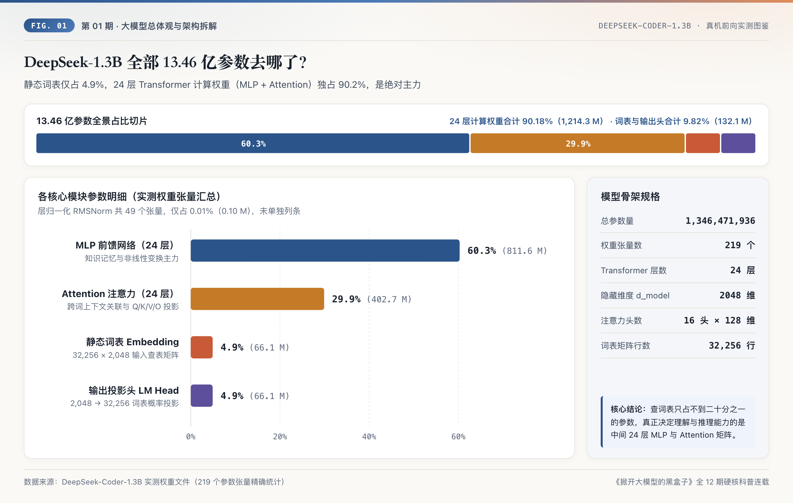

# 第 1 期｜大模型到底是什么？脱掉神秘外衣，它其实只是一个“超级函数”

## 💡 本节核心要点

- **总体观先行**：学习大模型最忌讳一上来就掉进局部公式与英文缩写里。从最高处俯瞰，任何大语言模型本质上都只是一个超大型数学函数 $Y = F(X)$。
- **看清输入与输出**：函数的输入 $X$ 是代表前文词元的**输入张量**；经过内部 24 层线性与非线性变换后，输出 $Y$ 是融合了上下文的**输出张量**，并最终映射为词表上所有候选词的**预测概率分布**。
- **“说话”即循环词语接龙**：大模型不会先打好整篇腹稿再动笔，它干的唯一一件事就是**按概率抽样选出下一个词**，把新词拼回原句末尾，再喂给自己预测再下一个词。
- **真机数据祛魅**：以本地开源模型 `deepseek-coder-1.3b-base` 为例，它的全部“智慧”就装在 `219` 个权重张量、共计 `1,346,471,936` 个固定数字里，没有一行神秘的“意识代码”。

---

## 一、 为什么学大模型必须“先见森林，再看树木”？

很多同学第一次翻开 AI 教程时，常被迎面扑来的 `Transformer`、`Attention`、`RoPE`、`Softmax` 砸得晕头转向，还没看清方向就已经在细节的灌木丛里迷了路。破局之道只有六个字：**先见森林，后看树木**。

回想高中数学里最基础的**函数** $y = f(x) = kx + b$：往机器 $f$ 里塞进自变量 $x$，内部固定参数 $k$（斜率）和 $b$（截距）做一次乘加运算，就吐出因变量 $y$。现在，请把这个高中函数放大十亿倍——**大语言模型（LLM）本质上就是一个超大型数学函数 $Y = F(X)$**：

1. **自变量 $X$（输入张量）**：喂给函数的是一句话切分出的多个词元（Token），每个词元查表变成一条数字向量，并排堆叠成名叫**输入张量（Input Tensor）**的数字方阵。
2. **函数体 $F$（24 层变换）**：函数内部排列着十几亿到上千亿个固定参数。输入张量穿过层层矩阵拉伸、旋转与非线性激活，把前文语境层层注入当前词，最终算出**输出张量（Output Tensor）**。
3. **因变量 $Y$（词表概率分布与抽样）**：最后一步把输出张量转化为全词表候选词的**预测概率分布**（总和为 $100\%$），再像掷多面骰子一样**抽样**选出下一个词。

<svg viewBox="0 0 680 260" style="width:100%;max-width:640px;height:auto;display:block;margin:16px auto;" xmlns="http://www.w3.org/2000/svg">
  <defs>
    <linearGradient id="bgGrad1" x1="0%" y1="0%" x2="100%" y2="100%">
      <stop offset="0%" stop-color="#f8fafc"/>
      <stop offset="100%" stop-color="#eff6ff"/>
    </linearGradient>
    <marker id="arrow1" viewBox="0 0 10 10" refX="8" refY="5" markerWidth="6" markerHeight="6" orient="auto-start-reverse">
      <path d="M 0 1 L 10 5 L 0 9 z" fill="#2563eb"/>
    </marker>
    <marker id="arrowLoop" viewBox="0 0 10 10" refX="8" refY="5" markerWidth="6" markerHeight="6" orient="auto-start-reverse">
      <path d="M 0 1 L 10 5 L 0 9 z" fill="#d97706"/>
    </marker>
  </defs>
  <rect x="4" y="4" width="672" height="252" rx="14" fill="url(#bgGrad1)" stroke="#cbd5e1" stroke-width="1.5"/>
  <text x="340" y="30" text-anchor="middle" font-size="15" font-weight="bold" fill="#0f172a">大模型总体观：超级数学函数 Y = F(X) 与自回归词语接龙</text>

  <rect x="20" y="54" width="136" height="122" rx="10" fill="#ffffff" stroke="#3b82f6" stroke-width="2"/>
  <text x="88" y="76" text-anchor="middle" font-size="13" font-weight="bold" fill="#1d4ed8">1. 输入张量 X</text>
  <text x="88" y="96" text-anchor="middle" font-size="11" fill="#334155">“我在苹果公司</text>
  <text x="88" y="112" text-anchor="middle" font-size="11" fill="#334155">吃了一个苹果”</text>
  <rect x="30" y="122" width="116" height="42" rx="6" fill="#eff6ff" stroke="#93c5fd"/>
  <text x="88" y="139" text-anchor="middle" font-size="10" fill="#1e40af">6 个词元 → 查表堆叠</text>
  <text x="88" y="155" text-anchor="middle" font-size="10" font-weight="bold" fill="#1e3a8a">形状: [1, 6, 2048]</text>

  <line x1="156" y1="115" x2="184" y2="115" stroke="#2563eb" stroke-width="2.2" marker-end="url(#arrow1)"/>

  <rect x="188" y="46" width="174" height="138" rx="12" fill="#1e293b" stroke="#0f172a" stroke-width="2"/>
  <text x="275" y="70" text-anchor="middle" font-size="13" font-weight="bold" fill="#38bdf8">2. 超级函数 F (24层变换)</text>
  <text x="275" y="90" text-anchor="middle" font-size="11" fill="#e2e8f0">1,346,471,936 个固定参数</text>
  <rect x="202" y="100" width="146" height="36" rx="6" fill="#334155" stroke="#64748b"/>
  <text x="275" y="115" text-anchor="middle" font-size="10" fill="#f8fafc">线性变换(拉伸/旋转) + 点积</text>
  <text x="275" y="129" text-anchor="middle" font-size="10" fill="#93c5fd">非线性激活 + 层层语境注入</text>
  <text x="275" y="156" text-anchor="middle" font-size="11" font-weight="bold" fill="#fbbf24">输出张量: [1, 6, 2048]</text>
  <text x="275" y="173" text-anchor="middle" font-size="10" fill="#cbd5e1">(取末位词向量预测下一词)</text>

  <line x1="362" y1="115" x2="390" y2="115" stroke="#2563eb" stroke-width="2.2" marker-end="url(#arrow1)"/>

  <rect x="394" y="54" width="142" height="122" rx="10" fill="#ffffff" stroke="#10b981" stroke-width="2"/>
  <text x="465" y="76" text-anchor="middle" font-size="13" font-weight="bold" fill="#047857">3. 词表概率分布 Y</text>
  <text x="465" y="94" text-anchor="middle" font-size="10" fill="#475569">32,256 个候选词打分</text>
  <rect x="406" y="103" width="61" height="13" rx="3" fill="#10b981"/>
  <text x="472" y="113" font-size="10" font-weight="bold" fill="#065f46">“，” 37.38%</text>
  <rect x="406" y="121" width="26" height="13" rx="3" fill="#34d399"/>
  <text x="438" y="131" font-size="10" fill="#065f46">“。” 14.64%</text>
  <rect x="406" y="139" width="10" height="13" rx="3" fill="#6ee7b7"/>
  <text x="422" y="149" font-size="10" fill="#065f46">“的” 2.71%</text>
  <rect x="406" y="157" width="9" height="12" rx="3" fill="#a7f3d0"/>
  <text x="421" y="167" font-size="10" fill="#065f46">“之后” 2.54%</text>

  <line x1="536" y1="115" x2="562" y2="115" stroke="#2563eb" stroke-width="2.2" marker-end="url(#arrow1)"/>

  <rect x="566" y="64" width="96" height="102" rx="10" fill="#fffbeb" stroke="#f59e0b" stroke-width="2"/>
  <text x="614" y="88" text-anchor="middle" font-size="13" font-weight="bold" fill="#b45309">4. 抽样选词</text>
  <text x="614" y="112" text-anchor="middle" font-size="18" font-weight="bold" fill="#d97706">“，”</text>
  <text x="614" y="132" text-anchor="middle" font-size="10" fill="#78350f">id = 19385</text>
  <text x="614" y="150" text-anchor="middle" font-size="10" fill="#92400e">拼回原句末尾</text>

  <path d="M 614 166 L 614 218 L 88 218 L 88 180" fill="none" stroke="#d97706" stroke-width="2" stroke-dasharray="6,4" marker-end="url(#arrowLoop)"/>
  <rect x="193" y="204" width="304" height="24" rx="12" fill="#fef3c7" stroke="#f59e0b"/>
  <text x="345" y="220" text-anchor="middle" font-size="11" font-weight="bold" fill="#92400e">自回归循环：新词拼入输入 X，继续预测第 2、3、4 个词</text>
</svg>

> **🧠 底层思想提炼**：**总体观与黑盒函数拆解思想**。面对任何庞大的深度学习系统，永远先建立“输入张量 $X \rightarrow$ 层层变换函数 $F \rightarrow$ 输出张量转概率分布 $Y \rightarrow$ 抽样接龙”的主干骨架。只要盯紧每一关的输入与输出张量，无论模型涨到多少亿参数，你都绝不会迷路。

---

## 二、 真机解剖 DeepSeek 1.3B：13.46 亿参数究竟装在哪里？

在本系列 12 期连载中，我们将全程解剖本地运行的开源大模型 **`deepseek-ai/deepseek-coder-1.3b-base`**。打开它保存在硬盘上的权重文件（`2.69 GB`），里面没有任何魔法，只有整整齐齐的 **`219` 个权重张量**，合计 **`1,346,471,936`（约 13.46 亿）个浮点数参数**。

这台机器像一栋 **24 层摩天大楼**：门口词表有 `vocab_size = 32256` 个词元编号；每个词进门后用一条 `hidden_size = 2048` 维的向量表示；中间堆叠着 `24` 层结构相同的 Transformer 楼层（每层含 `16` 个注意力头、每头 `128` 维，以及扩维至 `5504` 维的前馈网络）。下面是这 13.46 亿参数的真实资产清单：

| 模型核心部件 | 对应权重模块 | 张量数 | 真实参数量（个） | 占比 | 在超级函数 $Y=F(X)$ 中的角色 |
| :--- | :--- | :--- | :--- | :--- | :--- |
| **1. 词表嵌入层** | `embed_tokens` | 1 | `66,060,288` | `4.91%` | **一楼接待处**：形状 `[32256, 2048]`，把词编号查表变成 2048 维输入张量 |
| **2. 多头注意力层** | `24 × self_attn` | 96 | `402,653,184` | `29.90%` | **24 层语境情报局**：每层含 Q/K/V/O 矩阵，把前文语境融汇注入当前词 |
| **3. 前馈神经网络** | `24 × mlp` | 72 | `811,597,824` | `60.28%` | **24 层特征深加工车间**：对融汇语境后的向量做升维与非线性提炼 |
| **4. 层归一化参数** | `49 × RMSNorm` | 49 | `100,352` | `0.01%` | **24 层楼层稳压器**：校准向量长度，防止 24 层连乘导致数值爆炸 |
| **5. 词表输出头** | `lm_head` | 1 | `66,060,288` | `4.91%` | **顶楼打分台**：形状 `[32256, 2048]`，把输出张量映射为 `32,256` 个词的得分 |
| **总计** | **全模型汇总** | **219** | **1,346,471,936** | **100%** | **完整的超级函数 $Y = F(X)$** |

你会发现：**超过 `90%` 的参数（`29.90%` 注意力 + `60.28%` 前馈网络）都花在了中间 24 层重复堆叠的矩阵变换上**。一楼负责把文字变成向量，中间 24 层负责把前文语境层层注入当前词，顶楼 `lm_head` 配合指数归一化 `Softmax`，把第 24 层的输出张量变成 32,256 个候选词的概率榜。

---

## 三、 超级词语接龙实录：“我在苹果公司吃了一个苹果”后面接什么？

我们把贯通本系列的核心例句——**“我在苹果公司吃了一个苹果”**——喂给 DeepSeek 1.3B。分词器首先把它切成 **6 个词元（Token）**：
`我在`（`id=23098`）$\rightarrow$ `苹果`（`id=17144`）$\rightarrow$ `公司`（`id=2804`）$\rightarrow$ `吃`（`id=3509`）$\rightarrow$ `了一个`（`id=13556`）$\rightarrow$ `苹果`（`id=17144`）。

注意一个奇妙细节：句中前一个“苹果”是科技巨头，后一个“苹果”是水果，但刚进一楼时它们的编号**完全相同（都是 `17144` 号）**！模型如何在爬完 24 层楼后区分它们，将是我们后续追踪的主线。现在先看这 6 个词构成的 `[1, 6, 2048]` 输入张量穿过 24 层后，连续运转 **4 步词语接龙**的真机实测数据：

| 接龙步 | 当前喂入函数 $F(X)$ 的输入文本 | 选中最高概率词 | 选中 ID 与概率 | 词表概率榜前五名（Top-5 候选词真实概率） |
| :--- | :--- | :--- | :--- | :--- |
| **第 1 步** | `我在苹果公司吃了一个苹果` | **`，`** | `id=19385` (`37.38%`) | ① `，` (`37.38%`) ② `。` (`14.64%`) ③ `<字节>` (`2.71%`) ④ `的` (`2.71%`) ⑤ `之后` (`2.54%`) |
| **第 2 步** | `我在苹果公司吃了一个苹果，` | **`然后`** | `id=7759` (`5.75%`) | ① `然后` (`5.75%`) ② `你` (`4.48%`) ③ `苹果` (`3.95%`) ④ `但是` (`3.08%`) ⑤ `我` (`2.71%`) |
| **第 3 步** | `我在苹果公司吃了一个苹果，然后` | **`又`** | `id=3114` (`5.30%`) | ① `又` (`5.30%`) ② `在` (`4.40%`) ③ `把` (`3.88%`) ④ `，` (`3.65%`) ⑤ `你` (`3.22%`) |
| **第 4 步** | `我在苹果公司吃了一个苹果，然后又` | **`吃`** | `id=3509` (`23.52%`) | ① `吃` (`23.52%`) ② `在` (`11.11%`) ③ `把` (`4.93%`) ④ `买` (`4.09%`) ⑤ `去` (`2.64%`) |

看懂这张表，你就看穿了大模型聊天的底牌：第 1 步模型算完 `32,256` 个词的概率后，选中 `“，”`（`37.38%`）拼回句末；第 2 步以 7 个词为输入选出 `“然后”`（`5.75%`）；第 3 步选出 `“又”`（`5.30%`）；到了第 4 步，因为前文有“吃了一个苹果，然后又”，24 层注意力立刻锁定动作，把 `“吃”`（`id=3509`）的概率推高到 **`23.52%`**！四步接龙合成了**“我在苹果公司吃了一个苹果，然后又吃”**。每次挑第一名叫**贪心解码**，按概率比例摇号叫**随机抽样**。

> **🧠 底层思想提炼**：**自回归（Autoregressive）条件概率接龙思想**。大模型把复杂的“写文章”拆解为最纯粹的“单步条件概率预测 + 输出回填输入”的循环迭代，千言万语皆由此生长。

---

## 四、 本系列 12 期全景路线图：我们将如何一层层拆空这台机器？

有了 $Y = F(X)$ 的总体观，我们接下来 11 期就能像拼乐高一样按部就班地深挖每个部件：**第 2 期**先掌握破除黑话恐惧的 5 条学习铁律；**第 3～5 期**潜入计算机底层，看二进制与 UTF-8 的 243 个合法字节如何通过 BPE 算法滚雪球生成 Token；**第 6～7 期**进入高维几何空间，看词元如何堆叠成三维张量，并靠矩阵拉伸旋转与向量点积表达语义；**第 8～9 期**逐层追踪 24 层 Transformer 与 16 个注意力头如何区分“苹果公司”与“吃苹果”；**第 10～12 期**揭晓模型如何从一张随机噪音表训练出智慧，并在推理时冻结权重完成奇幻漂流。

---

## 📜 科学史故事栏：从马尔可夫数《奥涅金》字母，到香农的纸条猜词游戏

用“前文统计概率”来玩词语接龙，思想火种早在 **1913 年** 的俄国圣彼得堡就被点燃了。

当时 57 岁的数学家**安德烈·马尔可夫（Andrey Markov）**为了反驳“只有互不影响的独立事件才符合统计规律”的偏见，干了一件苦力活：他把普希金长诗《叶夫根尼·奥涅金》开头的 **20,000 个俄文字母**抄在方格纸上，靠手算统计元音与辅音的交替概率。他算出：只要前一个字母是元音，后一个字母是辅音的概率高达 `87.2%`！他用铁证揭示：**语言虽然千变万化，但后一个字出现的概率强烈依赖于前文**——这就是著名的**马尔可夫链**。

1948 年，信息论之父**克劳德·香农（Claude Shannon）**在贝尔实验室发表《通信的数学理论》，做了一个著名的“英文单词接龙实验”：如果闭眼随机摸词，拼出来全是乱码；但如果每次只根据**前一个单词的搭配概率**去猜下一个词，就能拼出 `THE HEAD AND IN FRONTAL ATTACK ON AN ENGLISH WRITER...` 这样像模像样的句子。今天 DeepSeek 和 GPT 所做的，不过是用 **24 层高维张量函数** 把香农当年靠翻书查前一个词的游戏，升级成了同时俯瞰前文上万个词的超级接龙。

---

## 🔮 下期预告

既然大模型底层只是高中数学里的函数 $Y = F(X)$、向量旋转与概率抽样，为什么很多同学看到 AI 论文和满天飞的行业新词，还是会一头雾水、产生深深的恐惧？**面对“每个汉字都认识，连在一起却看不懂”的理工科魔咒，初学者该如何破局？** 下一期，我们将奉上 **5 条硬核破局忠告**！

---

## 🔗 拓展资源加油站

1. **【3Blue1Brown 动画】《直观理解 GPT 与 Transformer》**：B 站搜索 `3Blue1Brown GPT`，用三维几何动画直观感受超级函数 $Y=F(X)$ 的概率预测过程。
2. **【交互式实验室】Transformer Explainer**：浏览器打开 `poloclub.github.io/transformer-explainer`，在线追踪输入句子穿过各层变成 Top-5 预测词概率条的全过程。
3. **【开源模型主页】`deepseek-ai/deepseek-coder-1.3b-base`**：在 HuggingFace 官网查看本系列实验模型的 `config.json`，核对 `24` 层架构与 `32,256` 词表配置。
