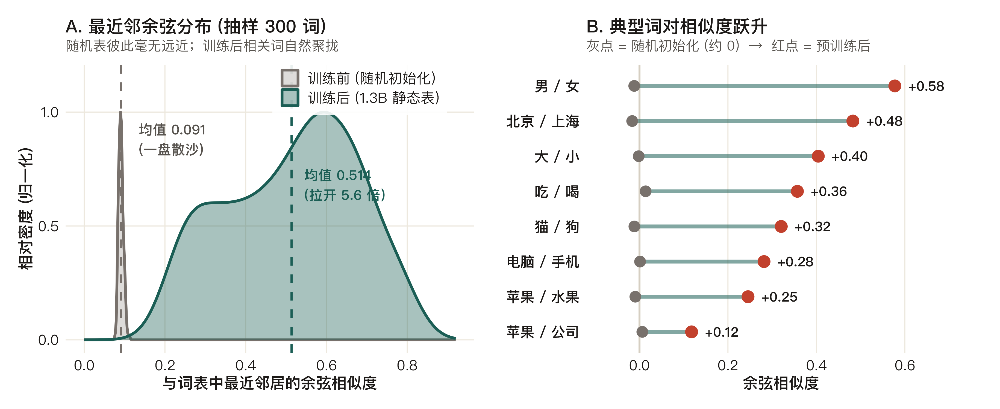

# 第 2 期｜别被满天飞的 AI 新词吓住！给高中生与初学者的 5 条硬核破局忠告

## 💡 本节核心要点

- **破除数学恐惧**：千亿参数大模型看似高不可攀，拆到底层全是你高中课本里的老熟人——向量的加减乘除、空间拉伸旋转、点积夹角与切线斜率（导数）。
- **永远把“基础概念定义”放第一位**：破解理工科“每个汉字都认识，连在一起却不知所云”魔咒的唯一解药，是死磕每个概念的**数学定义与输入输出张量形状**。
- **拒绝追逐泛滥的“中间型时髦名词”**：越是新词爆炸，越要屏蔽表层包装噪音，死磕那些十年都不会变的底层数学与统计思想。
- **真机实操 + AI 助教双轮驱动**：用 6 行 Python 代码在本地跑通 `DeepSeek 1.3B` 观察真实张量，同时用“费曼追问法”把大模型变成你的 24 小时交互式实验助教。

---

## 一、 忠告一：破除恐惧心理——千亿参数底层不过是高中数学

上一期建立起“大模型只是超级函数 $Y = F(X)$”的总体观后，很多同学依然心里打鼓：“听说现在的模型动辄百亿、千亿参数，我只有高中理科基础，真能看懂吗？”

请把心放回肚子里：**不仅能看懂，而且你手里的数学武器已经绰绰有余！** 大多数人之所以畏惧大模型，是因为把**“规模的庞大”**误当成了**“原理的深奥”**。拿拥有 `1,346,471,936`（13.46 亿）个参数的 `DeepSeek 1.3B` 来说，拿显微镜凑近看，整座大厦只靠高中数学的“四块基石”支撑：

1. **向量的线性变换（矩阵乘法）**：把一个词表示成长度为 `2048` 的数字向量，乘上一个矩阵，在几何空间里干的事情不过是把这根箭头**拉伸、缩放或者旋转一个角度**。
2. **向量的点积（$\vec{a}\cdot\vec{b} = |\vec{a}||\vec{b}|\cos\theta$）**：“注意力机制”的核心运算就是算两个词向量的点积——点积越大，说明两根向量在空间里夹角 $\theta$ 越小、靠得越近、语义越相关。
3. **指数归一化（指数函数 $y = e^x$）**：模型顶楼输出词表得分后，用指数函数把得分全部变成正数再除以总和算出百分比，这就是 `Softmax`。
4. **切线斜率（导数 $f'(x)$）**：训练时如何调整 13.46 亿个参数？无非是算误差函数的导数（斜率），顺着斜率下坡方向把参数微调一点点。

把一次乘加运算重复十亿次，那是显卡（GPU）干的体力活，不是你需要恐惧的脑力活。

<svg viewBox="0 0 680 310" style="width:100%;max-width:640px;height:auto;display:block;margin:16px auto;" xmlns="http://www.w3.org/2000/svg">
  <defs>
    <linearGradient id="pyrBg" x1="0%" y1="0%" x2="0%" y2="100%">
      <stop offset="0%" stop-color="#f8fafc"/>
      <stop offset="100%" stop-color="#f1f5f9"/>
    </linearGradient>
  </defs>
  <rect x="4" y="4" width="672" height="302" rx="14" fill="url(#pyrBg)" stroke="#cbd5e1" stroke-width="1.5"/>
  <text x="340" y="28" text-anchor="middle" font-size="15" font-weight="bold" fill="#0f172a">AI 硬核学习五步破局金字塔（从消除恐惧到自主探索）</text>

  <polygon points="340,42 250,90 430,90" fill="#f59e0b" stroke="#ffffff" stroke-width="2"/>
  <text x="340" y="72" text-anchor="middle" font-size="12" font-weight="bold" fill="#ffffff">5. 用 AI 学 AI</text>
  <text x="442" y="74" font-size="11" fill="#b45309" font-weight="bold">← 24小时费曼助教：随时要求降维举例与生成代码</text>

  <polygon points="246,94 190,142 490,142 434,94" fill="#10b981" stroke="#ffffff" stroke-width="2"/>
  <text x="340" y="123" text-anchor="middle" font-size="12" font-weight="bold" fill="#ffffff">4. 亲手真机实操（HuggingFace 小模型）</text>
  <text x="500" y="124" font-size="11" fill="#047857" font-weight="bold">← 6行代码跑通 DeepSeek 观察张量</text>

  <polygon points="186,146 130,194 550,194 494,146" fill="#0ea5e9" stroke="#ffffff" stroke-width="2"/>
  <text x="340" y="175" text-anchor="middle" font-size="12" font-weight="bold" fill="#ffffff">3. 屏蔽“中间型时髦名词”，死磕底层思想</text>

  <polygon points="126,198 70,246 610,246 554,198" fill="#3b82f6" stroke="#ffffff" stroke-width="2"/>
  <text x="340" y="227" text-anchor="middle" font-size="13" font-weight="bold" fill="#ffffff">2. 永远把“基础概念定义”放第一位（紧盯输入与输出张量）</text>

  <polygon points="66,250 20,296 660,296 614,250" fill="#1e293b" stroke="#ffffff" stroke-width="2"/>
  <text x="340" y="278" text-anchor="middle" font-size="13" font-weight="bold" fill="#38bdf8">1. 破除恐惧底座：函数 y=f(x) + 向量拉伸旋转 + 点积夹角 + 导数斜率</text>
</svg>

---

## 二、 忠告二：永远把“基础概念定义”放第一位——打破黑话魔咒

学理工科时，几乎人人都经历过这种痛苦：**“这句话里每个汉字我都认识，怎么连在一起就完全看不懂了？”** 比如：*“自回归模型对多头点积注意力输出张量进行层归一化，经线性投影与 Softmax 生成下一个词元。”*

为什么像天书？因为在理工科里，每个术语都有严格的“输入是什么、做完什么运算、输出是什么”。只要有一个基础概念在你脑子里是模糊的，五六个词串起来就会直接让大脑死机。我们把最常吓唬初学者的 **8 个核心黑话**直接翻译成**高中数学本质定义**，并附上 `DeepSeek 1.3B` 的真机实测数据：

| 常见吓人 AI 黑话 | 高中数学与几何本质定义（人话翻译） | DeepSeek 1.3B 真机实测数据 |
| :--- | :--- | :--- |
| **1. Token（词元）** | 文本切分后的最小编号单元（词表里的**整数身份证号**） | 例句切成 6 个编号，其中 `"苹果"` 的身份证号是 `id = 17144` |
| **2. Embedding（词嵌入）** | 把整数编号查表映射成一串实数坐标（空间里的**一条向量**） | `17144` 号在 `[32256, 2048]` 词表里查出 1 条 `2048` 维向量，模长 `8.07` |
| **3. Tensor（张量）** | 标量（0维）、向量（1维）、矩阵（2维）向更高维度的**数字方盒堆叠** | 1 句话 6 个词并排堆成 `[6, 2048]`，加批次变成三维盒 `[1, 6, 2048]` |
| **4. Linear Projection（线性投影）** | 高中矩阵乘法的别称，几何上只是把向量**拉伸、缩放和旋转** | 第 0 层 $Q$ 矩阵 `[2048, 2048]` 把归一化后的“苹果”向量拉伸 `8.26` 倍、旋转 `90.24°` |
| **5. Dot Product Attention（点积注意力）** | 用点积 $\vec{a}\cdot\vec{b}=|\vec{a}||\vec{b}|\cos\theta$ 测夹角亲密度，**按相关度加权求平均** | 训练后“苹果↔水果”点积 `13.79`（夹角 `75.80°`），“苹果↔微积分”仅 `4.19`（夹角 `86.97°`） |
| **6. Softmax（归一化指数函数）** | 用 $e^{x_i}/\sum e^{x_j}$ 把一组实数得分变成**总和为 100% 的概率表** | 第 1 步把 `32,256` 个候选词得分转成概率，`“，”` 占 `37.38%`、`“。”` 占 `14.64%` |
| **7. Autoregressive（自回归）** | 把函数 $Y=F(X)$ 吐出的新词拼回输入末尾，**循环调用同一个函数** | 从 `"我在苹果公司吃了一个苹果"` 连续 4 步循环接龙吐出 `"，然后又吃"` |
| **8. Gradient Descent（梯度下降）** | 顺着误差函数切线斜率（导数）最陡的下坡方向，**微调参数减小误差** | 训练时沿斜率微调 `13.46 亿`个参数，把随机噪音表雕琢成语义表 |

> **🧠 底层思想提炼**：**概念定义锚定思想**。遇到任何新术语，绝不放过含糊印象，立刻追问：“它的数学定义是什么？输入张量形状是什么？输出张量代表什么？”把基础定义锚定在高中数学上，一切黑话都会迎刃而解。

---

## 三、 忠告三：拒绝追逐泛滥的“中间型时髦名词”——死磕底层逻辑

现在的 AI 圈每隔几天就会蹦出一堆抓人眼球的“中间型时髦名词”——各种套壳框架缩写与花哨流派。许多初学者天天追逐这些半衰期只有几个月的新词，结果半年过去，连“一句话是怎么变成张量送进模型里的”都答不上来。

**越是概念爆炸，越要拒绝追逐“中间型名词”，把 90% 的精力用来死磕十年不变的底层逻辑**：二进制与 UTF-8 如何演化出 Token、张量如何用空间拉伸旋转与点积表达语义、24 层注意力如何注入语境，以及**训练过程（随机张量表试错学习）**与**推理过程（权重彻底冻结）**的本质分野。

---

## 四、 忠告四与忠告五：亲手跑通 6 行真机代码，用 AI 助教学 AI

**忠告四：亲手实操，从本地开源小模型里把真实张量拉出来看！** 像 `deepseek-coder-1.3b-base` 这样的小模型，在普通家用电脑上只需 **6 行 Python 代码** 就能撬开黑盒：

```python
import torch
from transformers import AutoTokenizer, AutoModelForCausalLM

tok = AutoTokenizer.from_pretrained("./ds13b")
model = AutoModelForCausalLM.from_pretrained("./ds13b", dtype=torch.bfloat16).eval()
ids = tok("我在苹果公司吃了一个苹果", return_tensors="pt", add_special_tokens=False).input_ids
print("词元编号:", ids.tolist(), "| 词向量表形状:", model.model.embed_tokens.weight.shape)
print("“苹果”(id=17144)前6维坐标:", [round(x, 4) for x in model.model.embed_tokens.weight[17144][:6].tolist()])
```

运行后屏幕会跳出真实词元编号 `[[23098, 17144, 2804, 3509, 13556, 17144]]`、词表形状 `torch.Size([32256, 2048])` 以及“苹果”前 6 维坐标 `[0.0398, -0.2314, 0.1011, 0.2002, -0.1553, 0.0908]`。对比未经训练的随机表与训练后的词表，你会看到“苹果↔水果”的余弦相似度从随机的 `-0.0094` 跃升至 `0.2454`，“吃↔喝”从 `0.0139` 跃升至 `0.3570`！



**忠告五：用 AI 学 AI，把大模型变成你的 24 小时实验助教**。遇到卡壳概念时，直接向 AI 发送**“三步降维追问指令”**：① *“只用高中向量、矩阵和函数知识解释该概念”*；② *“以‘我在苹果公司吃了一个苹果’为例写出输入输出张量形状”*；③ *“写 10 行内 PyTorch 代码打印该张量验证”*。

> **🧠 底层思想提炼**：**白盒实验与交互证伪思想**。把大模型从神坛拉回实验室标本，用真机代码输出检验数学定义，再用 AI 助教构建即时反馈闭环。

---

## 📜 科学史故事栏：费曼与父亲的林中散步——知道五国语言里的鸟名，不等于懂这只鸟

诺贝尔物理学奖得主**理查德·费曼（Richard Feynman）**一生最痛恨用华丽术语掩盖对底层原理的无知，这源于童年时父亲带他在树林里的一次散步。

那天树枝上落了一只小鸟正啄着羽毛，同行男孩考费曼：“你知道那是什么鸟吗？”费曼摇头后遭嘲笑：“连褐喉画眉都不知道！”等男孩走远，父亲蹲下身说：“这只鸟在英语里叫 `Brown-throated thrush`，在德语里叫 `Halzenfugel`，在葡萄牙语里叫 `Pássaro`，在中文里叫画眉，在日语里叫 `Katano Tekkera`……**可是，就算你把各国语言里它的名字背得滚瓜烂熟，你对这只鸟本身依然一无所知！**现在忘掉名字，看看这只鸟**在做什么**——它为什么刚飞下来就不停啄羽毛？”

背下 100 个时髦 AI 缩写，只相当于背下画眉鸟的五国译名；唯有掀开黑盒，亲眼看见 `1,346,471,936` 个数字如何在 `2048` 维空间里拉伸、旋转与点积，你才真正看懂了这只“大模型飞鸟”是如何振翅高飞的。

---

## 🔮 下期预告

现在我们要正式拆解超级函数 $Y = F(X)$ 的第一道大门了。**计算机芯片里只有高低电平开关，连一个汉字都不认识，甚至连十进制都不会算，它是怎么把人类语言变成数学输入的？更离奇的是，1 个字节明明有 $2^8 = 256$ 种状态，为什么现代大模型分词器的 UTF-8 初始底座却只有 243 个字节？** 下一期，我们揭秘《从电门开关到 UTF-8 的 243 字节之谜》！

---

## 🔗 拓展资源加油站

1. **【官方教程】HuggingFace `Transformers` 快速上手**：访问 `huggingface.co/docs/transformers/quicktour`，5 分钟学会用 Python 加载开源大模型。
2. **【费曼演讲视频】《知道名字 vs 真正理解》**：B 站搜索 `费曼 鸟的名字`，观看费曼晚年亲口讲述父亲教他观察画眉鸟的 4 分钟原版采访。
3. **【零配置云端实验】Google Colab 免费笔记本**：无需本地配环境，在浏览器里复制本期的 6 行 Python 代码即可在线查看张量形状与词向量坐标。
