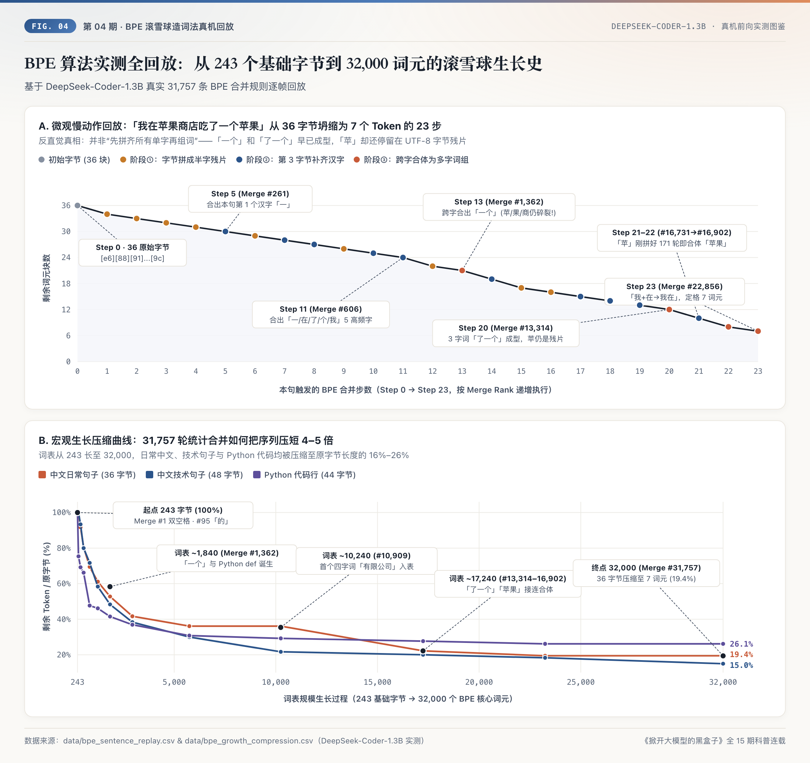

# 第 4 期｜为什么“我在”是一个词，“商店”却被劈成两半？揭秘大模型的 BPE 滚雪球造词法

## 💡 本节核心要点

- **分词不看《新华字典》，只看统计票数**：大模型切分词元（Token）不依赖人类语法或词典释义，完全由训练语料中的**相邻共现频次**决定。
- **BPE（字节对编码）的滚雪球机制**：从 **243 个合法 UTF-8 基础单字节**出发，每轮找出语料里相邻共现次数最多的“字节/词元对”合并成新词元。DeepSeek 1.3B 历经 **31,757 轮**合并，长成 **32,000** 核心词表。
- **颠覆直觉的跨级合成**：BPE 不是“先拼完单字，再拼词语”。真机慢镜头显示，当三字词`“了一个”`已合体时，单字`“苹”`还停留在破碎的 UTF-8 字节残片状态！
- **词表里的“影子词元（Shadowed Token）”奇观**：单字`“苹”`诞生仅 171 轮后就与`“果”`合体为`“苹果”`，在训练中几乎被`“苹果”`彻底遮蔽，导致其词向量模长（L2 Norm）仅有反常的 **4.42**（正常词元约为 8.0～10.4）。

---

## 一、颠覆直觉的真机切片：为什么“我在”合体了，“商店”却分家了？

在第 1 期建立总体观时我们知道，大模型本质是一个做词语接龙的数学函数 $Y = F(X)$；第 3 期我们又揭开了底层编码的秘密：任何文字进入计算机时都会先化作 **243 种合法的 UTF-8 基础字节**。

那么，为什么大模型不直接按“一个汉字”或“一个英文单词”来读文章，非要发明出 **Token（词元）**？我们直接打开本地 `deepseek-coder-1.3b-base` 真机，把两句只差两个字的话喂给分词器（Tokenizer）：

| 输入测试句子 | 汉字数 | UTF-8 字节 | DeepSeek 1.3B 真实切分结果（附 Token ID） | 词元数 |
| :--- | :---: | :---: | :--- | :---: |
| **我在苹果公司吃了一个苹果** | 12 | 36 | `我在`(23098) ｜ `苹果`(17144) ｜ `公司`(2804) ｜ `吃`(3509) ｜ `了一个`(13556) ｜ `苹果`(17144) | **6 个** |
| **我在苹果商店吃了一个苹果** | 12 | 36 | `我在`(23098) ｜ `苹果`(17144) ｜ **`商`(2888)** ｜ **`店`(5432)** ｜ `吃`(3509) ｜ `了一个`(13556) ｜ `苹果`(17144) | **7 个** |

盯着这张实测表，你会立刻发现三个违背语文直觉的现象：
1. “我”是代词、“在”是介词，语法上根本不是一个词，但**`“我在”`却拥有独立词元编号（`id=23098`）**！
2. 助词“了”加数量词“一个”，居然被焊成了一个三字词元**`“了一个”`（`id=13556`）**！
3. `“公司”`顺理成章合为一词（`id=2804`），可常用词**`“商店”`却被劈成两半**，变成了单字`“商”`（`id=2888`）和`“店”`（`id=5432`）！

制造这一现象的幕后推手，正是 GPT-4、LLaMA 与 DeepSeek 共同采用的造词算法——**BPE（Byte-Pair Encoding，字节对编码）**。

> **🧠 底层思想提炼：统计涌现取代人工规则**
> 人工词典永远追不上网络新词、多语种混排与代码符号。BPE 的核心思想是**“抛弃语法词典，让相邻共现的统计频率自己说话”**——只要两个符号在海量语料里总是肩并肩出现，就把它们打包成一个新词元，用空间（增加词表条目）换取时间（缩短句子序列长度）。

---

## 二、BPE 滚雪球造词法：从 243 个基础字节到 32,000 词表的统计竞选

大模型词表的第 0 层地基，就是第 3 期讲过的 **243 个合法 UTF-8 单字节**（占用 `id=0..242`）。BPE 造词就像一场 **31,757 轮的“相邻积木抱团竞选”**：

- **第 1 轮（Merge #1）**：扫描数千亿字语料，统计哪两个相邻字节共现次数最多。在 DeepSeek 语料中，两个连续空格 `' ' + ' '` 票数最高，率先合体为双空格 `'  '`，领到第 243 号身份证（因初始字节占 `0..242`，**新词元 `id = 合并轮次 + 242`**）。
- **第 95 轮（Merge #95）**：最高频汉字**`“的”`**率先集齐 3 个 UTF-8 字节（`<0xe7 9a> + <0x84>`），成为全词表**第 1 个完整汉字**（`id=337`）！
- **滚雪球与关门（Merge #31757）**：新词元诞生后立即作为整体参加下一轮竞选。单字节滚成半字残片，再滚成单字、双字词、三字词乃至四字词（如 #10,909 轮诞生的首个四字词`“有限公司”`）。当词表满 **32,000**（`243 + 31,757 = 32,000`）时大门准时关闭，没抢到名额的组合只能永远保持拆分状态。

---

## 三、真机 23 步慢动作回放：“我在苹果商店吃了一个苹果”是如何坍缩的？

大模型分词时，会严格按当年训练词表的合并顺序（Merge Rank 从小到大），把句子里的相邻块一步步捏合。我们将`“我在苹果商店吃了一个苹果”`（12 个汉字共 **36 个 UTF-8 字节**；若去掉句末重复的“苹果”则为 30 个字节）放入 DeepSeek 1.3B 合并表中，回放它从 36 字节坍缩为 7 个 Token 的完整 **23 步慢镜头**：

| 步骤 | 合并轮次 (Merge Rank) | 合并动作与新 Token ID（括注纯编码序） | 剩余块数 | 慢镜头关键节点说明 |
| :---: | :---: | :--- | :---: | :--- |
| **Step 0** | 初始状态 | 拆为 36 个 UTF-8 原始字节 | **36** | `<e6><88><91> <e5><9c><a8> ... <e6><9e><9c>` |
| **Step 1** | Merge #56 | `<0xe4>+<0xb8> → <0xe4 b8>` (`id=298`, 2处) | **34** | “一”和“个”共享的前两字节率先抱团 |
| **Step 2~4** | Merge #112~#241 | 合出`<e4 ba>`(了)、`<e5 9c>`(在)、`<e5 90>`(吃)前两字节 | **31** | 高频字的前两字节拼成半字残片 |
| **Step 5** | Merge #261 | `<0xe4 b8>+<0x80> →` **`'一'`** (`id=503`) | **30** | 本句**第 1 个完整汉字`'一'`**诞生 |
| **Step 6** | Merge #268 | `<0xe6>+<0x88> → <0xe6 88>` (`id=510`) | **29** | “我”的前两字节完成拼接 |
| **Step 7** | Merge #366 | `<0xe5 9c>+<0xa8> →` **`'在'`** (`id=608` / `#248`) | **28** | 高频单字**`'在'`**成型 |
| **Step 8** | Merge #371 | `<0xe4 ba>+<0x86> →` **`'了'`** (`id=613` / `#202`) | **27** | 高频单字**`'了'`**成型 |
| **Step 9~10** | Merge #497~#552 | 合出“店”前两字节`<e5 ba>`及单字 **`'个'`** (`id=794`) | **25** | `'了'`、`'一'`、`'个'` 三个单字就位 |
| **Step 11** | Merge #606 | `<0xe6 88>+<0x91> →` **`'我'`** (`id=848` / `#221`) | **24** | `'我'`、`'在'` 均已拼成完整单字 |
| **Step 12** | Merge #793 | `<0xe6>+<0x9e> → <0xe6 9e>` (`id=1035`, 2处) | **22** | 两处“果”的前两字节同步拼接 |
| **Step 13** | Merge #1362 | **`'一' + '个' → '一个'`** (`id=1604`) | **21** | **首个双字词`'一个'`合体！此时果/商/店/苹还没拼成字** |
| **Step 14** | Merge #1579 | `<0xe6 9e>+<0x9c> →` **`'果'`** (`id=1821`, 2处) | **19** | 两处单字**`'果'`**同时成型 |
| **Step 15~16**| Merge #1830~#1926| 合出两处`<e8 8b>`(苹)与`<e5 95>`(商)前两字节 | **16** | “苹”与“商”进入半字残片阶段 |
| **Step 17** | Merge #2646 | `<0xe5 95>+<0x86> →` **`'商'`** (`id=2888` / `#2540`) | **15** | 单字**`'商'`**正式成型 |
| **Step 18** | Merge #3267 | `<0xe5 90>+<0x83> →` **`'吃'`** (`id=3509`) | **14** | 动词**`'吃'`**正式成型 |
| **Step 19** | Merge #5190 | `<0xe5 ba>+<0x97> →` **`'店'`** (`id=5432` / `#5188`) | **13** | 单字**`'店'`**成型，与`'商'`并排站立 |
| **Step 20** | Merge #13314 | **`'了' + '一个' → '了一个'`** (`id=13556` / `#21375`) | **12** | **三字词`'了一个'`合体！此时“苹”居然仍是字节残片** |
| **Step 21** | Merge #16731 | `<0xe8 8b>+<0xb9> →` **`'苹'`** (`id=16973`, 2处) | **10** | 苦等一万六千轮，单字**`'苹'`**终于拼成 |
| **Step 22** | Merge #16902 | **`'苹' + '果' → '苹果'`** (`id=17144`, 2处) | **8** | **仅隔 171 轮，两处`'苹'+'果'`瞬间合体为`'苹果'`** |
| **Step 23** | Merge #22856 | **`'我' + '在' → '我在'`** (`id=23098` / `#20866`) | **7** | **终局定格：`我在 ｜ 苹果 ｜ 商 ｜ 店 ｜ 吃 ｜ 了一个 ｜ 苹果`** |

这张实测表揭示了两个惊人事实：
第一，**BPE 绝不是“先拼完所有单字再拼词”**。在第 13 步和第 20 步，高频组合`“一个”`和`“了一个”`早已跨字合体，而`“苹”`居然还躺在地上当`<0xe8 8b>`和`<0xb9>`两块字节残片！
第二，**为什么`“商店”`倒在了关门前？**请看下面的 **BPE 层次合并族谱树**：

<svg viewBox="0 0 680 350" style="width:100%;max-width:640px;height:auto;display:block;margin:16px auto;background:#FBF8F3;border-radius:10px;border:1px solid #E6DEC8;font-family:'PingFang SC','Microsoft YaHei',sans-serif;">
  <text x="340" y="28" text-anchor="middle" font-size="14" font-weight="bold" fill="#1C1917">“我在苹果商店吃了一个苹果” BPE 自底向上滚雪球合并树（真机实测）</text>
  <text x="340" y="47" text-anchor="middle" font-size="11" fill="#57534E">从底层 36 个 UTF-8 字节出发，按共现频次竞选合并，最终在 31,757 轮关门时定格为 7 个词元</text>
  <text x="16" y="318" font-size="10.5" font-weight="bold" fill="#57534E">底层字节(36)</text>
  <g fill="#EFECE6" stroke="#A8A29E" stroke-width="1" font-size="9.5" text-anchor="middle">
    <rect x="88" y="302" width="38" height="22" rx="3"/><text x="107" y="317" fill="#44403C" stroke="none">e6 88 91</text>
    <rect x="132" y="302" width="38" height="22" rx="3"/><text x="151" y="317" fill="#44403C" stroke="none">e5 9c a8</text>
    <rect x="182" y="302" width="38" height="22" rx="3"/><text x="201" y="317" fill="#44403C" stroke="none">e8 8b b9</text>
    <rect x="226" y="302" width="38" height="22" rx="3"/><text x="245" y="317" fill="#44403C" stroke="none">e6 9e 9c</text>
    <rect x="276" y="302" width="38" height="22" rx="3"/><text x="295" y="317" fill="#44403C" stroke="none">e5 95 86</text>
    <rect x="322" y="302" width="38" height="22" rx="3"/><text x="341" y="317" fill="#44403C" stroke="none">e5 ba 97</text>
    <rect x="372" y="302" width="38" height="22" rx="3"/><text x="391" y="317" fill="#44403C" stroke="none">e5 90 83</text>
    <rect x="422" y="302" width="38" height="22" rx="3"/><text x="441" y="317" fill="#44403C" stroke="none">e4 ba 86</text>
    <rect x="466" y="302" width="38" height="22" rx="3"/><text x="485" y="317" fill="#44403C" stroke="none">e4 b8 80</text>
    <rect x="510" y="302" width="38" height="22" rx="3"/><text x="529" y="317" fill="#44403C" stroke="none">e4 b8 aa</text>
    <rect x="560" y="302" width="44" height="22" rx="3"/><text x="582" y="317" fill="#44403C" stroke="none">e8 8b b9</text>
    <rect x="610" y="302" width="44" height="22" rx="3"/><text x="632" y="317" fill="#44403C" stroke="none">e6 9e 9c</text>
  </g>
  <text x="16" y="238" font-size="10.5" font-weight="bold" fill="#1B5E55">单字层(12)</text>
  <g stroke="#1B5E55" stroke-width="1.2" fill="#E6F2EF" font-size="10.5" text-anchor="middle">
    <rect x="88" y="220" width="38" height="28" rx="4"/><text x="107" y="238" fill="#1C1917" stroke="none" font-weight="bold">我</text>
    <rect x="132" y="220" width="38" height="28" rx="4"/><text x="151" y="238" fill="#1C1917" stroke="none" font-weight="bold">在</text>
    <rect x="182" y="220" width="38" height="28" rx="4" stroke-dasharray="3,2"/><text x="201" y="238" fill="#B07219" stroke="none" font-weight="bold">苹</text>
    <rect x="226" y="220" width="38" height="28" rx="4"/><text x="245" y="238" fill="#1C1917" stroke="none" font-weight="bold">果</text>
    <rect x="276" y="220" width="38" height="28" rx="4" fill="#FDE8E4" stroke="#C2412D" stroke-width="1.8"/><text x="295" y="238" fill="#C2412D" stroke="none" font-weight="bold">商</text>
    <rect x="322" y="220" width="38" height="28" rx="4" fill="#FDE8E4" stroke="#C2412D" stroke-width="1.8"/><text x="341" y="238" fill="#C2412D" stroke="none" font-weight="bold">店</text>
    <rect x="372" y="220" width="38" height="28" rx="4" fill="#FDE8E4" stroke="#C2412D" stroke-width="1.8"/><text x="391" y="238" fill="#C2412D" stroke="none" font-weight="bold">吃</text>
    <rect x="422" y="220" width="38" height="28" rx="4"/><text x="441" y="238" fill="#1C1917" stroke="none" font-weight="bold">了</text>
    <rect x="466" y="220" width="38" height="28" rx="4"/><text x="485" y="238" fill="#1C1917" stroke="none" font-weight="bold">一</text>
    <rect x="510" y="220" width="38" height="28" rx="4"/><text x="529" y="238" fill="#1C1917" stroke="none" font-weight="bold">个</text>
    <rect x="560" y="220" width="44" height="28" rx="4" stroke-dasharray="3,2"/><text x="582" y="238" fill="#B07219" stroke="none" font-weight="bold">苹</text>
    <rect x="610" y="220" width="44" height="28" rx="4"/><text x="632" y="238" fill="#1C1917" stroke="none" font-weight="bold">果</text>
  </g>
  <g font-size="8.5" fill="#57534E" text-anchor="middle">
    <text x="107" y="215">#606</text><text x="151" y="215">#366</text>
    <text x="201" y="215" fill="#B07219">#16731</text><text x="245" y="215">#1579</text>
    <text x="295" y="215">#2646</text><text x="341" y="215">#5190</text><text x="391" y="215">#3267</text>
    <text x="441" y="215">#371</text><text x="485" y="215">#261</text><text x="529" y="215">#552</text>
    <text x="582" y="215" fill="#B07219">#16731</text><text x="632" y="215">#1579</text>
  </g>
  <g stroke="#A8A29E" stroke-width="1.1">
    <line x1="107" y1="302" x2="107" y2="248"/><line x1="151" y1="302" x2="151" y2="248"/>
    <line x1="201" y1="302" x2="201" y2="248"/><line x1="245" y1="302" x2="245" y2="248"/>
    <line x1="295" y1="302" x2="295" y2="248"/><line x1="341" y1="302" x2="341" y2="248"/>
    <line x1="391" y1="302" x2="391" y2="248"/><line x1="441" y1="302" x2="441" y2="248"/>
    <line x1="485" y1="302" x2="485" y2="248"/><line x1="529" y1="302" x2="529" y2="248"/>
    <line x1="582" y1="302" x2="582" y2="248"/><line x1="632" y1="302" x2="632" y2="248"/>
  </g>
  <rect x="470" y="152" width="74" height="26" rx="4" fill="#FEF3C7" stroke="#B07219" stroke-width="1.3"/>
  <text x="507" y="169" text-anchor="middle" font-size="11" font-weight="bold" fill="#92400E">一个 (#1362)</text>
  <line x1="485" y1="220" x2="500" y2="178" stroke="#B07219" stroke-width="1.2"/>
  <line x1="529" y1="220" x2="514" y2="178" stroke="#B07219" stroke-width="1.2"/>
  <text x="16" y="96" font-size="10.5" font-weight="bold" fill="#C2412D">终局词元(7)</text>
  <rect x="88" y="75" width="82" height="34" rx="5" fill="#FDE8E4" stroke="#C2412D" stroke-width="1.8"/>
  <text x="129" y="92" text-anchor="middle" font-size="12" font-weight="bold" fill="#1C1917">我在</text>
  <text x="129" y="104" text-anchor="middle" font-size="8.5" fill="#C2412D">id=23098 (#22856)</text>
  <line x1="107" y1="220" x2="122" y2="109" stroke="#C2412D" stroke-width="1.4"/>
  <line x1="151" y1="220" x2="136" y2="109" stroke="#C2412D" stroke-width="1.4"/>
  <rect x="182" y="75" width="82" height="34" rx="5" fill="#FDE8E4" stroke="#C2412D" stroke-width="1.8"/>
  <text x="223" y="92" text-anchor="middle" font-size="12" font-weight="bold" fill="#1C1917">苹果</text>
  <text x="223" y="104" text-anchor="middle" font-size="8.5" fill="#C2412D">id=17144 (#16902)</text>
  <line x1="201" y1="220" x2="216" y2="109" stroke="#C2412D" stroke-width="1.4"/>
  <line x1="245" y1="220" x2="230" y2="109" stroke="#C2412D" stroke-width="1.4"/>
  <rect x="276" y="128" width="84" height="36" rx="5" fill="#FFF1F2" stroke="#E11D48" stroke-width="1.4" stroke-dasharray="4,2"/>
  <text x="318" y="144" text-anchor="middle" font-size="10" font-weight="bold" fill="#E11D48">❌ 商店未合并</text>
  <text x="318" y="157" text-anchor="middle" font-size="8.5" fill="#9F1239">关门前票数不足</text>
  <line x1="295" y1="220" x2="295" y2="164" stroke="#E11D48" stroke-width="1.2" stroke-dasharray="3,2"/>
  <line x1="341" y1="220" x2="341" y2="164" stroke="#E11D48" stroke-width="1.2" stroke-dasharray="3,2"/>
  <rect x="424" y="75" width="118" height="34" rx="5" fill="#FDE8E4" stroke="#C2412D" stroke-width="1.8"/>
  <text x="483" y="92" text-anchor="middle" font-size="12" font-weight="bold" fill="#1C1917">了一个</text>
  <text x="483" y="104" text-anchor="middle" font-size="8.5" fill="#C2412D">id=13556 (#13314)</text>
  <line x1="441" y1="220" x2="468" y2="109" stroke="#C2412D" stroke-width="1.4"/>
  <line x1="507" y1="152" x2="493" y2="109" stroke="#C2412D" stroke-width="1.4"/>
  <rect x="560" y="75" width="94" height="34" rx="5" fill="#FDE8E4" stroke="#C2412D" stroke-width="1.8"/>
  <text x="607" y="92" text-anchor="middle" font-size="12" font-weight="bold" fill="#1C1917">苹果</text>
  <text x="607" y="104" text-anchor="middle" font-size="8.5" fill="#C2412D">id=17144 (#16902)</text>
  <line x1="582" y1="220" x2="600" y2="109" stroke="#C2412D" stroke-width="1.4"/>
  <line x1="632" y1="220" x2="614" y2="109" stroke="#C2412D" stroke-width="1.4"/>
</svg>

在 DeepSeek 1.3B 偏重代码与科技商业的语料中，`“商”`早早与“业”、“品”合体成了**`“商业”`（#12,754，`id=12996`）**与**`“商品”`（#15,389，`id=15631`）**；而`“商”+“店”`的共现票数没能排进前 31,757 名，在词表关门时遗憾落选！

---

## 四、词表里的“影子词元”奇观：为什么单字“苹”的向量模长只有 4.42？

当我们抽出 DeepSeek 1.3B 词向量矩阵（`[32256, 2048]`）做体检时，还在 Step 21 与 Step 22 之间抓到了一个奇妙的**“影子词元（Shadowed Token）”**现象：

- 单字 **`“商”`**（`id=2888`）模长 **`10.17`**，**`“店”`**（`id=5432`）模长 **`9.65`**，**`“果”`**（`id=1821`）模长 **`9.13`**；
- 双字词 **`“苹果”`**（`id=17144`，#16,902 轮诞生）：模长 **`8.07`**；
- 单字 **`“苹”`**（`id=16973`，#16,731 轮诞生）：模长竟然只有 **`4.42`**！

正常词元的向量模长都在 **8.0～10.5** 之间，为什么单字`“苹”`萎缩到了 **`4.42`**？
答案就在那短短 **171 轮**的寿命差里！`“苹”`在第 16,731 轮刚拼成单字，第 16,902 轮就合体出了`“苹果”`（`id=17144`）。在中文里，“苹”几乎只出现在“苹果”一词中。一旦`“苹果”`拿到了独立编号 `17144`，此后训练语料里所有的“苹果”都会在 Step 22 被截胡合并为 `17144` 号！

结果，单字`“苹”`（`16973` 号）就像站在大树背后的影子，在神经网络训练中**被`“苹果”`彻底遮蔽，极少有机会出场接受梯度更新**，其向量模长便一直停留在接近初始随机状态的 **`4.42`**。

> **🧠 底层思想提炼：分词器是大模型看世界的“视网膜”**
> 分词规则直接决定了神经网络能“看见”什么。高频合体词会夺走绝大部分训练机会，而仅充当合成跳板的中间词元（如单字“苹”或两字节残片），则会沦为词表深处沉睡的“影子词元”。

---

## 📜 科学史故事栏：从 1994 年的小硬盘压缩术，到 2015 年大模型造词革命

今天统治 GPT-4 和 DeepSeek 的 BPE 算法，诞生之初其实和 AI 毫无关系。

**1994 年 2 月**，在个人电脑软盘只有 1.44 MB 的年代，软件工程师**菲利普·盖奇（Philip Gage）**在《The C Users Journal》杂志上发表了一篇短文《一种新的数据压缩算法》。他的想法极其朴素：扫描文件找出出现最多的相邻字节对（如英文 `'t'` 和 `'h'`），用一个未使用的单字节替换所有 `'th'`，循环往复即可缩小文件体积。盖奇将这个几百行 C 代码的小技巧命名为 **Byte-Pair Encoding（BPE）**。

此后 21 年里，自然语言处理学者一直被**“未登录词（OOV）”**困扰：按整词建表哪怕收录 50 万词，遇到专业新词或拼写错误仍会吐出 `<UNK>`（未知词）。直到 **2015 年夏天**，爱丁堡大学青年学者**里科·森里奇（Rico Sennrich）**突发奇想：何不把 1994 年盖奇的 BPE 压缩术搬来给神经网络“造词”？让常见词合体为整词，罕见词自动拆解为高频词根或字符！随后 OpenAI 在 GPT-2 中直接以 UTF-8 字节为底座运行 BPE，彻底消灭了 `<UNK>`。三十年前为省几 KB 软盘空间写下的压缩算法，就此成为大模型理解人类语言的第一块基石。

---

## 🔮 下期预告

既然 BPE 这么好用，为什么它偏爱把`“我在”`、`“了一个”`这种虚词粘在一起，却把真正代表实体的`“商店”`拆散？有没有算法能认出`“商”`和`“店”`才是“灵魂伴侣”？此外，为什么 DeepSeek 1.3B 词表是 3.2 万，而 DeepSeek-V3 却扩充到了 12.9 万？

下一期，我们将请出分词江湖三大门派——**BPE、WordPiece 与 Unigram** 华山论剑，用“思想优先原则”带你一眼看穿所有分词算法的共同本质！

---

## 🔗 拓展资源加油站

1. **Tiktokenizer 在线分词实验室**：`https://tiktokenizer.vercel.app/`（输入`“我在苹果商店吃了一个苹果”`，实时查看 DeepSeek 与 GPT-4 的色块切分与 ID）。
2. **HuggingFace 官方 BPE 交互教程**：`https://huggingface.co/learn/nlp-course/zh-CN/chapter6/5`（全中文图解，带你用几十行 Python 手搓迷你 BPE）。
3. **经典论文溯源**：Rico Sennrich (2015) *Neural Machine Translation of Rare Words with Subword Units*（`https://arxiv.org/abs/1508.07909`）。
