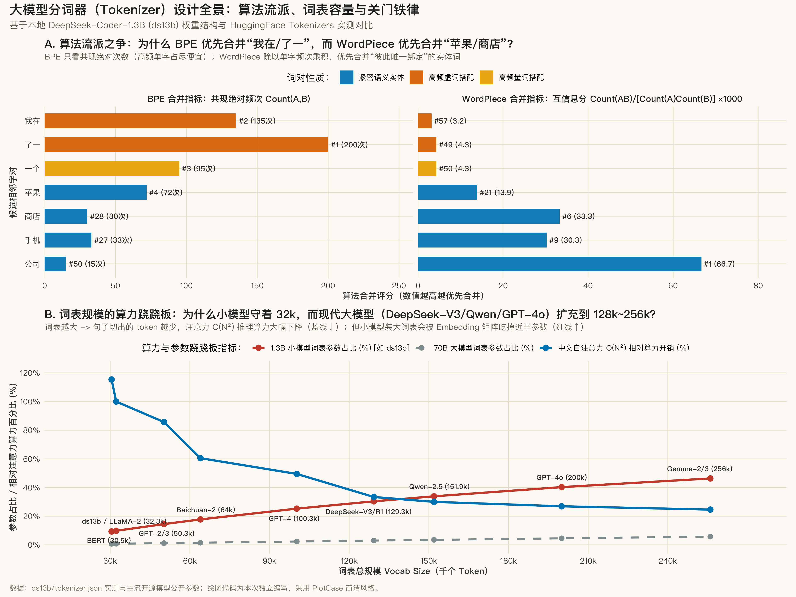

# 第 5 期｜BPE、WordPiece 与 Unigram 三大流派华山论剑：透过算法差异看“底层思想”

## 💡 本节核心要点

- **思想优先原则（穿透公式看本质）**：BPE（拼绝对票数）、WordPiece（拼互信息默契度）与 Unigram（自顶向下概率剪枝）打分公式各异，但底层思想完全相通——**统计规律取代人工字典、子词组合平衡生僻词与颗粒度、空间换时间**。
- **BPE vs. WordPiece 的数学分歧**：BPE 只看共现绝对次数 $\text{Count}(A,B)$，偏爱`“我在”`、`“了一”`等高频虚词组合；WordPiece 除以单字频次乘积 $\frac{\text{Count}(A,B)}{\text{Count}(A)\times\text{Count}(B)}$，优先合并`“公司”`、`“商店”`等高度绑定的语义实体。
- **词表规模的“空间—时间算力跷跷板”**：词表越大，句子 Token 序列越短，自注意力 $O(L^2)$ 算力越省；但词表矩阵占用的显存参数也越大。这解释了为何 1.3B 小模型坚守 **3.2 万**词表（外加 **234 行 GPU 张量核心对齐空位**凑成 `32,256`），而 DeepSeek-V3、Gemma 等大模型扩充至 **12.9 万～25.6 万**。
- **关门轮次与语料基因**：同一个 BPE 算法，训练语料的行业配比（科技代码 vs. 日常消费）与关门轮次设定，直接决定了哪些词合体、哪些词拆散。

---

## 一、三大流派华山论剑：拼绝对票数、拼灵魂默契，还是自顶向下淘汰？

上一期我们留下了一个悬念：**为什么 BPE 宁可把毫无语法关联的`“我在”`、`“了一个”`捏合成词，却把真正代表实体概念的`“商店”`劈成两半？**

要解开这个谜团，正是践行本系列**“原则二：思想优先原则”**的最佳时刻。在大模型分词江湖里，三大主流门派各自奉行着一套截然不同的“造词价值观”：

1. **BPE 流派（GPT / DeepSeek / LLaMA 选用）——自底向上“拼绝对票数”**：
   $$\text{Score}_{\text{BPE}}(A, B) = \text{Count}(A, B)$$
   谁挨在一起出现的绝对总次数多，谁就先合体。`“我”`、`“在”`、`“了”`、`“一”`是汉语里的“交际花”，几乎句句不离，哪怕偶然撞在一起，累加出的绝对票数也高得吓人，总能抢走前排名额。
2. **WordPiece 流派（Google BERT 选用）——自底向上“拼灵魂默契（互信息 PMI）”**：
   $$\text{Score}_{\text{WordPiece}}(A, B) = \frac{\text{Count}(A, B)}{\text{Count}(A) \times \text{Count}(B)}$$
   如果 $A$ 和 $B$ 到处跟别的字组队，分母 $\text{Count}(A)\times\text{Count}(B)$ 就会无比巨大，把得分狠狠压低！反之，像`“苹”`与`“果”`、`“商”`与`“店”`平时极少单独乱跑，**只要出场就必定成双入对**，它们的“默契分”就会瞬间爆表！
3. **Unigram LM 流派（T5 / XLNet / AlBERT 选用）——自顶向下“优胜劣汰”**：
   反其道而行之，先用所有高频子串建一个超大候选词表，每轮评估**“删掉某个词会让全语料总似然概率损失多少”**，把最无关痛痒的 20% 词元剪枝淘汰，直到缩减至目标词表规模。

我们在受控语料上让三大流派在**相同词表预算（仅给 7 个多字词名额）**下同场竞技，实测数据如下：

| 候选字对 | 词对性质分类 | $\text{Count}(A)$ | $\text{Count}(B)$ | 共现 $\text{Count}(AB)$ | BPE 排名 | WordPiece 默契分 ($\times 1000$) | WP 排名 |
| :---: | :---: | :---: | :---: | :---: | :---: | :---: | :---: |
| **`了一`** | 高频虚词搭配 | 200 | 230 | **200** | **第 1 名** | 4.3478 | 第 49 名 |
| **`我在`** | 高频虚词搭配 | 210 | 200 | **135** | **第 2 名** | 3.2143 | 第 57 名 |
| **`一个`** | 高频量词搭配 | 230 | 95 | **95** | **第 3 名** | 4.3478 | 第 50 名 |
| **`苹果`** | 紧密语义实体 | 72 | 72 | **72** | **第 4 名** | 13.8889 | 第 21 名 |
| **`手机`** | 紧密语义实体 | 33 | 33 | **33** | 第 27 名 | 30.3030 | **第 9 名** |
| **`商店`** | 紧密语义实体 | 30 | 30 | **30** | 第 28 名 | **33.3333** | **第 6 名** |
| **`公司`** | 紧密语义实体 | 15 | 15 | **15** | 第 50 名 | **66.6667** | **第 1 名** |

在同样只给 7 个合成词名额下切分`“我在苹果商店吃了一个苹果”`：
- **BPE**：`['我在', '苹', '果', '商', '店', '吃', '了一个', '苹', '果']`（保住高频虚词`我在`、`了一个`）；
- **WordPiece**：`['我', '在', '苹果', '商店', '吃', '了', '一个', '苹果']`（精准保住`苹果`、`商店`两大实体！）；
- **Unigram**：`['我在', '苹果', '商', '店', '吃', '了', '一个', '苹果']`（兼顾全局概率的折中方案）。

---

## 二、穿透公式看本质：三大分词算法共享的 3 条“底层思想”

按照**思想优先原则**，不死记公式，三大算法其实共享着 **3 条完全一致的底层哲学**：

> **🧠 底层思想提炼：所有现代分词器共通的三大基石**
> 1. **统计涌现代替人工字典规则**：不写一条人工语法规则，全靠海量语料中的统计分布（频次、互信息或似然概率），让词汇边界自动从数据中涌现。
> 2. **子词组合性（Subword Compositionality）的黄金折中**：纯单字切分序列太长、语义太碎；纯整词切分词表爆炸且怕生僻词。**“子词”让常见词合体、罕见词退化拆解为单字或字节**，兼顾了“零未知词”与“语义完整度”。
> 3. **空间与时间的算力跷跷板（Space-Time Trade-off）**：把高频词组打包成一个 Token，本质是用**空间（词表多存一行参数）**换取**时间（缩短句子长度 $L$，大幅降低注意力计算耗时）**。

---

## 三、词表规模的算力跷跷板：为什么 DeepSeek 1.3B 是 32,256，而 V3 涨到了 12.9 万？

先揭晓一个藏在本地 `deepseek-coder-1.3b-base` 里的工程彩蛋：它的 BPE 核心词表是 **32,000**（`243` 个合法字节 + `31,757` 轮合并），加上 `13` 个 RFC 3629 禁用字节（`32000..32012`）和 `9` 个特殊控制符（`32013..32021`），明明只有 **32,022** 个词元；为何模型词向量矩阵 `embed_tokens.weight` 的形状却是 **`[32256, 2048]`**？

多出来的 **234 行（`id=32022..32255`）**是**“GPU 张量核心对齐空位”**！英伟达 GPU 的 Tensor Cores 做矩阵乘法时，要求矩阵维度最好是 64 或 256 的整数倍才能跑满硬件流水线。离 `32,022` 最近的 256 倍数正是 **$32,256 = 126 \times 256$**！工程师故意在末尾填上 234 行空座，纯粹为了换取极致的硬件吞吐速度。

那么，为何早年模型与小模型多用 **3.2 万**词表，而 DeepSeek-V3、Qwen-2.5、GPT-4o 和 Gemma-2/3（及 BGE-M3）却扩充到了 **12.9 万～25.6 万**？请看真机测算表：

| 代表大模型 | 算法流派 | 词表规模 $V$ | 1.3B 小模型词表参数占比 | 70B 大模型词表参数占比 | 中文每字 Token 数 | 注意力 $O(L^2)$ 相对算力 |
| :--- | :---: | :---: | :---: | :---: | :---: | :---: |
| **BERT-base (2018)** | WordPiece | 30,522 | 9.33% (1.25亿) | 0.72% | 1.45 | 115.4% |
| **DeepSeek-1.3B / LLaMA-2** | Byte-BPE | **32,256** | **9.81% (1.32亿)** | **0.76%** | **1.35** | **100.0% (基准)** |
| **GPT-2 / GPT-3 (2020)** | Byte-BPE | 50,257 | 14.49% (2.06亿) | 1.18% | 1.25 | 85.7% |
| **Baichuan-2 (2023)** | BPE | 64,000 | 17.75% (2.62亿) | 1.50% | 1.05 | 60.5% |
| **GPT-4 cl100k (2023)** | Byte-BPE | 100,256 | 25.27% (4.11亿) | 2.33% | 0.95 | 49.5% |
| **DeepSeek-V3 / R1 (2025)** | Byte-BPE | **129,280** | 30.37% (5.30亿) | **2.98%** | **0.78** | **33.4%** |
| **Qwen-2.5 (2024)** | Byte-BPE | 151,936 | 33.88% (6.22亿) | 3.49% | 0.74 | 30.0% |
| **GPT-4o o200k (2024)** | Byte-BPE | 200,019 | 40.29% (8.19亿) | 4.54% | 0.70 | 26.9% |
| **Gemma-2/3 / BGE-M3** | Unigram/BPE | **256,000** | **46.34% (10.49亿)** | **5.74%** | **0.67** | **24.6%** |

结合下方原理图，我们可以一目了然地看清这架**“空间—时间跷跷板”**：

<svg viewBox="0 0 680 340" style="width:100%;max-width:640px;height:auto;display:block;margin:16px auto;background:#FBF8F3;border-radius:10px;border:1px solid #E6DEC8;font-family:'PingFang SC','Microsoft YaHei',sans-serif;">
  <text x="340" y="26" text-anchor="middle" font-size="14" font-weight="bold" fill="#1F1F1F">三大分词算法方向对比 与 词表规模的“空间—时间跷跷板”</text>
  <rect x="18" y="42" width="310" height="282" rx="8" fill="#FFFFFF" stroke="#E6DEC8"/>
  <text x="173" y="64" text-anchor="middle" font-size="12" font-weight="bold" fill="#1F1F1F">A. 三大流派的构建方向与核心公式</text>
  <polygon points="173,82 118,122 228,122" fill="#FDE8E4" stroke="#C2412D" stroke-width="1.3"/>
  <text x="173" y="108" text-anchor="middle" font-size="10" font-weight="bold" fill="#C2412D">精简目标词表 (32k~256k)</text>
  <polygon points="95,180 251,180 280,230 66,230" fill="#E6F2EF" stroke="#1B5E55" stroke-width="1.3"/>
  <text x="173" y="202" text-anchor="middle" font-size="10" font-weight="bold" fill="#1B5E55">底部：243字节 / 基础单字</text>
  <text x="173" y="218" text-anchor="middle" font-size="9" fill="#57534E">(或顶部：百万级候选子串池)</text>
  <path d="M 122 174 L 122 128" stroke="#C2412D" stroke-width="2.2"/>
  <text x="72" y="148" text-anchor="middle" font-size="9.5" font-weight="bold" fill="#C2412D">自底向上合并</text>
  <text x="72" y="162" text-anchor="middle" font-size="8.5" fill="#57534E">BPE / WordPiece</text>
  <path d="M 224 128 L 224 174" stroke="#0072B2" stroke-width="2.2"/>
  <text x="275" y="148" text-anchor="middle" font-size="9.5" font-weight="bold" fill="#0072B2">自顶向下剪枝</text>
  <text x="275" y="162" text-anchor="middle" font-size="8.5" fill="#57534E">Unigram LM</text>
  <rect x="30" y="242" width="286" height="72" rx="5" fill="#FBF8F3" stroke="#D6CFC2"/>
  <text x="40" y="260" font-size="9.5" fill="#C2412D" font-weight="bold">• BPE (拼绝对频次)：</text>
  <text x="148" y="260" font-size="9.5" fill="#333333">Score = Count(A, B) → 偏爱“我在/了一”</text>
  <text x="40" y="280" font-size="9.5" fill="#0072B2" font-weight="bold">• WordPiece (拼默契)：</text>
  <text x="155" y="280" font-size="9.5" fill="#333333">Score = Count(AB)/[Count(A)Count(B)]</text>
  <text x="40" y="300" font-size="9.5" fill="#1B5E55" font-weight="bold">• Unigram (概率淘汰)：</text>
  <text x="155" y="300" font-size="9.5" fill="#333333">每轮剔除使全语料似然概率损失最小的词</text>
  <rect x="342" y="42" width="320" height="282" rx="8" fill="#FFFFFF" stroke="#E6DEC8"/>
  <text x="502" y="64" text-anchor="middle" font-size="12" font-weight="bold" fill="#1F1F1F">B. 词表容量 V 的“显存空间—推理时间”跷跷板</text>
  <polygon points="502,190 484,225 520,225" fill="#57534E"/>
  <line x1="375" y1="225" x2="629" y2="225" stroke="#A8A29E" stroke-width="2"/>
  <line x1="382" y1="162" x2="622" y2="208" stroke="#1C1917" stroke-width="4" stroke-linecap="round"/>
  <rect x="366" y="102" width="118" height="54" rx="6" fill="#FDE8E4" stroke="#C2412D" stroke-width="1.5"/>
  <text x="425" y="122" text-anchor="middle" font-size="10.5" font-weight="bold" fill="#C2412D">词表显存参数 ↑</text>
  <text x="425" y="137" text-anchor="middle" font-size="9" fill="#333333">2 × V × d (输入+输出层)</text>
  <text x="425" y="150" text-anchor="middle" font-size="8.5" fill="#C2412D">256k占1.3B模型 46.3%!</text>
  <rect x="516" y="146" width="128" height="54" rx="6" fill="#E0F2FE" stroke="#0072B2" stroke-width="1.5"/>
  <text x="580" y="166" text-anchor="middle" font-size="10.5" font-weight="bold" fill="#0072B2">注意力算力 O(L²) ↓</text>
  <text x="580" y="181" text-anchor="middle" font-size="9" fill="#333333">多字合体 → 序列长度 L 缩短</text>
  <text x="580" y="194" text-anchor="middle" font-size="8.5" fill="#0072B2">129k~256k省下 67%~75% 算力!</text>
  <rect x="356" y="242" width="292" height="72" rx="5" fill="#FBF8F3" stroke="#D6CFC2"/>
  <text x="366" y="261" font-size="9.5" fill="#1C1917" font-weight="bold">• 为什么 1.3B 小模型选 32,256？</text>
  <text x="374" y="276" font-size="9" fill="#57534E">若装25.6万大词表，光查表矩阵就要吃掉近半(10.5亿)参数！</text>
  <text x="366" y="295" font-size="9.5" fill="#1C1917" font-weight="bold">• 为什么 DeepSeek-V3 (671B) 选 129,280？</text>
  <text x="374" y="310" text-anchor="middle" dx="125" font-size="9" fill="#57534E">大块头不在乎几亿词表参数，却能把中文推理速度提升近 3 倍！</text>
</svg>

对于 1.3B 小模型，输入与输出两张词表（$2\times V\times d$）若扩到 25.6 万，会吃掉 **46.34%（10.49 亿）**的参数，把负责思考的 Transformer 层饿死；而对于 70B～671B 的巨无霸模型，大词表仅占不到 **3%～5%** 的参数，却能把每个汉字切出的 Token 数从 `1.35` 压到 `0.67～0.78`，让平方级增长的注意力算力 $O(L^2)$ 暴降到原来的 **24.6%～33.4%**！

---

## 四、决定词表长相的两只无形大手：“关门轮次”与“语料基因”

即便算法相同，**关门轮次 $K$** 与**训练语料基因**也会彻底改变分词面貌：
1. **关门轮次截断实测**：在 DeepSeek 1.3B 中，若 $K=1,000$ 就关门，本句只会合出`我/在/了/一/个`五个单字，其余全是字节残片（22 个 Token）；到 $K=17,000$ 时`苹果`合体（8 个 Token）；到 $K=31,757$ 时`我在`合体（7 个 Token），而`商店`被永久挡在门外。
2. **语料基因反转实测**：用完全相同的 BPE 代码和词表预算，喂**“科技代码语料”**训练时，切出 `['我在', '苹果', '商', '店', '和', '苹果', '公司', ...]`（`公司`合体，`商店`拆开）；而改喂**“日常消费语料”**训练时，结果变成 `['我在', '苹果', '商店', '和', '苹果', '公', '司', ...]`——**`商店`顺利合体，`公司`反而被劈成了两半！**

---

## 📜 科学史故事栏：当 Google 遭遇日韩语音与多语言危机——WordPiece 与 SentencePiece 的诞生

如果说 BPE 是从数据压缩界跨界而来的独行侠，那么 **WordPiece** 和 **SentencePiece** 则是 Google 工程师被亚洲多国语言逼出来的绝技。

2012 年，Google 语音识别专家**迈克·舒斯特（Mike Schuster）**与日本学者**中岛界介（Kaisuke Nakajima）**在优化日韩语音搜索时遭遇了滑铁卢：日语和中文一样书写没有空格，韩语词根后能粘上十几种词尾助词。若直接按共现频次合并，满街跑的日语助词会瞬间塞满词表。两人决定引入**最大似然互信息比**——每一步只合并能让全语料语言模型概率提升最大的字对。这项算法被命名为 **WordPiece**，并在 6 年后成为 Google BERT 的御用分词器。

到了 2018 年，Google 翻译团队的日本工程师**工藤拓（Taku Kudo）**又解决了另一个工程噩梦：支持 100 种语言的大模型若在前端维护 100 套各国传统分词脚本，简直是人间地狱。工藤拓开发了开源神器 **SentencePiece**，提出**“把空格也当成一个普通字符 `▁`（U+2581）”**，将地球上所有语言一视同仁地看作原始字符流，直接在其上运行 BPE 或 Unigram。从此，无空格的中日文与有空格的英文、代码终于在同一个统计框架下实现了大一统。

---

## 🔮 下期悬念

至此，人类文字已经变成了词元身份证号，比如 `[23098, 17144, 2804, 3509, 13556, 17144]`。但编号终究只是门牌号（`17144` 号代表“苹果”），两个门牌号相加毫无意义！计算机究竟是怎么把干巴巴的整数编号，变成能送进函数 $Y=F(X)$ 做矩阵运算的**“张量（Tensor）”**的？

下一期，我们将用搭积木的方式，从 **1 个数字**一路堆叠到 **45 个词的三维魔方**，带你彻底看懂大模型里的“张量”到底长什么样！

---

## 🔗 拓展资源加油站

1. **HuggingFace 三大分词算法对比手册**：`https://huggingface.co/learn/nlp-course/zh-CN/chapter6/4`（一页并排对比 BPE、WordPiece 与 Unigram 计分过程）。
2. **工藤拓 SentencePiece 官方开源库**：`https://github.com/google/sentencepiece`（一行命令即可拿中文小说或代码亲手训练专属 BPE/Unigram 词表）。
3. **经典论文**：Mike Schuster & Kaisuke Nakajima (2012) *Japanese and Korean Voice Search*（WordPiece 诞生之作）。
