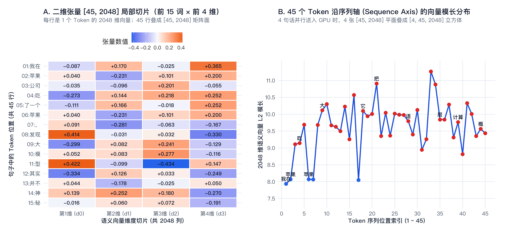

# 第 6 期｜从 1 个数字到 45 个词的三维魔方：一文看懂大模型里的“张量（Tensor）”是如何堆叠出来的

## 💡 本节核心要点

- **回归总体观与概念第一铁律**：大模型本质是超级函数 $Y = F(X)$，它的**输入 $X$、层间流转与输出 $Y$ 全是张量**。学懂大模型，必须先把“张量（Tensor）”的基础定义放第一位。
- **张量的极简几何定义**：在深度学习中，张量只是把高中数学的 **0 维点（标量）、1 维线（向量）、2 维面（矩阵）**继续向 **3 维立方体**及更高维整齐堆叠的“多维数字网格”。
- **真机 45 词逐级堆叠实验**：在 DeepSeek 1.3B 中，1 个词元（如`“苹果”`）查表变成 **2,048 个浮点数**组成的 1D 向量；一段 **45 个词元**的话并排铺开，叠成 **`[45, 2048]`** 的 2D 语义矩阵面（共 92,160 个数）。
- **大模型体内的两座 3D 张量魔方**：一是**批次并行魔方 `[4, 45, 2048]`**（GPU 并行处理 4 段话）；二是**多头视角魔方 `[45, 16, 128]`**（把 2,048 维切为 16 个 128 维注意力视角）。盯紧各层输入输出张量的形状，就是拆解 Transformer 的**“分层学习法”**。

---

## 一、破除名词恐惧：大模型的输入与输出，为什么统称为“张量（Tensor）”？

翻开任何 AI 论文，“张量（Tensor）”、“TensorFlow”、“Tensor Core”总是扑面而来。很多同学明明学过函数、向量和矩阵，却一看到“张量”二字就发怵。

请回想第 2 期的头号铁律——**破除恐惧，把“基础概念定义”放第一位**；同时回忆第 1 期的总体观：**大模型本质是数学函数 $Y = F(X)$，它的输入是张量，输出也是张量。**

在计算机里，“张量”的定义非常朴素：**按固定维度（坐标轴）整齐排列的多维数字容器**。你在高中数学里早就见过它的前三种形态：
- **0 维张量 = 标量（Scalar）**：0 个方向展开，仅 **1 个数字**，几何上是**“点”**；
- **1 维张量 = 向量（Vector）**：沿 1 个方向排成一排，几何上是**“线/长条”**；
- **2 维张量 = 矩阵（Matrix）**：沿 2 个方向（行与列）铺成表格，几何上是**“平面”**；
- **3 维及更高维张量（3D/4D Tensor）**：把多张二维表格叠成 **3 个方向（长、宽、高）的“数字立方体”**乃至超立方体。科学家把所有维度的数字网格统称为**“张量”**！

> **🧠 底层思想提炼：张量是语义在计算机里的“标准集装箱”**
> 现代 GPU 天生是“超级矩阵乘法器”。把零散文字装进形状严整的多维张量集装箱，显卡才能用一条指令在几毫秒内同时完成上万个词、十几个语义视角的并行几何运算。

---

## 二、从 0 维到 2 维：看 45 个真实词元如何从“一个点”铺成“一张语义平面”

打开本地 `deepseek-coder-1.3b-base` 真机，输入一段正好切分为 **45 个 Token（词元）** 的段落：

> **测试段落（45 个词元）**：`“我在苹果公司吃了一个苹果，发现大模型其实并不神秘——它只是一个把词元转化为高维语义张量、再通过层层注意力计算预测下一个词概率”`

看它在真机内存里如何从 **0 维的点**铺成 **2 维的面**：

1. **第零阶：0D 标量（点）`shape = ()`**：仅 **1 个浮点数**（BF16 下占 **2 字节**），无坐标轴。例如真机测出`“苹果”`与`“水果”`向量的点积得分 **`13.79`**（FP16 下约 **`13.84`**），或采样温度 $T = 0.7$，都是 0 维标量。
2. **第一阶：1D 向量（线/长条）`shape = (2048,)`**：为何不能把`“苹果”`的编号 `17144` 直接送进函数运算？因为门牌号大小与词义无关。DeepSeek 1.3B 准备了一张 `[32256, 2048]` 的词向量表，当`“苹果”`拿 `17144` 号查表时，直接抽出第 17144 行——由 **2,048 个浮点数**排成的 **1D 向量长条**（占 `4,096` 字节 = 4 KB）：
   $$\vec{e}_{\text{苹果}} = [0.0398,\ -0.2314,\ 0.1011,\ 0.2002,\ -0.1553,\ 0.0908,\ \dots] \quad (\text{模长 } 8.07)$$
3. **第二阶：2D 矩阵（平面）`shape = (45, 2048)`**：1 个词是一根 2,048 维横条，整段话 **45 个词**从上往下并排叠放，就铺成了 **45 行 × 2048 列** 的二维表格——即 **`(45, 2048)` 的 2D 张量面**（共 $45 \times 2048 = \mathbf{92,160}$ 个浮点数，占 180 KB 显存）。

下面是 DeepSeek 1.3B 内存中 `[45, 2048]` 二维张量的真实切片表：

| 序列行号 | 词元 (Token) | Token ID | 向量模长 (L2) | `dim1` | `dim2` | `dim3` | `dim4` | 后续维度 (`dim5..2048`) |
| :---: | :---: | :---: | :---: | :---: | :---: | :---: | :---: | :---: |
| **第 01 行** | `我在` | 23098 | 7.9353 | -0.0874 | +0.1699 | -0.0247 | +0.3652 | `... (共2048列)` |
| **第 02 行** | **`苹果`₁** | **17144** | **8.0703** | **+0.0398** | **-0.2314** | **+0.1011** | **+0.2002** | `... (共2048列)` |
| **第 03 行** | `公司` | 2804 | 9.1093 | -0.0347 | -0.0957 | +0.2012 | -0.0554 | `... (共2048列)` |
| **第 04 行** | `吃` | 3509 | 9.1426 | -0.2734 | +0.1436 | +0.2178 | +0.2520 | `... (共2048列)` |
| **第 05 行** | `了一个` | 13556 | 9.6877 | -0.1108 | +0.1660 | -0.0177 | +0.2520 | `... (共2048列)` |
| **第 06 行** | **`苹果`₂** | **17144** | **8.0703** | **+0.0398** | **-0.2314** | **+0.1011** | **+0.2002** | `... (共2048列)` |
| **第 09~11 行**| `大`/`模`/`型` | 744/4604/3044 | 10.12/10.30/9.67 | -0.2988 | +0.0815 | +0.2412 | -0.1289 | `... (拆为3行)` |
| **第 30~31 行**| `张`/`量` | 3674 / 1958 | 10.13 / 8.94 | +0.0141 | +0.0063 | +0.0292 | +0.4570 | `... (拆为2行)` |
| **第 37~38 行**| `注意`/`力` | 7421 / 1405 | 10.28 / 9.31 | +0.0028 | -0.0029 | -0.1670 | -0.3242 | `... (双字+单字)` |
| **第 44~45 行**| `概`/`率` | 9783 / 4184 | 9.57 / 9.43 | +0.1709 | -0.0605 | +0.2256 | -0.2910 | `... (句尾末两行)` |

请注意表中的**第 02 行（`苹果₁`）**与**第 06 行（`苹果₂`）**：在刚查表生成的 `[45, 2048]` 初始二维张量里，两处“苹果”的 2,048 个浮点数完全相同！

---

## 三、跃迁到 3 维与 4 维：大模型体内的两座“三维张量魔方”

有了 `[45, 2048]` 的二维平面，为什么 Transformer 里还频繁出现 **3 维张量（3D Tensor）**？因为这张平面会沿两个方向变成**两座三维魔方**：

1. **向外堆叠的“批次并行魔方（Batch 3D Cube）” `shape = (4, 45, 2048)`**：当 4 位用户同时发送 4 段 45 词的句子时，GPU 把 **4 张 `[45, 2048]` 平面像 4 片吐司一样前后叠成一摞**，组成厚 4、高 45、宽 2048 的三维立方体（共 $368,640$ 个数），一次并行算完 4 句话！
2. **向内切分的“多头视角魔方（Multi-Head 3D Cube）” `shape = (45, 16, 128)`**：在单句话内部进入多头注意力层时，模型不增减数字，而是把每个词 **2,048 维**长条均分成 **16 段（16 个注意力头）**，每段 **$2048 \div 16 = 128$ 维**。就像派 16 位侦探从 16 个子空间视角同时审视这 45 个词，将 `[45, 2048]` 平面原地折叠为 **`[45, 16, 128]`** 的三维魔方（仍是 92,160 个数）！
3. **两者合体的 4D 超立方体 `shape = (4, 16, 45, 128)`**：4 句话在 16 个注意力头中同时计算 Q/K/V 时，就构成了四维张量。

请看下方的 **0D 点 $\rightarrow$ 1D 线 $\rightarrow$ 2D 面 $\rightarrow$ 3D 魔方** 等轴测几何图解与实测总表：

<svg viewBox="0 0 680 375" style="width:100%;max-width:640px;height:auto;display:block;margin:16px auto;background:#F8FAFC;border-radius:10px;border:1px solid #CBD5E1;font-family:'PingFang SC','Microsoft YaHei',sans-serif;">
  <text x="340" y="26" text-anchor="middle" font-size="14" font-weight="bold" fill="#0F172A">从 0 维标量到 3 维魔方：大模型张量（Tensor）的四级几何堆叠图解</text>
  <text x="340" y="45" text-anchor="middle" font-size="10.5" fill="#475569">基于 DeepSeek 1.3B 真机实测：每个格子代表 1 个浮点数，观察维度轴如何一步步扩展</text>
  <rect x="14" y="60" width="112" height="298" rx="8" fill="#FFFFFF" stroke="#E2E8F0"/>
  <text x="70" y="82" text-anchor="middle" font-size="12" font-weight="bold" fill="#0F172A">① 0D 标量</text>
  <text x="70" y="99" text-anchor="middle" font-size="10" fill="#2563EB" font-weight="bold">shape: ()</text>
  <circle cx="70" cy="168" r="18" fill="#DBEAFE" stroke="#2563EB" stroke-width="2.2"/>
  <text x="70" y="172" text-anchor="middle" font-size="10" font-weight="bold" fill="#1E3A8A">13.84</text>
  <text x="70" y="215" text-anchor="middle" font-size="10" font-weight="bold" fill="#334155">几何上的“点”</text>
  <text x="70" y="236" text-anchor="middle" font-size="9" fill="#64748B">仅 1 个浮点数</text>
  <text x="70" y="252" text-anchor="middle" font-size="9" fill="#64748B">(占 2 Bytes)</text>
  <text x="70" y="282" text-anchor="middle" font-size="8.5" fill="#475569">例：“苹果”与“水果”</text>
  <text x="70" y="296" text-anchor="middle" font-size="8.5" fill="#475569">的点积相似度得分</text>
  <rect x="136" y="60" width="146" height="298" rx="8" fill="#FFFFFF" stroke="#E2E8F0"/>
  <text x="209" y="82" text-anchor="middle" font-size="12" font-weight="bold" fill="#0F172A">② 1D 向量</text>
  <text x="209" y="99" text-anchor="middle" font-size="10" fill="#0D9488" font-weight="bold">shape: (2048,)</text>
  <g transform="translate(148, 152)">
    <rect x="0" y="0" width="22" height="24" fill="#CCFBF1" stroke="#0D9488" stroke-width="1.4"/>
    <rect x="22" y="0" width="22" height="24" fill="#99F6E4" stroke="#0D9488" stroke-width="1.4"/>
    <rect x="44" y="0" width="22" height="24" fill="#5EEAD4" stroke="#0D9488" stroke-width="1.4"/>
    <rect x="66" y="0" width="24" height="24" fill="#F0FDFA" stroke="#0D9488" stroke-width="1.4"/>
    <rect x="90" y="0" width="30" height="24" fill="#2DD4BF" stroke="#0D9488" stroke-width="1.4"/>
    <text x="11" y="15" text-anchor="middle" font-size="7.5" fill="#134E4A">.04</text>
    <text x="33" y="15" text-anchor="middle" font-size="7.5" fill="#134E4A">-.23</text>
    <text x="55" y="15" text-anchor="middle" font-size="7.5" fill="#134E4A">.10</text>
    <text x="78" y="15" text-anchor="middle" font-size="8" fill="#134E4A">...</text>
    <text x="105" y="15" text-anchor="middle" font-size="7.5" fill="#134E4A">d₂₀₄₈</text>
  </g>
  <text x="209" y="142" text-anchor="middle" font-size="9" fill="#0F766E" font-weight="bold">← 2048 维语义特征轴 →</text>
  <text x="209" y="215" text-anchor="middle" font-size="10" font-weight="bold" fill="#334155">几何上的“线/长条”</text>
  <text x="209" y="236" text-anchor="middle" font-size="9" fill="#64748B">1 个词元 = 2,048 个数</text>
  <text x="209" y="252" text-anchor="middle" font-size="9" fill="#64748B">(占 4 KB 内存)</text>
  <text x="209" y="282" text-anchor="middle" font-size="8.5" fill="#475569">例：词元“苹果”(id=17144)</text>
  <text x="209" y="296" text-anchor="middle" font-size="8.5" fill="#475569">查表抽出的 1 行语义向量</text>
  <rect x="292" y="60" width="166" height="298" rx="8" fill="#FFFFFF" stroke="#E2E8F0"/>
  <text x="375" y="82" text-anchor="middle" font-size="12" font-weight="bold" fill="#0F172A">③ 2D 矩阵</text>
  <text x="375" y="99" text-anchor="middle" font-size="10" fill="#D97706" font-weight="bold">shape: (45, 2048)</text>
  <g transform="translate(324, 122)">
    <rect x="0" y="0" width="106" height="16" fill="#FEF3C7" stroke="#D97706" stroke-width="1.2"/>
    <rect x="0" y="16" width="106" height="16" fill="#FDE68A" stroke="#D97706" stroke-width="1.2"/>
    <rect x="0" y="32" width="106" height="16" fill="#FCD34D" stroke="#D97706" stroke-width="1.2"/>
    <rect x="0" y="48" width="106" height="16" fill="#FFFBEB" stroke="#D97706" stroke-width="1.2"/>
    <rect x="0" y="64" width="106" height="16" fill="#F59E0B" stroke="#D97706" stroke-width="1.2"/>
    <line x1="26" y1="0" x2="26" y2="80" stroke="#D97706" stroke-width="0.8"/>
    <line x1="52" y1="0" x2="52" y2="80" stroke="#D97706" stroke-width="0.8"/>
    <line x1="78" y1="0" x2="78" y2="80" stroke="#D97706" stroke-width="0.8"/>
    <text x="-4" y="12" text-anchor="end" font-size="8" fill="#92400E">1:我在</text>
    <text x="-4" y="28" text-anchor="end" font-size="8" fill="#92400E">2:苹果</text>
    <text x="-4" y="44" text-anchor="end" font-size="8" fill="#92400E">3:公司</text>
    <text x="-4" y="59" text-anchor="end" font-size="8" fill="#92400E">...</text>
    <text x="-4" y="76" text-anchor="end" font-size="8" fill="#92400E">45:率</text>
  </g>
  <text x="377" y="116" text-anchor="middle" font-size="8.5" fill="#B45309" font-weight="bold">← 2048 列特征 →</text>
  <text x="375" y="220" text-anchor="middle" font-size="10" font-weight="bold" fill="#334155">几何上的“平面/表格”</text>
  <text x="375" y="238" text-anchor="middle" font-size="9" fill="#64748B">45 个词并排叠成 45 行</text>
  <text x="375" y="254" text-anchor="middle" font-size="9" fill="#64748B">共 92,160 个数 (180 KB)</text>
  <text x="375" y="282" text-anchor="middle" font-size="8.5" fill="#475569">竖轴是词的先后顺序 (45)</text>
  <text x="375" y="296" text-anchor="middle" font-size="8.5" fill="#475569">横轴是每个词的特征 (2048)</text>
  <rect x="468" y="60" width="198" height="298" rx="8" fill="#FFFFFF" stroke="#E2E8F0"/>
  <text x="567" y="82" text-anchor="middle" font-size="12" font-weight="bold" fill="#0F172A">④ 3D 张量魔方 (两种形态)</text>
  <text x="567" y="99" text-anchor="middle" font-size="9.5" fill="#E11D48" font-weight="bold">(4, 45, 2048) 或 (45, 16, 128)</text>
  <g transform="translate(502, 118)">
    <rect x="36" y="0" width="84" height="58" fill="#FFE4E6" stroke="#E11D48" stroke-width="1.2" rx="2"/>
    <rect x="18" y="14" width="84" height="58" fill="#FECDD3" stroke="#E11D48" stroke-width="1.2" rx="2"/>
    <rect x="0" y="28" width="84" height="58" fill="#FDA4AF" stroke="#E11D48" stroke-width="1.6" rx="2"/>
    <line x1="0" y1="47" x2="84" y2="47" stroke="#E11D48" stroke-width="0.9"/>
    <line x1="0" y1="66" x2="84" y2="66" stroke="#E11D48" stroke-width="0.9"/>
    <line x1="28" y1="28" x2="28" y2="86" stroke="#E11D48" stroke-width="0.9"/>
    <line x1="56" y1="28" x2="56" y2="86" stroke="#E11D48" stroke-width="0.9"/>
    <text x="42" y="42" text-anchor="middle" font-size="8" font-weight="bold" fill="#881337">第 1 层平面</text>
    <text x="108" y="12" font-size="8" font-weight="bold" fill="#E11D48">↗ 深度轴</text>
  </g>
  <text x="567" y="222" text-anchor="middle" font-size="10" font-weight="bold" fill="#334155">几何上的“三维立方体”</text>
  <rect x="478" y="232" width="178" height="54" rx="5" fill="#FFF1F2" stroke="#FECDD3"/>
  <text x="485" y="248" font-size="8.5" font-weight="bold" fill="#BE123C">形态A·批次魔方 [4, 45, 2048]：</text>
  <text x="485" y="261" font-size="8" fill="#475569">4 段话叠在一起并行送入 GPU (36.8万个数)</text>
  <text x="485" y="278" font-size="8.5" font-weight="bold" fill="#BE123C">形态B·多头魔方 [45, 16, 128]：</text>
  <rect x="478" y="290" width="178" height="54" rx="5" fill="#EFF6FF" stroke="#BFDBFE"/>
  <text x="485" y="305" font-size="8" fill="#1E3A8A">把 2048 维切分成 16 个 128 维注意力头</text>
  <text x="485" y="320" text-anchor="middle" dx="80" font-size="8" font-weight="bold" fill="#1D4ED8">两者合体 → 4D超立方体 [4,16,45,128]</text>
</svg>

| 张量维度阶数 | 形状 (Shape) | 浮点数总数 | BF16 显存 | 几何形态 | DeepSeek 1.3B 物理含义与真机实测值 |
| :--- | :---: | :---: | :---: | :---: | :--- |
| **0D 标量** | `()` | **1** | 2 B | **点** | 单个数字，如`“苹果”`与`“水果”`点积得分 **`13.79`**（或 `13.84`） |
| **1D 向量** | `(2048,)` | **2,048** | 4 KB | **线** | 1 个 Token（`“苹果”` `id=17144`）的 2048 维语义特征长条 |
| **2D 矩阵** | `(45, 2048)` | **92,160** | 180 KB | **面** | 1 段话 **45 个 Token** 并排铺成的二维语义平面 |
| **3D 多头张量** | `(45, 16, 128)` | **92,160** | 180 KB | **魔方 A** | 2048 维切分为 **16 个注意力头（每头 128 维）**折叠成的立方体 |
| **3D 批次张量** | `(4, 45, 2048)` | **368,640** | 720 KB | **魔方 B** | GPU 同时并行处理 **4 段 45 词句子**叠成的三维语义块 |
| **4D 批量多头** | `(4, 16, 45, 128)` | **368,640** | 720 KB | **超立方体** | 4 段话在 16 个注意力头中同时计算 Q/K/V 时的四维容器 |

---

## 四、掌握“分层学习法”的金钥匙：盯死每一层的输入张量与输出张量

看透张量的堆叠阶梯，我们就拿到了**“原则四：分层学习法”**的金钥匙！无论 Transformer 架构图画得多复杂，只要**盯住每一层输入与输出张量的形状**，DeepSeek 1.3B 的 24 层大楼就会像玻璃一样透明：

1. **进门查表（Embedding）**：输入 `[4, 45]` 的词元编号，查表输出 **`[4, 45, 2048]`** 的三维张量魔方；
2. **穿越 24 层主干（Layers 1～24）**：每一层接收 **`[4, 45, 2048]`** 输入，内部切分为 `[4, 16, 45, 128]` 交换语境后，再拼回 **`[4, 45, 2048]`** 输出给下一层！
3. **出门猜词（LM Head）**：将第 24 层输出的 `[4, 45, 2048]` 投影为 **`[4, 45, 32256]`**，给出词表上每个词的接龙概率。

> **🧠 底层思想提炼：形状守恒下的“语义提纯流水线”**
> 在 24 层 Transformer 中，张量外壳形状 `[Batch, 45, 2048]` 严守不变；真正逐层演变的是里面 **92,160 个浮点数的数值**——每过一层注入一次前文语境，把“静态字面义”提纯为“动态上下文语义”。

---

## 📜 科学史故事栏：从晶体的“拉伸应力”到爱因斯坦弯曲时空，再到 TensorFlow

明明是“多维数字网格”，为何偏偏叫**“张量（Tensor）”**？

**1898 年**，德国哥廷根大学的晶体物理学家**沃尔德马·福格特（Woldemar Voigt）**在研究拉拽晶体产生的内部形变时发现：温度用 1 个数字（标量）就能表示，力的方向用 3 个数字（三维向量）就能表示，但晶体内部沿 $X/Y/Z$ 三个切面、每个切面又沿三个方向的“拉伸应力”，必须用 **$3\times 3 = 9$ 个数字组成的二维网格**才能描述！福格特遂从拉丁语动词 ***tendere***（意为**“拉伸、绷紧”**，英文 *tension* 张力的词根）中造出了 **Tensor（张量）** 一词。

十几年后，**爱因斯坦**在创立广义相对论时，借助列维-奇维塔的“张量分析”（用 $4\times 4 = 16$ 个分量的度规与曲率张量刻画弯曲的四维时空），于 1915 年完成了物理学的伟大革命。一百年后的 **2015 年**，Google 大脑团队发现深度学习网络里流转的多维数据块在数学形式上正是张量，于是将开源框架命名为 **TensorFlow（张量之流）**；2017 年英伟达更将显卡里的矩阵乘法单元命名为 **Tensor Core（张量核心）**。一个诞生于 19 世纪末晶体拉伸实验的物理词汇，就此成为 AI 时代的算力图腾。

---

## 🔮 下期预告

我们已经看到，词元`“苹果”`是一根 2,048 个浮点数组成的 1D 张量 `[0.0398, -0.2314, ...]`。但最核心的数学之谜来了：**凭什么这 2,048 个冷冰冰的正负小数就能代表“苹果”的语义？** 为什么`“苹果”`与`“水果”`做一次**点积（Dot Product）**就能算出 `13.79` 的高分？千亿参数的大模型在每一层里对张量做的运算，脱掉外衣后究竟只有哪两件事？

下一期，我们将开启**数学与几何双视角**：不推枯燥公式，带你亲眼看见高维空间里的**“拉伸、旋转”与“点积靠近”**！

---

## 🔗 拓展资源加油站

1. **TensorSpace.js 浏览器 3D 张量可视化**：`https://tensorspace.org/`（用鼠标 360 度旋转拆解神经网络各层的 3D 张量魔方）。
2. **PyTorch 官方 10 分钟张量交互教程**：`https://pytorch.org/tutorials/beginner/basics/tensorqs_tutorial.html`（用 `torch.randn(4, 45, 2048)` 亲手体验三维与四维张量变形）。
3. **3Blue1Brown 经典动画《线性代数的本质》**：`https://www.bilibili.com/video/BV1ys411472E/`（前 3 集用极致几何直觉讲透向量与矩阵）。
