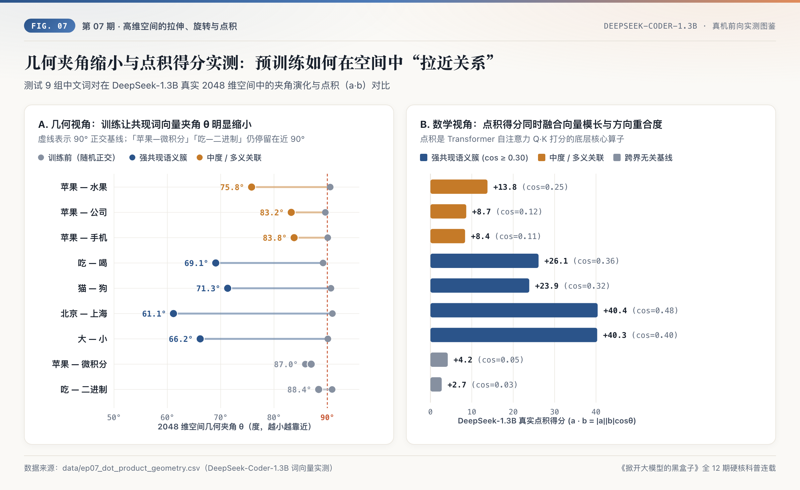

# 第 7 期｜大模型的数学秘密：为什么说千亿参数的本质，只是空间里的“拉伸、旋转”与“点积靠近”？

## 💡 本节核心要点

* **数学视角的极致简化**：剥离所有复杂的架构名词，大语言模型那数十亿乃至上千亿个参数，在数学上从头到尾只做两件事——**线性变换（$Y = XW$）**与**非线性变换（如 SiLU、Softmax）**。
* **线性变换的几何直觉**：无需死背矩阵乘法的求和公式！在几何空间里，乘以权重矩阵 $W$，本质上就是抓着语义向量做了一次**拉伸（放大）、压缩（缩小）与旋转**。
* **非线性变换是深度的灵魂**：若只有线性变换，哪怕堆叠 100 层网络，在数学上也会坍缩成单一的一层矩阵（$W_1 W_2 \cdots W_n = W_{\text{total}}$）。只有加入 SiLU 等**非线性弯折**，模型才能刻画复杂的逻辑转折。
* **点积（Dot Product）与语义聚拢**：点积 $\vec{a}\cdot\vec{b} = |\vec{a}||\vec{b}|\cos\theta$ 是衡量“语义亲密度”的标尺。训练前，2048 维随机向量几乎处处垂直（$\theta \approx 90^\circ$，点积 $\approx 0$）；训练后，常在相似语境结伴出现的词会在空间里彼此靠近、夹角缩小。

---

## 一、 破除公式恐惧：千亿参数在数学上只靠“两条腿”走路

很多同学一翻开 AI 教材，看到满页的矩阵求和符号 $\sum_{i=1}^{d} x_i w_{ij}$ 就心生畏惧。但如果我们站在**总体观**的高度，剖开本地运行的 `deepseek-coder-1.3b-base`（共 **1,346,471,936** 个参数、219 个张量），你会发现一个令人安心的真相：**这座 13.5 亿参数的大厦，在数学上只靠“两条腿”走路——线性变换与非线性变换。**

上一期我们知道，每个词元（Token）进入模型后都会变成一条 2048 维的语义向量 $\vec{x}$，就像**高维空间里从原点出发的一支带方向和长度的箭头**。当这支箭头穿越 24 层网络时，它经历的所有运算无非是交替进行两步：
1. **线性变换（$Y = XW$）**：用输入向量乘以权重矩阵 $W$（模型超 99.9% 的参数都存放在这些矩阵里）；
2. **非线性变换（SiLU 激活、Softmax 概率化、RMSNorm）**：对向量坐标做一次“不成比例”的弯折、截断或指数放大。

> **🧠 底层思想提炼**：**化繁为简的“数学二分法”**。无论大模型架构如何演进，它的数学骨架永远是**用线性变换（矩阵乘法）高效重组空间方向，再用非线性变换打破线性束缚、制造逻辑转折**。

---

## 二、 几何视角看变换：空间里的“拉伸、缩放与旋转”

当一条 2048 维向量 $\vec{x}$ 乘以 `[2048, 2048]` 的矩阵 $W$ 时，几何空间里发生了什么？**请忘掉“行乘列再相加”的机械算术！在几何上，矩阵乘法就是把向量做了一次空间旋转，加上方向上的拉伸或缩小。**

我们把**“苹果”**（ID `17144`）送入 DeepSeek 1.3B 的第 1 层（Layer 0），用探针实测它在经历矩阵线性投影与 SiLU 非线性门控时的**真实模长**与**空间旋转角度**：

| 变换阶段 | 数学性质 | 权重维度 | 输入模长 | 输出模长 | 长度伸缩倍数 | 空间旋转角 | 几何物理意义拆解 |
| :--- | :--- | :---: | :---: | :---: | :---: | :---: | :--- |
| **0. 原始向量 $\rightarrow$ RMSNorm** | 尺度校准 | `[2048]` | 8.070 | **6.614** | 0.820x | $0.00^\circ$ | 方向不变，将箭头长度校准到统一标准起跑线 |
| **1. 查询投影 (`q_proj`)** | **纯线性变换** | `[2048, 2048]` | 6.614 | **54.659** | **8.264x** (单头 **1.135x**) | **$90.24^\circ$** (**$89.38^\circ$**) | 猛烈**拉伸放大**，并**旋转近直角**进入“提问子空间” |
| **2. 键投影 (`k_proj`)** | **纯线性变换** | `[2048, 2048]` | 6.614 | **40.950** | **6.191x** | **$90.84^\circ$** | 拉伸并**旋转**到“被检索标签子空间” |
| **3. 值投影 (`v_proj`)** | **纯线性变换** | `[2048, 2048]` | 6.614 | **6.642** | **1.004x** (相对 **0.369x**) | **$87.11^\circ$** | **收缩/克制**能量尺度，旋转提取核心语义干货 |
| **4. MLP 门控 (`gate` $\rightarrow$ `SiLU`)** | **线性+非线性** | `[2048->5504]` | 21.654 | **11.803** | **0.545x** | **$14.24^\circ$** | **非线性弯折**：2118 个负数坐标被压扁（最小值从 -1.695 弯至 -0.277） |

这张实测表揭示了两个核心事实：
第一，同一支“苹果”向量在 `q_proj`、`k_proj`、`v_proj` 三个线性矩阵面前，被抓着箭头做了截然不同的**拉伸与旋转**：`q_proj` 把它整体拉长 **8.264 倍**（单头尺度拉伸 **1.135 倍**）并旋转了 **$89.38^\circ \sim 90.24^\circ$**；而 `v_proj` 则大幅收缩相对尺度（仅 **0.369 倍** / `1.004x`），只做 **$87.11^\circ$** 转向。正是不同的拉伸与旋转，让同一个词分身出“提问者（Q）”、“标签（K）”和“内容（V）”三种角色！

第二，为什么第 4 步必须加入 **SiLU 非线性变换**（$\text{SiLU}(x) = \frac{x}{1 + e^{-x}}$）？
高中数学告诉我们，把向量先拉伸 2 倍再拉伸 3 倍，等于直接拉伸 6 倍；任何多层线性矩阵连乘，都会直接合并成一个单层矩阵（$X W_1 W_2 \cdots W_{24} = X W_{\text{total}}$）。如果没有非线性函数，24 层网络会瞬间坍缩成 1 层！实测中，当 5504 维向量穿过 SiLU 时，**3386 个正数维度**被放行，而 **2118 个负数维度**被强行压扁（极小值从 `-1.695` 弯折到 `-0.277`），使向量发生 **$14.24^\circ$** 的非线性弯折，从而保住了 24 层深度推理的能力。

<svg viewBox="0 0 680 280" style="width:100%;max-width:640px;height:auto;display:block;margin:16px auto;background:#f8fafc;border-radius:12px;border:1px solid #e2e8f0;font-family:-apple-system,BlinkMacSystemFont,'PingFang SC',sans-serif;">
  <defs>
    <marker id="ag" viewBox="0 0 10 10" refX="8" refY="5" markerWidth="6" markerHeight="6" orient="auto"><path d="M 0 1 L 10 5 L 0 9 z" fill="#64748b"/></marker>
    <marker id="ab" viewBox="0 0 10 10" refX="8" refY="5" markerWidth="6" markerHeight="6" orient="auto"><path d="M 0 1 L 10 5 L 0 9 z" fill="#2563eb"/></marker>
    <marker id="ar" viewBox="0 0 10 10" refX="8" refY="5" markerWidth="6" markerHeight="6" orient="auto"><path d="M 0 1 L 10 5 L 0 9 z" fill="#dc2626"/></marker>
    <marker id="agr" viewBox="0 0 10 10" refX="8" refY="5" markerWidth="6" markerHeight="6" orient="auto"><path d="M 0 1 L 10 5 L 0 9 z" fill="#16a34a"/></marker>
  </defs>
  <text x="340" y="26" text-anchor="middle" font-size="14.5" font-weight="bold" fill="#0f172a">几何双视角：① 线性拉伸与旋转 vs ② 向量点积与投影靠近</text>
  <line x1="340" y1="42" x2="340" y2="265" stroke="#cbd5e1" stroke-width="1.5" stroke-dasharray="5,5"/>
  <!-- Left -->
  <text x="170" y="52" text-anchor="middle" font-size="12.5" font-weight="bold" fill="#1e293b">【视角一】线性矩阵 = 拉伸 + 旋转</text>
  <line x1="45" y1="220" x2="295" y2="220" stroke="#94a3b8" stroke-width="1.5"/>
  <line x1="75" y1="245" x2="75" y2="70" stroke="#94a3b8" stroke-width="1.5"/>
  <line x1="75" y1="220" x2="185" y2="192" stroke="#64748b" stroke-width="3" marker-end="url(#ag)"/>
  <text x="190" y="200" font-size="11.5" font-weight="bold" fill="#475569">原向量 x ("苹果" 6.61)</text>
  <line x1="75" y1="220" x2="132" y2="80" stroke="#2563eb" stroke-width="3.5" marker-end="url(#ab)"/>
  <text x="142" y="90" font-size="11.5" font-weight="bold" fill="#2563eb">线性投影 Y = xW_Q</text>
  <text x="142" y="106" font-size="10" fill="#1d4ed8">拉伸 1.135x/8.26x + 旋转 89.38°</text>
  <path d="M 135 204 A 62 62 0 0 0 100 160" fill="none" stroke="#f59e0b" stroke-width="2" stroke-dasharray="3,3"/>
  <text x="135" y="170" font-size="10.5" font-weight="bold" fill="#d97706">旋转 θ</text>
  <text x="170" y="258" text-anchor="middle" font-size="10.5" font-weight="bold" fill="#1e40af">SiLU 非线性：压扁 2118 个负坐标，空间弯折 14.24°</text>
  <!-- Right -->
  <text x="510" y="52" text-anchor="middle" font-size="12.5" font-weight="bold" fill="#1e293b">【视角二】点积 a·b = |a||b|cosθ</text>
  <line x1="380" y1="220" x2="645" y2="220" stroke="#94a3b8" stroke-width="1.5"/>
  <line x1="405" y1="245" x2="405" y2="70" stroke="#94a3b8" stroke-width="1.5"/>
  <line x1="405" y1="220" x2="408" y2="105" stroke="#94a3b8" stroke-width="2" stroke-dasharray="4,4" marker-end="url(#ag)"/>
  <text x="415" y="105" font-size="10.5" fill="#64748b">无关词 ("二进制" θ=88.39° 垂直)</text>
  <line x1="405" y1="220" x2="610" y2="220" stroke="#16a34a" stroke-width="3.5" marker-end="url(#agr)"/>
  <text x="565" y="210" font-size="11.5" font-weight="bold" fill="#15803d">向量 b ("上海")</text>
  <line x1="405" y1="220" x2="545" y2="112" stroke="#dc2626" stroke-width="3.5" marker-end="url(#ar)"/>
  <text x="548" y="118" font-size="11.5" font-weight="bold" fill="#dc2626">向量 a ("北京" θ=61.1°)</text>
  <line x1="545" y1="112" x2="545" y2="220" stroke="#dc2626" stroke-width="1.5" stroke-dasharray="4,4"/>
  <line x1="405" y1="224" x2="545" y2="224" stroke="#dc2626" stroke-width="4"/>
  <text x="485" y="258" text-anchor="middle" font-size="10.5" font-weight="bold" fill="#dc2626">投影影子 |a|cosθ 变长 → 点积跃升至 +40.44</text>
</svg>

---

## 三、 点积（Dot Product）与语义聚拢：为什么相似的词会彼此靠近？

高中数学里，两个向量的点积公式为：
$$\vec{a} \cdot \vec{b} = \sum_{i=1}^{2048} a_i b_i = |\vec{a}| \cdot |\vec{b}| \cdot \cos\theta$$

从几何上看，**点积就是把向量 $\vec{a}$ 垂直投影到 $\vec{b}$ 的方向上，用“影子长度”$|\vec{a}|\cos\theta$ 乘以 $|\vec{b}|$**。两支箭头方向越接近（夹角 $\theta$ 越小），影子越长，点积越大；当两支箭头垂直（$\theta = 90^\circ$）时，$\cos 90^\circ = 0$，点积为 $0$。

在高维空间（2048 维）里，随机生成的两支向量天然几乎完全垂直（$\theta \approx 90^\circ$）。我们实测对比了 DeepSeek 1.3B **训练前（随机初始化）**与**训练后** 9 组词对的夹角与点积得分：

| 词元配对 ($w_1 \leftrightarrow w_2$) | 词元 ID | 训练前夹角 | 训练前点积 | **训练后真实夹角 $\theta$** | **训练后 $\cos\theta$** | **训练后点积得分** | 几何空间“语义聚拢”规律 |
| :--- | :---: | :---: | :---: | :---: | :---: | :---: | :--- |
| **北京 $\leftrightarrow$ 上海** | `7203`/`9329` | $90.95^\circ$ | -1.31 | **$61.10^\circ$** ($61.15^\circ$) | **0.4825** | **+40.44** (+40.40) | 核心城市高频共现，夹角剧烈缩小近 $30^\circ$ |
| **大 $\leftrightarrow$ 小** | `744`/`1310` | $90.10^\circ$ | -0.14 | **$66.16^\circ$** | **0.4042** | **+40.29** | 反义词共享修饰语境，紧靠在同一语义区 |
| **吃 $\leftrightarrow$ 喝** | `3509`/`9066` | $89.20^\circ$ | +1.10 | **$69.10^\circ$** ($69.08^\circ$) | **0.3570** | **+26.07** (+26.12) | 饮食动词高频结伴，箭头大幅靠拢 |
| **猫 $\leftrightarrow$ 狗** | `15474`/`12417` | $90.67^\circ$ | -0.92 | **$71.31^\circ$** | **0.3205** | **+23.87** | 宠物名词共享上下文，从正交聚拢至 $71.3^\circ$ |
| **苹果 $\leftrightarrow$ 水果** | `17144`/`21965` | $90.54^\circ$ | -0.76 | **$75.80^\circ$** | **0.2454** | **+13.84** (+13.79) | 同属水果语义簇，点积从负数跃升至 +13.84 |
| **苹果 $\leftrightarrow$ 公司** | `17144`/`2804` | $89.63^\circ$ | +0.52 | **$83.24^\circ$** | **0.1178** | **+8.66** | 科技巨头固定搭配，形成第二条引力线 |
| **苹果 $\leftrightarrow$ 手机** | `17144`/`7259` | $90.08^\circ$ | -0.11 | **$83.77^\circ$** | **0.1084** | **+8.37** | 数码产品语义簇，与“苹果”产生显著正投影 |
| **苹果 $\leftrightarrow$ 微积分** | `17144`/`4788` | $85.88^\circ$ | +5.80 | **$86.97^\circ$** | **0.0528** | **+4.19** | 跨界无关词对，保持近乎垂直的陌生距离 |
| **吃 $\leftrightarrow$ 二进制** | `3509`/`2535` | $90.90^\circ$ | -1.30 | **$88.39^\circ$** ($88.37^\circ$) | **0.0285** | **+2.73** | 跨界无关词对，夹角停在 $88.39^\circ$，几乎正交 |

---

## 四、 语义扩散与引力聚拢：高维星空是如何自我组织的？

为什么“北京”和“上海”、“苹果”和“水果”训练后会自动靠近？因为模型在海量语料里既读到“我爱吃**苹果**”，又读到“我爱吃**水果**”。为了在看到“我爱吃___”时同时给两者打出高点积，算法就会像引力一样，**把常在相同上下文出现的词向量拉向同一个几何方向**！

更妙的是表格里的**“苹果”**：它在语料里既常和“水果、吃”共现，又常和“公司、手机”共现，因此在空间里被两股引力同时拉扯——它与**“水果”**夹角缩至 **$75.8^\circ$**（点积 **+13.84**），与**“公司”**和**“手机”**夹角也缩至 **$83.24^\circ$** 和 **$83.77^\circ$**（点积 **+8.66**、**+8.37**），而与跨界无关的**“吃 $\leftrightarrow$ 二进制”**则停留在 **$88.39^\circ$** 的近乎垂直状态。

> **🧠 底层思想提炼**：**语义即几何夹角，共现即空间引力**。通过把“经常结伴出现的词拉向同一方向”，人类语言的微妙语义关联，被完美翻译成了高维空间里的**夹角缩小与点积增大**。

---

## 📜 科学史故事栏：从弗斯的“观其伴知其义”到“国王 - 男人 + 女人 = 女王”

1957 年，英国语言学家**约翰·弗斯（J.R. Firth）**写下了著名格言：**“You shall know a word by the company it keeps（观其伴，知其义）。”**

56 年后的 2013 年，Google 年轻研究员**托马斯·米科洛夫（Tomas Mikolov）**设计了 Word2Vec，让神经网络在海量语料上只做一件事：让常常结伴出现的邻居词之间**点积越大越好**。训练结束后，米科洛夫在终端里做了一个向量加减法测试：拿**“国王（King）”**的向量减去**“男人（Man）”**，加上**“女人（Woman）”**，再去找点积最大的词。屏幕上跳出的第一名，赫然是**“女王（Queen）”**！人们第一次震撼地发现：当亿万次点积把共现词拉拢在一起时，几何空间竟自发涌现出了代表语义逻辑的平行四边形法则！

---

## 🔮 下期预告

既然在词向量表里，**“苹果”**（ID `17144`）只有唯一的一串固定坐标——它既朝“水果”偏了一点（$75.8^\circ$），又朝“公司”偏了一点（$83.24^\circ$）。那么当模型读到**“我在苹果公司吃了一个苹果”**时，刚查表出来的两个“苹果”向量是 **100% 完全相同**的（$\cos\theta = 1.0000$）！

大模型究竟如何通过 24 层网络，把前一个“苹果”变成科技巨头，把后一个变成水果？下一期，我们将亮出学习 Transformer 的终极武器——**“分层输入输出追踪法”**！

---

## 🔗 拓展资源加油站

1. **3Blue1Brown《线性代数的本质》**：推荐观看第 3 集《线性变换与矩阵》与第 9 集《点积与对偶性》，建立满分几何直觉。
2. **TensorFlow Embedding Projector**（`projector.tensorflow.org`）：在浏览器里三维旋转并搜索真实词向量星空。
3. **动手实验**：用 Python 加载 DeepSeek 1.3B 的 `embed_tokens.weight`，亲手计算任意两个词的点积与空间夹角！
