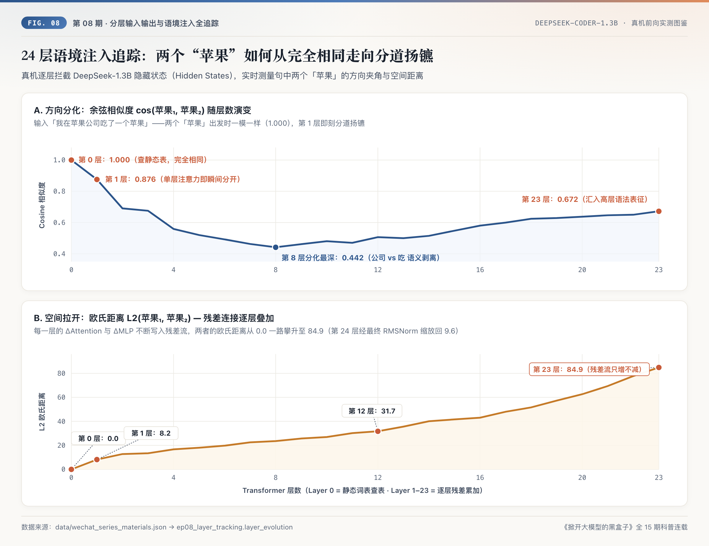

# 第 8 期｜词语接龙的灵魂：每一层如何把前文语境“注入”当前词？（分层输入输出全追踪）

## 💡 本节核心要点

* **攻克 Transformer 的“分层学习法”**：学习大模型架构绝不能对着一张笼统的框图“看个大概”。最直接的破局之道，是**紧盯每一层输入的张量是什么形状、内部做了哪几步线性与非线性变换、输出的张量又变成了什么**。
* **进出同形的“语义流水线”**：在 DeepSeek 1.3B 的 24 层网络中，每一层输入和输出的张量形状永远严丝合缝地保持为 `[1, 6, 2048]`。形状不变，但每个词向量内部的数值完成了一次脱胎换骨的“语境更新”。
* **词语接龙的灵魂是“语境注入”**：接龙不是机械查表，而是**每一层都把前面所有 Token 的语境信息按相关性提取出来，注入并融汇到当前 Token 自己的向量里**。
* **绝不止 1 层——几十上百层接力炼出“理解”**：单层 `[自注意力 + 前馈层]` 只是起跑的第一级台阶，现代大模型会把这种楼层叠上 **24 层甚至上百层**。在“我在苹果公司吃了一个苹果”实测中，两个“苹果”从 Layer 0 的 `cos = 1.0000` 一路经第 8 层谷底 `0.4417` 走到第 24 层 `0.5795`（空间距离拉开至 `26.597`），从孤立符号蜕变为融入上下文关系网的动态语义表示！

---

## 一、 拒绝“看个大概”：用“分层输入输出追踪法”拆解黑盒

初学者第一次看到 Transformer 架构图时，常被残差连接、多头注意力、前馈网络绕得头晕目眩。为什么觉得难？因为静态框图没有告诉你**张量在里面是怎么变形的**。

我们在第 1 期立下总体观：大模型是一个 24 层复合函数 $Y = F_{24}(F_{23}(\cdots F_1(X)))$。要学透它，只需掌握一条黄金法则——**“分层学习法”（紧盯输入与输出）**：
1. 进门时，**输入的张量形状与物理意义是什么？**
2. 房间内，**依次做了哪几次线性变换（拉伸旋转）与非线性变换（Softmax 概率化与 SiLU 弯折）？**
3. 出门时，**输出的张量形状是什么？比进门前多出了什么信息？**

只要扒透第 1 层（代码里为 `Layer 0`），剩下的第 2~24 层不过是用完全相同的图纸、换 23 套权重矩阵接力加工而已！

> **🧠 底层思想提炼**：**紧盯张量形状的“分层学习法”**。再复杂的神经网络也是一条严密的张量流水线。顺着数据流把每一步的 `[输入形状 -> 变换性质 -> 输出形状]` 列成清单，黑盒迷雾便会瞬间消散。

---

## 二、 钻进第 1 层内部：6 个词元的 7 步张量变形全追踪

把例句**“我在苹果公司吃了一个苹果”**喂给本地 `deepseek-coder-1.3b-base`，分词器将其切为 **6 个 Token**：`[①我在(23098), ②苹果₁(17144), ③公司(2804), ④吃(3509), ⑤了一个(13556), ⑥苹果₂(17144)]`。

刚查表出来时，2 号位**“苹果₁”**与 6 号位**“苹果₂”**编号都是 `17144`，因此它们的 2048 维初始向量 **100% 相同**（模长均为 `8.07`，余弦相似度 `1.0000`）。接下来，形状为 `[1, 6, 2048]` 的张量踏入第 1 层，我们用探针记录下它在层内 **7 个步骤**的完整变形表：

| 层内步骤 | 数学变换性质 | 输入张量形状 | 核心权重形状 | 输出张量形状 | 两“苹果”模长与相似度 | 这一步究竟在干什么？（物理与几何意义） |
| :--- | :--- | :---: | :---: | :---: | :---: | :--- |
| **0. 词表查表 (`Embedding`)** | 查表映射 | `[1, 6]` | `[32256, 2048]` | **`[1, 6, 2048]`** | `8.07` / `8.07` **$\cos = 1.0000$** | 把 6 个词编号变成 6 条 2048 维初始向量（此时两个“苹果”完全克隆） |
| **1. 层归一化 (`RMSNorm`)** | 非线性缩放+线性微调 | `[1, 6, 2048]` | `[2048]` | **`[1, 6, 2048]`** | `6.61` / `6.61` **$\cos = 1.0000$** | 把每条向量长度校准到统一量级，防止多层计算数值爆炸 |
| **2. Q/K/V 线性投影** | **纯线性变换** (拉伸+旋转) | `[1, 6, 2048]` | $3 \times$ `[2048, 2048]` | **Q,K,V 各 `[1, 6, 2048]`** | `54.66` / `54.66` **$\cos = 1.0000$** | 旋转投影出三种分身：**找人的问题(Q)**、**被找的标签(K)**、**携带的干货(V)** |
| **3. 切分 16 头 + `RoPE` 旋转** | 维度重排 + **几何旋转** | `[1, 6, 2048]` | 无参数 (位置旋转角) | **`[1, 16, 6, 128]`** | 模长 `54.66` **按位置旋转分离** | 把 2048 维劈成 16 个 128 维独立视角，并按词的位置序号（2号 vs 6号）旋转不同角度 |
| **4. 注意力打分与 `Softmax`** | **点积** + **非线性(Softmax)** | Q,K: `[1, 16, 6, 128]` | 因果掩码 (上三角 $-\infty$) | **`[1, 16, 6, 6]`** | 行概率和 $= 1.00$ **关注视野不同** | 算点积并经 Softmax 变成概率：算出**前文每个词对当前词的影响权重** |
| **5. 语境注入 + 残差相加** | 线性组合 + `o_proj` 投影 | `[1,16,6,6]` $\times$ `V` | `W_o`: `[2048, 2048]` | **`[1, 6, 2048]`** | **前文语境已注入** 开始分道扬镳 | 把 16 个头提取的前文干货 V 汇总，经残差连接（`+ 原输入`）直接**注入当前词体内** |
| **6. `SwiGLU` 前馈网络 (MLP)** | **线性升维 $\rightarrow$ SiLU 非线性 $\rightarrow$ 线性降维** | `[1, 6, 2048]` $\rightarrow$ `[1, 6, 5504]` | `up/gate` `[2048,5504]` `down` `[5504,2048]` | **`[1, 6, 2048]`** *(第1层最终输出)* | `16.72` vs `15.92` **$\cos = 0.8588$** (`0.8757`) | 在 5504 维高维空间做 SiLU 非线性知识加工，压回 2048 维输出第 1 层崭新张量！ |

<svg viewBox="0 0 680 310" style="width:100%;max-width:640px;height:auto;display:block;margin:16px auto;background:#f8fafc;border-radius:12px;border:1px solid #e2e8f0;font-family:-apple-system,BlinkMacSystemFont,'PingFang SC',sans-serif;">
  <defs>
    <marker id="ar1" viewBox="0 0 10 10" refX="8" refY="5" markerWidth="6" markerHeight="6" orient="auto"><path d="M 0 1 L 10 5 L 0 9 z" fill="#475569"/></marker>
    <marker id="ar2" viewBox="0 0 10 10" refX="8" refY="5" markerWidth="6" markerHeight="6" orient="auto"><path d="M 0 1 L 10 5 L 0 9 z" fill="#2563eb"/></marker>
  </defs>
  <text x="340" y="25" text-anchor="middle" font-size="14" font-weight="bold" fill="#0f172a">Transformer 单层内部张量流转与“语境注入”流程图</text>
  <!-- Row 1 -->
  <rect x="20" y="45" width="125" height="58" rx="8" fill="#f1f5f9" stroke="#94a3b8" stroke-width="1.5"/>
  <text x="82" y="66" text-anchor="middle" font-size="11" font-weight="bold" fill="#1e293b">① 输入 X + RMSNorm</text>
  <text x="82" y="84" text-anchor="middle" font-size="12" font-weight="bold" fill="#2563eb">[1, 6, 2048]</text>
  <line x1="145" y1="74" x2="173" y2="74" stroke="#475569" stroke-width="2" marker-end="url(#ar1)"/>
  <rect x="175" y="45" width="142" height="58" rx="8" fill="#eff6ff" stroke="#60a5fa" stroke-width="1.5"/>
  <text x="246" y="66" text-anchor="middle" font-size="11" font-weight="bold" fill="#1e3a8a">② Q/K/V 线性投影</text>
  <text x="246" y="84" text-anchor="middle" font-size="11.5" font-weight="bold" fill="#2563eb">3 × [1, 6, 2048]</text>
  <line x1="317" y1="74" x2="345" y2="74" stroke="#475569" stroke-width="2" marker-end="url(#ar1)"/>
  <rect x="347" y="45" width="145" height="58" rx="8" fill="#eff6ff" stroke="#60a5fa" stroke-width="1.5"/>
  <text x="419" y="66" text-anchor="middle" font-size="11" font-weight="bold" fill="#1e3a8a">③ 16头切分 + RoPE</text>
  <text x="419" y="84" text-anchor="middle" font-size="11.5" font-weight="bold" fill="#2563eb">[1, 16, 6, 128]</text>
  <line x1="492" y1="74" x2="520" y2="74" stroke="#475569" stroke-width="2" marker-end="url(#ar1)"/>
  <rect x="522" y="45" width="138" height="58" rx="8" fill="#fef2f2" stroke="#f87171" stroke-width="1.5"/>
  <text x="591" y="66" text-anchor="middle" font-size="11" font-weight="bold" fill="#991b1b">④ 点积 + Softmax</text>
  <text x="591" y="84" text-anchor="middle" font-size="11.5" font-weight="bold" fill="#dc2626">[1, 16, 6, 6]</text>
  <!-- Row 2 -->
  <path d="M 591 103 L 591 152 L 505 152" fill="none" stroke="#475569" stroke-width="2" marker-end="url(#ar1)"/>
  <path d="M 82 103 L 82 152 L 325 152" fill="none" stroke="#94a3b8" stroke-width="1.5" stroke-dasharray="4,4" marker-end="url(#ar1)"/>
  <text x="200" y="145" text-anchor="middle" font-size="10" fill="#64748b">残差连接 (+ 原始输入 X)</text>
  <rect x="330" y="125" width="172" height="56" rx="8" fill="#f0fdf4" stroke="#4ade80" stroke-width="1.8"/>
  <text x="416" y="146" text-anchor="middle" font-size="11" font-weight="bold" fill="#166534">⑤ 语境加权注入 + 合并</text>
  <text x="416" y="165" text-anchor="middle" font-size="12" font-weight="bold" fill="#15803d">[1, 6, 2048]</text>
  <!-- Row 3 -->
  <path d="M 416 181 L 416 210 L 160 210 L 160 230" fill="none" stroke="#2563eb" stroke-width="2" marker-end="url(#ar2)"/>
  <rect x="65" y="232" width="195" height="58" rx="8" fill="#faf5ff" stroke="#c084fc" stroke-width="1.5"/>
  <text x="162" y="253" text-anchor="middle" font-size="11" font-weight="bold" fill="#581c87">⑥ SwiGLU 升维 + SiLU 激活</text>
  <text x="162" y="272" text-anchor="middle" font-size="11.5" font-weight="bold" fill="#7e22ce">[1, 6, 2048] → [1, 6, 5504]</text>
  <line x1="260" y1="261" x2="310" y2="261" stroke="#475569" stroke-width="2" marker-end="url(#ar1)"/>
  <rect x="312" y="232" width="155" height="58" rx="8" fill="#faf5ff" stroke="#c084fc" stroke-width="1.5"/>
  <text x="389" y="253" text-anchor="middle" font-size="11" font-weight="bold" fill="#581c87">⑦ 线性降维 + 残差</text>
  <text x="389" y="272" text-anchor="middle" font-size="11.5" font-weight="bold" fill="#7e22ce">[1, 6, 5504] → [1, 6, 2048]</text>
  <line x1="467" y1="261" x2="505" y2="261" stroke="#2563eb" stroke-width="2.5" marker-end="url(#ar2)"/>
  <rect x="508" y="232" width="152" height="58" rx="8" fill="#fefce8" stroke="#facc15" stroke-width="2"/>
  <text x="584" y="253" text-anchor="middle" font-size="11" font-weight="bold" fill="#854d0e">★ 第 1 层最终输出</text>
  <text x="584" y="272" text-anchor="middle" font-size="11.5" font-weight="bold" fill="#b45309">[1, 6, 2048] (cos=0.8588)</text>
</svg>

看懂这张表，层内两大模块的分工一目了然：
1. **注意力模块（Step 2~5，占全模型 `29.90%`）——“收集前文，注入语境”**：受因果掩码限制，“苹果₁”只看 `[我在]`，而“苹果₂”能看全前文，用 $Q\cdot K$ 点积加 Softmax 把“吃”“公司”的干货 $V$ 按比例直接注入自己体内！
2. **SwiGLU 前馈层（Step 6~7，占全模型 `60.28%`）——“闭关消化知识”**：升维到 **5504 维**经 SiLU 激活常识，再压回 **2048 维**交给下一层。

---

## 三、 24 层语境注入全追踪：两个“苹果”如何一步步分道扬镳？

第 1 层结束后，两个“苹果”的相似度从 `1.0000` 降到了 `0.8588`（未去均值原始态为 `0.8757`）。当 `[1, 6, 2048]` 的张量继续穿过第 2 层直至第 24 层时，每一层都在做更深度的“语境接力注入”。我们实测提取了从 **Layer 0 到 Layer 24** 两个“苹果”的模长、空间距离（L2）与余弦相似度轨迹：

| 网络层深度 | 输出形状 | “苹果₁”/“苹果₂”模长 | 空间距离 (L2) | **余弦相似度 ($\cos\theta$)** | 24 层语境注入演进解析 |
| :--- | :---: | :---: | :---: | :---: | :--- |
| **Layer 0 (初始查表)** | `[1, 6, 2048]` | 8.07 / 8.07 | **0.000** | **1.0000** | **双胞胎起点**：刚查表出炉，无上下文，100% 重合 |
| **Layer 1 (第 1 层后)** | `[1, 6, 2048]` | 16.72 / 15.92 | **8.175** | **0.8588** *(原始 0.8757)* | **初次分化**：“苹果₂”首次吸入“吃/公司”语境 |
| **Layer 2 (第 2 层后)** | `[1, 6, 2048]` | 16.96 / 15.38 | **12.803** | **0.6904** | **句法锁死**：多头注意力锁死动宾搭配，相似度陡降 |
| **Layer 4 (第 4 层后)** | `[1, 6, 2048]` | 18.95 / 16.26 | **16.704** | **0.5592** | **语义剥离**：前一个绑地点状语，后一个绑食物宾语 |
| **Layer 8 (第 8 层后)** | `[1, 6, 2048]` | 23.60 / 20.79 | **23.576** | **0.4417** | **消歧谷底**：词义彻底剥离，夹角扩大至近 $64^\circ$ |
| **Layer 12 (第 12 层后)** | `[1, 6, 2048]` | 32.72 / 31.11 | **31.732** | **0.5067** | **全局融汇**：全句语境共享，残差流模长突破 30 |
| **Layer 23 (第 23 层后)** | `[1, 6, 2048]` | 106.35 / 103.14 | **84.870** | **0.6721** | **临门一脚**：残差累积模长破百，距离高达 84.87 |
| **Layer 24 (最终输出)** | `[1, 6, 2048]` | 17.99 / 18.20 | **26.597** *(校准后 9.614)* | **0.5795** *(原始 0.8590)* | **终局定格**：最终归一化校准，化为两个不同语义实体！ |

---

## 四、 千万别误会！这只是 1 层：为什么要叠上几十甚至上百层？

看到第二节那张 7 步流程图，很多同学很容易产生一个误解：**“哦，原来一个 Token 传进大模型，过一遍自注意力层、再过一遍前馈层就搞定了！”**

**千万别被单层图骗了——那仅仅是 1 层楼！** 在现代大模型里，像这样一套完整的 `[自注意力 + 前馈层]` 会被向上叠加几十甚至上百层：我们实测的 `DeepSeek 1.3B` 叠了 **24 层**，`DeepSeek-V3` 叠了 **61 层**，`Llama-3 70B` 叠了 **80 层**，超大规模旗舰模型甚至超过 **96～120 层**。而且**每一层都有自己独立的一套参数权重**，并不是拿同一层反复套娃。

为什么非要叠这么多层？最终又想炼出一个什么样的“表示”？打个最形象的比方——**这就像一个人从幼儿园、小学、初中一路读到大学毕业的升学修炼**：

<svg viewBox="0 0 680 328" style="width:100%;max-width:640px;height:auto;display:block;margin:16px auto;font-family:-apple-system,BlinkMacSystemFont,'PingFang SC',sans-serif;">
  <defs>
    <marker id="arUp" viewBox="0 0 10 10" refX="8" refY="5" markerWidth="6" markerHeight="6" orient="auto"><path d="M 0 1 L 10 5 L 0 9 z" fill="#2563eb"/></marker>
  </defs>
  <rect x="0" y="0" width="680" height="328" rx="12" fill="#f8fafc" stroke="#cbd5e1" stroke-width="1.5"/>
  <text x="340" y="25" text-anchor="middle" font-size="14" font-weight="bold" fill="#0f172a">绝不止 1 层！几十至上百层接力：Token 如何像“升学”一样炼出终极“理解”表示</text>

  <!-- Ascending staircase of 4 stages -->
  <!-- Stage 0: Layer 0 -->
  <rect x="20" y="168" width="136" height="82" rx="9" fill="#f1f5f9" stroke="#94a3b8" stroke-width="1.5"/>
  <text x="88" y="188" text-anchor="middle" font-size="11.5" font-weight="bold" fill="#1e293b">入园起跑 · Layer 0</text>
  <text x="88" y="206" text-anchor="middle" font-size="10" fill="#475569">静态词表死符号</text>
  <text x="88" y="223" text-anchor="middle" font-size="10" font-weight="bold" fill="#dc2626">两“苹果”cos = 1.00</text>
  <text x="88" y="239" text-anchor="middle" font-size="9.5" fill="#64748b">只知编号 17144</text>

  <path d="M 156 196 L 178 178" stroke="#2563eb" stroke-width="2" marker-end="url(#arUp)"/>

  <!-- Stage 1: Shallow L1-L4 -->
  <rect x="182" y="130" width="142" height="86" rx="9" fill="#eff6ff" stroke="#60a5fa" stroke-width="1.5"/>
  <text x="253" y="150" text-anchor="middle" font-size="11.5" font-weight="bold" fill="#1e3a8a">小学阶段 · 浅层 L1–4</text>
  <text x="253" y="168" text-anchor="middle" font-size="10" fill="#334155">认清局部词法与搭配</text>
  <text x="253" y="185" text-anchor="middle" font-size="10" font-weight="bold" fill="#2563eb">“吃→苹果₂” / “苹果₁+公司”</text>
  <text x="253" y="203" text-anchor="middle" font-size="9.5" fill="#1d4ed8">相似度骤降至 0.5592</text>

  <path d="M 324 158 L 346 140" stroke="#2563eb" stroke-width="2" marker-end="url(#arUp)"/>

  <!-- Stage 2: Middle L5-L12 -->
  <rect x="350" y="90" width="144" height="88" rx="9" fill="#faf5ff" stroke="#c084fc" stroke-width="1.6"/>
  <text x="422" y="110" text-anchor="middle" font-size="11.5" font-weight="bold" fill="#581c87">中学阶段 · 中层 L5–12</text>
  <text x="422" y="128" text-anchor="middle" font-size="10" fill="#334155">多视角消歧·剥离词义</text>
  <text x="422" y="146" text-anchor="middle" font-size="10" font-weight="bold" fill="#7e22ce">L8 分歧谷底 cos = 0.44</text>
  <text x="422" y="164" text-anchor="middle" font-size="9.5" fill="#6b21a8">夹角近 64°，身份彻底分野</text>

  <path d="M 494 118 L 516 100" stroke="#2563eb" stroke-width="2" marker-end="url(#arUp)"/>

  <!-- Stage 3: Deep L13-L24+ -->
  <rect x="520" y="46" width="142" height="106" rx="10" fill="#f0fdf4" stroke="#10b981" stroke-width="2"/>
  <text x="591" y="66" text-anchor="middle" font-size="11.5" font-weight="bold" fill="#065f46">大学升华 · 深层 L13–24+</text>
  <text x="591" y="83" text-anchor="middle" font-size="9.5" fill="#047857">（旗舰模型可达 80～100+ 层）</text>
  <rect x="530" y="92" width="122" height="48" rx="6" fill="#fefce8" stroke="#eab308" stroke-width="1.4"/>
  <text x="591" y="109" text-anchor="middle" font-size="10.5" font-weight="bold" fill="#854d0e">★ 终极“理解”表示</text>
  <text x="591" y="124" text-anchor="middle" font-size="9.2" fill="#713f12">融入语法·结构·词间关系网</text>
  <text x="591" y="136" text-anchor="middle" font-size="9" fill="#92400e">出口就绪，预测下一个词</text>

  <!-- Repeating block reminder bar at bottom -->
  <rect x="20" y="264" width="642" height="48" rx="9" fill="#ffffff" stroke="#cbd5e1" stroke-width="1.2"/>
  <text x="341" y="284" text-anchor="middle" font-size="11" font-weight="bold" fill="#1e293b">每一级台阶都用独立的新权重，踩同一套节拍：[ 自注意力吸收语境 ＋ 前馈层消化提炼 ]</text>
  <text x="341" y="302" text-anchor="middle" font-size="10" fill="#475569">第 1 层新表示 → 送入第 2 层再升级 → …… → 穿完 24～100+ 层，把冷冰冰的符号淬炼成浓缩上下文精华的活向量</text>
</svg>

对照上面的 24 层实测曲线，这趟“升学进阶”清晰得像透明玻璃：
1. **小学阶段（浅层第 1～4 层）**：刚学会把相邻线索拼在一起——前一个“苹果₁”迅速粘住“公司”，后一个“苹果₂”吸收动词“吃”，余弦相似度从 `1.0000` 骤降至 `0.5592`；
2. **中学阶段（中层第 5～12 层）**：在浅层新表示的基础上换更多视角反复推敲，第 8 层迎来最大分歧（`0.4417`，夹角近 $64^\circ$），两个词的角色被彻底剥离；
3. **大学冲刺（深层第 13～24 层，乃至更大模型的 80～100+ 层）**：随着每层残差不断叠加，向量模长攀升破百，最终在第 24 层出口定格在 `0.5795`、欧氏距离 `26.597`（校准态 `9.614`），完成面向下一个词预测的终极凝练！

每一层都在上一层刚炼出的表示上继续升级。走完几十上百层后，句尾的“苹果₂”早已不再是刚进门时那个孤零零的编号 `17144`，而是仿佛**吸收了整句话的上下文精华——把语法、句式结构、多视角关系统统浓缩进了这根 2048 维向量里**，甚至细腻到连人类语言学规则都难以逐条穷举的几何境界。直到这一刻，我们才敢给它打上引号，说模型**“理解”**了这句话。

这恰恰触及了现代**计算语言学（分布语义学）**与大语言模型最核心的灵魂。还记得**第 2 期**费曼父亲指着树枝上画眉鸟说过的话吗？**一只鸟叫什么名字（不管它是符号 `"苹果"`、`"apple"` 还是编号 `17144`）根本不重要；真正重要的是它的内涵是什么，它在真实世界里和其他词是什么关系、彼此的含义有没有交集！** 大模型层层堆叠几十上百层，绝不是在对静态符号做死板的查表计算，而是在高维几何空间里把每个词背后深层的关系内涵，一遍遍织进它最终的动态表示里。

> **🧠 底层思想提炼**：**深层表示的“逐级抽象”与关系语义观**。单层网络只能抓住浅层词对搭配；唯有叠加数十至上百层 `[语境注入 + 知识提炼]`，模型才能像升学一样层层升级 Token 表示，摆脱静态符号的束缚，在高维空间里织就带引号的深层“理解”。

---

## 📜 科学史故事栏：2014 年蒙特利尔，巴达瑙如何打破“长句遗忘魔咒”？

2014 年之前，机器翻译被困在**“固定向量瓶颈”**里：旧式的循环神经网络（RNN）读长句子时，必须把整句 50 个词的信息硬塞进最后一个固定向量里，导致句子一长就“读了后面忘前面”。

2014 年冬天，加拿大蒙特利尔大学博士生**兹米特里·巴达瑙（Dzmitry Bahdanau）**与**曹均铉（Kyunghyun Cho）**、导师**约书亚·本吉奥（Yoshua Bengio）**提出了一个精妙直觉：**人类翻译长句时，每写一个词都会回头扫视原文最相关的词！** 他们不再把整句话压成一个死向量，而是让当前词对前文所有词打分、经 Softmax 算出权重后**把前文语境动态注入当前词**，并命名为**注意力机制（Attention）**，为 3 年后的 Transformer 埋下了最关键的火种。

---

## 🔮 下期预告

在第 1 层追踪表的 Step 3 里，为什么模型非要把 2048 维劈成 **16 个 128 维的小分队（16 个注意力头）**？如果把第 1 层的 **16 个注意力头实测数据全表**摊开，究竟是哪一个头在盯紧动词**“吃”**，又是哪一个头在锁死**“苹果公司”**？下一期，真机 16 头实测全表大放送！

---

## 🔗 拓展资源加油站

1. **The Illustrated Transformer（Jay Alammar 图解教程）**：配合本期 7 步张量表阅读，彻底看清 Q/K/V 流转。
2. **Transformer Explainer**（`poloclub.github.io/transformer-explainer/`）：在浏览器里实时观察每一层张量形状与数值变化。
3. **动手实验**：用 PyTorch 的 `register_forward_hook` 提取 DeepSeek 1.3B 各层输出，复现两个“苹果”的分道扬镳曲线！
