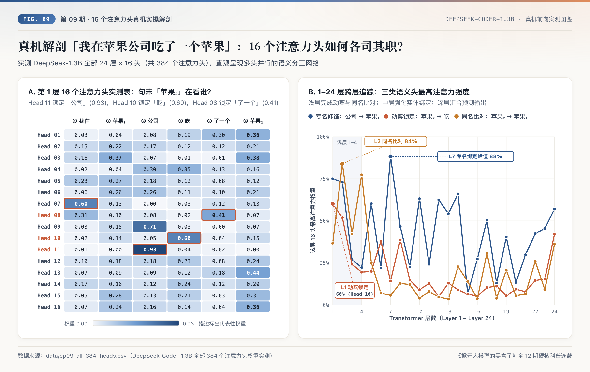

# 第 9 期｜真机解剖“我在苹果公司吃了一个苹果”：16 个注意力头究竟在看什么？（附实测全表）

## 💡 本节核心要点

* **多头注意力（Multi-Head Attention）的底层思想**：只用一种视角看句子容易“偏听偏信”。把 2048 维空间切分为 **16 个独立的 128 维子空间（$2048 = 16 \times 128$）**，相当于同时派出 16 位“专科侦探”，从句法、修饰、指代等 16 个维度并行审视同一句话。
* **第 1 层 16 头真机实测全表**：将“我在苹果公司吃了一个苹果”喂给本地 DeepSeek 1.3B，在第 1 层中，句尾的**“苹果₂”**展现出惊人的专业分工——**Head 10** 把 **60.16%** 的注意力锁定在动词**“吃”**上；**Head 11** 把 **92.97%** 锁定在**“公司”**上；**Head 08** 用 **41.41%** 盯住量词**“了一个”**；**Head 07** 用 **60.16%** 锚定句首**“我在”**；**Head 03** 则用 **36.72%** 回头比对**“苹果₁”**！
* **全模型 384 个侦探头跨层接力**：在 24 层 $\times$ 16 头 = **384 个注意力头**中，动宾锁定头、专名修饰头（如 L7-H5 高达 **88.28%**）与同名比对头（L2-H10 高达 **83.98%**）跨层协同，彻底消解一词多义。

---

## 一、 为什么要“多头”？16 位专科侦探的并行会诊

上一期我们看到，词向量经过 $W_Q, W_K, W_V$ 线性旋转后，模型把 `[1, 6, 2048]` 切分成了 **`[1, 16, 6, 128]`**——即劈成 16 个注意力头（Heads），每头 128 维。

为什么不直接用 2048 维算一次总点积？因为指数函数 Softmax 具有强烈的“赢家通吃”效应：如果只算一次总分（单头注意力），最高分的那个词会吞掉绝大部分概率，导致当前词只能盯住前文某 **1 个词**，漏掉其他重要线索！

而切成 **16 个头**，就是通过线性旋转把词向量投影到 **16 个互不干扰的 128 维子空间**里，各自独立算点积、独立做 Softmax。这就好比组织了一场 **16 位专科侦探的联合会诊**：在阅读**“我在苹果公司吃了一个苹果”**（`[①我在, ②苹果₁, ③公司, ④吃, ⑤了一个, ⑥苹果₂]`）时，有的头专查“谁是我的动作谓语”，有的头专查“谁是修饰我的量词”，有的头专查“前文有没有同名词汇”，最后再把 16 份 128 维情报拼回 2048 维！

> **🧠 底层思想提炼**：**子空间解耦与“多视角并行会诊”**。多头注意力的本质，是**拒绝单一评价标准，通过线性投影开辟 16 个平行的几何子空间，让模型在同一层内同时捕捉动宾、修饰、场景与指代等十几种语法语义关联**。

---

## 二、 真机解剖第 1 层：句尾“苹果₂”在 16 个头里分别看到了谁？

我们在本地运行 `deepseek-coder-1.3b-base`，输入**“我在苹果公司吃了一个苹果”**，将**第 1 层（Layer 1）全部 16 个注意力头**中句尾**“⑥苹果₂”**对前文 6 个位置的注意力权重完整导出（每行前 6 列概率和恒为 `1.00`，倒数第二列附测该头中“③公司 $\rightarrow$ ②苹果₁”的绑定权重）：

| 第 1 层注意力头 | 看 `①我在` | 看 `②苹果₁` | 看 `③公司` | 看 `④吃` | 看 `⑤了一个` | 看 `⑥苹果₂(自身)` | 附：`③公司` $\rightarrow$ `②苹果₁` | 该注意力头的“侦探专长”实测诊断 |
| :--- | :---: | :---: | :---: | :---: | :---: | :---: | :---: | :--- |
| **Head 01** | 0.0294 | 0.0435 | 0.0840 | 0.1895 | **0.2988** | **0.3555** | 0.4258 | **邻近滑窗头**：关注自身与紧邻的前词“了一个” |
| **Head 02** | 0.1455 | 0.2246 | 0.1748 | 0.1240 | 0.1201 | 0.2109 | 0.5234 | **全局匀光头**：把注意力均匀洒向全句每个词 |
| **Head 03** | 0.1621 | **0.3672** | 0.0664 | 0.0082 | 0.0146 | **0.3809** | 0.6211 | **★同名回溯头**：以 **36.72%** 跨越半句回头比对“苹果₁”！ |
| **Head 04** | 0.0245 | 0.0378 | **0.2988** | **0.3496** | 0.1309 | 0.1602 | **0.6992** | **复合主干头**：同时抓谓语“吃”(35%) 与场景“公司”(30%) |
| **Head 05** | 0.2275 | **0.2734** | 0.1826 | 0.1216 | 0.0762 | 0.1182 | 0.2988 | **前文扫描头**：侧重扫描句首前半段背景 |
| **Head 06** | 0.0591 | **0.2559** | **0.2637** | 0.1138 | 0.1006 | 0.2061 | 0.4414 | **专名打包头**：把“苹果₁+公司”成对打包吸收 |
| **Head 07** | **0.6016** | 0.1260 | 0.0006 | 0.0276 | 0.1162 | 0.1299 | 0.1445 | **★句首锚点头**：以 **60.16%** 死死锚定句首主语“我在” |
| **Head 08** | 0.3125 | 0.1045 | 0.0830 | 0.0203 | **0.4141** | 0.0654 | 0.2139 | **★数量修饰侦探**：以 **41.41%** 最高权重锁死量词“了一个”！ |
| **Head 09** | 0.0332 | 0.1484 | **0.7070** | 0.0342 | 0.0018 | 0.0747 | 0.1406 | **场景地点侦探**：以 **70.70%** 重度提取地点词“公司” |
| **Head 10** | 0.0208 | 0.1396 | 0.0498 | **0.6016** | 0.0400 | 0.1484 | **0.7500** | **★王牌动宾侦探**：“苹果₂”以 **60.16%** 锁死“吃”；“公司”以 **75%** 锁死“苹果₁”！ |
| **Head 11** | 0.0061 | 0.0010 | **0.9297** | 0.0415 | 0.0209 | 0.0010 | 0.0006 | **★极端环境锁定头**：高达 **92.97%** 火力集中抽取“公司” |
| **Head 12** | 0.0986 | 0.1787 | 0.1787 | **0.2295** | 0.0791 | 0.2363 | 0.4180 | **均衡融合头**：兼顾自身(23.6%)、动作“吃”(23.0%)与前文 |
| **Head 13** | 0.0747 | 0.0942 | 0.0889 | 0.1211 | 0.1846 | **0.4355** | 0.3301 | **自身保底头**：以 **43.55%** 守住“苹果₂”自身词义底色 |
| **Head 14** | 0.1689 | 0.1602 | 0.1157 | **0.2383** | 0.1157 | 0.2021 | 0.3848 | **温和谓语辅助头**：以“吃”为重心向全句平缓铺开 |
| **Head 15** | 0.0503 | **0.2773** | 0.1289 | 0.2090 | 0.0276 | **0.3086** | 0.5586 | **双苹果对照头**：在自身、前一个苹果与“吃”之间三角比对 |
| **Head 16** | 0.0664 | 0.2422 | 0.1562 | 0.1406 | 0.0369 | **0.3574** | **0.6602** | **名词短语粘合头**：辅助将“苹果₁+公司”粘合为专名短语 |

这张实测表把大模型“理解上下文”的底牌照得一清二楚——哪有什么玄学，全靠 16 个头的精密分工：
* **Head 10（王牌动宾猎手）**：让“苹果₂”投出 **60.16%（`0.6016`）** 的压倒性权重锁定动词**“吃”**（确认自己是被吃的食物）；同时让“公司”投出 **75.00%（`0.7500`）** 锁定**“苹果₁”**（焊死科技公司专名）！
* **Head 11 & Head 09（环境猎手）**：分别用 **92.97%（`0.9297`）** 和 **70.70%** 提取地点**“公司”**。
* **Head 08（量词猎手）**：用 **41.41%（`0.4141`）** 锁定数量修饰词**“了一个”**。
* **Head 07（句首锚点）**：用 **60.16%** 锁定主语**“我在”**；**Head 03** 则用 **36.72%** 回头比对**“苹果₁”**。

<svg viewBox="0 0 680 265" style="width:100%;max-width:640px;height:auto;display:block;margin:16px auto;background:#f8fafc;border-radius:12px;border:1px solid #e2e8f0;font-family:-apple-system,BlinkMacSystemFont,'PingFang SC',sans-serif;">
  <text x="340" y="25" text-anchor="middle" font-size="14" font-weight="bold" fill="#0f172a">多头注意力实测连线图：3 类不同专长的侦探头在同一句话里各抓各的线索</text>
  <rect x="35" y="38" width="610" height="28" rx="6" fill="#f1f5f9" stroke="#cbd5e1"/>
  <line x1="50" y1="52" x2="80" y2="52" stroke="#dc2626" stroke-width="3.5"/>
  <text x="86" y="56" font-size="10.5" font-weight="bold" fill="#dc2626">动宾&amp;专名头 (L1-H10)</text>
  <line x1="255" y1="52" x2="285" y2="52" stroke="#2563eb" stroke-width="3.5"/>
  <text x="291" y="56" font-size="10.5" font-weight="bold" fill="#2563eb">量词修饰头 (L1-H8 / L14-H5)</text>
  <line x1="463" y1="52" x2="493" y2="52" stroke="#16a34a" stroke-width="3" stroke-dasharray="5,3"/>
  <text x="499" y="56" font-size="10.5" font-weight="bold" fill="#15803d">同名比对头 (L1-H3 / L2-H10)</text>
  <!-- Arcs -->
  <path d="M 575 175 Q 475 82 375 175" fill="none" stroke="#dc2626" stroke-width="4"/>
  <text x="475" y="112" text-anchor="middle" font-size="10.5" font-weight="bold" fill="#dc2626">H10 动宾锁定: 60.16%</text>
  <path d="M 275 175 Q 225 102 175 175" fill="none" stroke="#dc2626" stroke-width="3.5"/>
  <text x="225" y="122" text-anchor="middle" font-size="10.5" font-weight="bold" fill="#dc2626">H10 专名锁定: 75.0%</text>
  <path d="M 575 175 Q 525 128 475 175" fill="none" stroke="#2563eb" stroke-width="3.5"/>
  <text x="535" y="142" text-anchor="middle" font-size="10" font-weight="bold" fill="#1d4ed8">H8 量词: 41.41%</text>
  <path d="M 575 213 Q 375 272 175 213" fill="none" stroke="#16a34a" stroke-width="3" stroke-dasharray="6,4"/>
  <text x="375" y="254" text-anchor="middle" font-size="10.5" font-weight="bold" fill="#15803d">同名比对：L1-H3 (36.72%) → L2-H10 飙升至 83.98%！</text>
  <!-- Tokens -->
  <rect x="35" y="175" width="80" height="38" rx="7" fill="#fff" stroke="#64748b" stroke-width="1.5"/>
  <text x="75" y="198" text-anchor="middle" font-size="12.5" font-weight="bold" fill="#1e293b">① 我在</text>
  <rect x="135" y="175" width="80" height="38" rx="7" fill="#eff6ff" stroke="#2563eb" stroke-width="2"/>
  <text x="175" y="198" text-anchor="middle" font-size="12.5" font-weight="bold" fill="#1d4ed8">② 苹果₁</text>
  <rect x="235" y="175" width="80" height="38" rx="7" fill="#fff" stroke="#64748b" stroke-width="1.5"/>
  <text x="275" y="198" text-anchor="middle" font-size="12.5" font-weight="bold" fill="#1e293b">③ 公司</text>
  <rect x="335" y="175" width="80" height="38" rx="7" fill="#fef2f2" stroke="#dc2626" stroke-width="2"/>
  <text x="375" y="198" text-anchor="middle" font-size="12.5" font-weight="bold" fill="#b91c1c">④ 吃</text>
  <rect x="435" y="175" width="80" height="38" rx="7" fill="#fff" stroke="#64748b" stroke-width="1.5"/>
  <text x="475" y="198" text-anchor="middle" font-size="12.5" font-weight="bold" fill="#1e293b">⑤ 了一个</text>
  <rect x="535" y="175" width="80" height="38" rx="7" fill="#fefce8" stroke="#eab308" stroke-width="2.5"/>
  <text x="575" y="198" text-anchor="middle" font-size="12.5" font-weight="bold" fill="#a16207">⑥ 苹果₂</text>
</svg>

---

## 三、 1~24 层王牌侦探头榜单：384 个头的跨层协同

在全模型 24 层 $\times$ 16 头 = **384 个注意力头**中，我们扫描整理出了跨层接力的**《王牌专科侦探头榜单》**：

| 侦探专科类别 | 核心语义配对任务 | 冠军王牌头 (实测权重) | 亚军王牌头 (实测权重) | 季军/深层接力头 (实测权重) | 跨层协同消歧规律 |
| :--- | :--- | :---: | :---: | :---: | :--- |
| **① 动宾锁定头** | `⑥苹果₂` $\rightarrow$ 动词 `④吃` | **Layer 1 - Head 10** (**60.16%** / `0.6016`) | **Layer 2 - Head 09** (**51.95%** / `0.5195`) | **Layer 24 - Head 08** (**41.99%** / `0.4199`) | 浅层(L1/L2)第一时间锁死“吃苹果”，直到第24层仍在重申动宾关系以预测下一词 |
| **② 专名修饰头** | `③公司` $\rightarrow$ 前缀 `②苹果₁` | **Layer 7 - Head 05** (**88.28%** / `0.8828`) | **Layer 1 - Head 10** (**75.00%** / `0.7500`) | **Layer 2 - Head 02** (**73.05%** / `0.7305`) | 从 L1(75%)、L2(73.05%) 到 L7(**88.28%**)，把“苹果₁”彻底焊死在“公司”身上 |
| **③ 同名比对头** | `⑥苹果₂` $\rightarrow$ 比对 `②苹果₁` | **Layer 2 - Head 10** (**83.98%** / `0.8398`) | **Layer 4 - Head 09** (**77.34%** / `0.7734`) | **Layer 1 - Head 03** (**36.72%** / `0.3672`) | L2-H10(**83.98%**)与 L4-H9(**77.34%**)把两个“苹果”拉到一起做反差比对，迅速推开夹角 |
| **④ 数量修饰头** | `⑥苹果₂` $\rightarrow$ 量词 `⑤了一个` | **Layer 14 - Head 05** (**79.30%** / `0.7930`) | **Layer 2 - Head 05** (**73.83%** / `0.7383`) | **Layer 1 - Head 08** (**41.41%** / `0.4141`) | 浅层与中深层反复确认动作已完成且数量为单数，为续写“，然后又吃”埋下伏笔 |

正是靠着第 1 层锁死“吃”与“公司”、第 2~4 层启动高达 **83.98%** 的同名反差比对，两个“苹果”才在几何空间里彻底分道扬镳！

---

## 四、 384 个注意力头是如何合力消解“一词多义”的？

把上面两张真机实测表连起来看，困扰我们整整三期的终极谜题——**“模型到底怎么知道前一个苹果是公司、后一个苹果是水果”**——终于有了滴水不漏的答案：

1. **第一步：第 1 层并行贴标签**。在 Layer 1 中，10 号头同时打出了两记重拳：一方面让 3 号位的“公司”以 **75.00%** 的高权重死死抱住 2 号位的“苹果₁”；另一方面让 6 号位的“苹果₂”以 **60.16%** 的高权重紧紧抓住 4 号位的动词“吃”，同时 8 号头把 **41.41%** 的量词“了一个”注入“苹果₂”，11 号头把 **92.97%** 的场景词“公司”注入“苹果₂”。
2. **第二步：第 2~4 层同名反差比对**。到了 Layer 2 的 10 号头（权重 **83.98%**）和 Layer 4 的 9 号头（权重 **77.34%**），同名比对侦探登场！它让已经吸入了“吃了一个”语境的“苹果₂”，回头去和前文的“苹果₁”做正面比对，瞬间识别出“原来前一个苹果是办公地点，而我是盘中餐”，从而在几何空间里把两支向量推向不同的方向！
3. **第三步：中深层持续巩固直至输出**。到了第 7 层 5 号头（“公司 $\rightarrow$ 苹果₁”高达 **88.28%**）、第 14 层 5 号头（“苹果₂ $\rightarrow$ 了一个”高达 **79.30%**）直至第 24 层 8 号头（“苹果₂ $\rightarrow$ 吃”保持 **41.99%**），384 个头层层护航，确保句尾最终输出的张量精准预测出下一个标点与动作“，然后又吃”！

> **🧠 底层思想提炼**：**智能涌现于“简单算子的海量分工协同”**。单个注意力头做的事情极其简单，不过是在 128 维子空间里算一次点积和 Softmax；但当每层 16 个头、24 层共 **384 个头**横向分工、纵向接力时，人类语言里最幽微的句法与一词多义，就被拆解得明明白白。

---

## 📜 科学史故事栏：2017 年谷歌餐厅的午饭奇想——《Attention Is All You Need》

2017 年春天，尽管巴达瑙发明的注意力机制已经问世三年，但全世界所有的主流模型仍把笨重且无法并行计算的循环神经网络（RNN/LSTM）当成绝对主角，只敢把注意力当成一个辅助插件。

一天中午，在加州山景城 Google Brain 园区餐厅吃午饭时，**阿希什·瓦斯瓦尼（Ashish Vaswani）**、**诺姆·沙泽尔（Noam Shazeer）**、**伊利亚·波洛苏欣（Illia Polosukhin）**、**雅各布·乌兹科雷特（Jakob Uszkoreit）**等 8 位年轻学者（后来被尊称为“Transformer 八子”）聊起了一个疯狂的念头：**“既然 RNN 串行计算这么慢，而真正帮模型找准上下文的功臣其实是注意力——那我们干脆把所有的 RNN 和卷积网络（CNN）统统扔进垃圾桶，只用纯注意力机制来搭建整个大模型！”**

为了解决单头注意力在 Softmax 后只会死盯一个词的缺陷，团队里的工程奇才诺姆·沙泽尔等人设计了把向量切成多份子空间并行会诊的**多头注意力（Multi-Head Attention）**。在给论文起名时，团队里的利昂·琼斯（Llion Jones）借用披头士乐队那首家喻户晓的名曲《All You Need Is Love》，写下了 AI 史上最霸气的标题——**《Attention Is All You Need（注意力就是你所需要的一切）》**，一举开启了今天的大模型黄金时代。

---

## 🔮 下期预告

看着这 384 个注意力头配合得滴水不漏、轻松分清了两个“苹果”，你可能以为 Transformer 已经全部拆完了。**等等——翻开第 1 期的参数账本，24 层注意力加起来其实只占了核心主体参数的 1/3！剩下整整 2/3、足足 8.12 亿个神秘参数究竟藏在哪儿？** 光在学校“上课听讲”还不算真学会，下一期，我们推开每层注意力身后的那扇重门——**FFN 前馈层**，看看每个词是如何“关起门来回家复习、升维修炼”的！

---

## 🔗 拓展资源加油站

1. **BertViz 多头注意力交互神器**（GitHub `jessevig/bertviz`）：鼠标悬停即可交互式查看任意句子在各层各头的注意力连线。
2. **经典原著《Attention Is All You Need》**（`arxiv.org/abs/1706.03762`）：翻到第 4 页公式，用高中点积知识即可 100% 读懂。
3. **动手实验**：运行 DeepSeek 1.3B 时开启 `output_attentions=True`，测试“他拿着苹果手机吃苹果”的 16 头权重！
