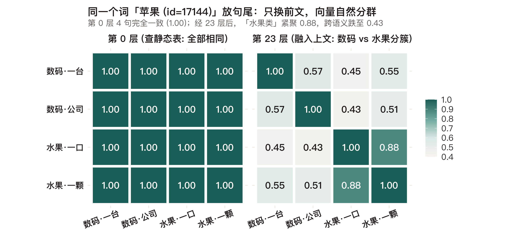

# 第 11 期｜训练与推理大不同！为什么聊天时大模型的 Embedding 词表早已“彻底冻结”？

## 💡 本节核心要点

- **严格区分大模型的“两段人生”**：**训练（Training）**是出厂前耗资数百万美元、用反向传播反复改写权重的“寒窗苦读期”；日常聊天则是**推理（Inference）**，此时模型只做单向前向计算，处于不改任何参数的“考场答题期”。
- **密码学铁证破除“边聊边改词表”迷思**：对 DeepSeek 1.3B 全部 **219 个权重张量（1,346,471,936 个参数）** 进行推理前后 SHA-1 密码学哈希比对，发生改变的张量数为 **`0`**——聊天时词表和权重连 1 个比特都不会变。
- **静态死词表 + 动态活语境**：推理时第 0 层 `[32256, 2048]` 词表是彻底锁死的只读字典，“苹果（`id=17144`）”在任何句子里的第 0 层初始向量永远 100% 相同（余弦相似度恒为 `1.0000`）。
- **语境分化靠的是 24 层注意力加工**：模型能区分“买一台苹果”与“咬一口苹果”，靠的是第 1～24 层多头注意力将不同前文动态注入当前词向量，在高层空间实现自动分群。

---

## 一、 破除初学者头号迷思：训练与推理，完全是两套运行状态

看完第 10 期的训练四步循环后，很多同学都会问：**“我平时跟 DeepSeek 或 ChatGPT 聊天时，每发一句话，它是不是也在后台做反向传播、实时修改它的词向量表？”**

答案是斩钉截铁的三个字：**绝不会！**

如果把大模型比作高考生，**训练（Training）**是高考前十二年刷题、对答案、修正脑回路的过程；而模型发布上线供我们聊天则是**推理（Inference）**，相当于走进了高考考场——**考生只能调动已经定型的脑回路单向写出答案，绝不允许一边考试一边翻标准答案改写大脑结构！**

我们从六个核心维度将这两套运行状态做个彻底对照：

| 对比维度 | 训练过程（Training 寒窗苦读期） | 推理过程（Inference 考场答题期） |
| :--- | :--- | :--- |
| **1. 数据流动方向** | **双向往返**：前向传播算概率 + 反向传播传梯度 | **单向直通**：仅从第 0 层到第 24 层单向前向传播 |
| **2. 是否计算导数梯度** | **是**：必须沿复合函数链条求偏导，算 13.46 亿参数梯度 $\nabla$ | **否**：完全关闭求导引擎（开启 `torch.no_grad()`） |
| **3. 词表与权重是否改变** | **持续动态改写**：每一步都在微调拉伸、旋转词表与矩阵 | **100% 彻底冻结（Frozen）**：所有权重只读不写，纹丝不动 |
| **4. 算力与显存开销** | **极高**：需存储激活值、梯度与优化器状态，千卡集群数周 | **极低**：仅加载只读权重，普通个人笔记本毫秒级响应 |
| **5. 核心数学目标** | **雕琢函数 $F$ 本身**：最小化误差 $\text{Loss} = -\ln P$ | **调用固定函数 $Y=F(X)$**：输入上文 $X$，抽样下一个词 $Y$ |
| **6. 时间尺度与阶段** | 模型上线前，由 AI 实验室耗时数周一次性或分阶段完成 | 模型上线后，用户每次敲击回车键的几十毫秒内实时触发 |

<svg viewBox="0 0 680 290" style="width:100%;max-width:640px;height:auto;display:block;margin:16px auto;font-family:'PingFang SC','Microsoft YaHei',sans-serif;">
  <rect x="0" y="0" width="680" height="290" rx="12" fill="#F8FAFC" stroke="#CBD5E1" stroke-width="1.5"/>
  <text x="340" y="25" text-anchor="middle" font-size="14.5" font-weight="bold" fill="#0F172A">训练过程（权重解锁双向更新） vs 推理过程（权重冻结单向注入）对比图</text>
  <rect x="16" y="38" width="648" height="112" rx="10" fill="#FFFBEB" stroke="#F59E0B" stroke-width="1.5"/>
  <text x="32" y="58" font-size="12.5" font-weight="bold" fill="#B45309">A. 训练阶段（Training）：权重未上锁 🔓，双向循环改写参数</text>
  <rect x="32" y="70" width="122" height="44" rx="6" fill="#FEF3C7" stroke="#D97706"/>
  <text x="93" y="89" text-anchor="middle" font-size="11" font-weight="bold" fill="#92400E">Embedding 词表</text>
  <text x="93" y="105" text-anchor="middle" font-size="9.5" fill="#B45309">🔓 坐标每步都在变</text>
  <rect x="192" y="70" width="146" height="44" rx="6" fill="#FEF3C7" stroke="#D97706"/>
  <text x="265" y="89" text-anchor="middle" font-size="11" font-weight="bold" fill="#92400E">24 层注意力与 MLP</text>
  <text x="265" y="105" text-anchor="middle" font-size="9.5" fill="#B45309">🔓 矩阵每步都在变</text>
  <rect x="376" y="70" width="122" height="44" rx="6" fill="#FEF3C7" stroke="#D97706"/>
  <text x="437" y="89" text-anchor="middle" font-size="11" font-weight="bold" fill="#92400E">lm_head 投影层</text>
  <text x="437" y="105" text-anchor="middle" font-size="9.5" fill="#B45309">🔓 权重每步都在变</text>
  <rect x="536" y="70" width="112" height="44" rx="6" fill="#FEE2E2" stroke="#EF4444"/>
  <text x="592" y="89" text-anchor="middle" font-size="11" font-weight="bold" fill="#B91C1C">对照答案算 Loss</text>
  <text x="592" y="105" text-anchor="middle" font-size="9.5" fill="#B91C1C">-ln P(标准答案)</text>
  <path d="M154 92 L188 92" stroke="#D97706" stroke-width="2"/><polygon points="190,92 183,88 183,96" fill="#D97706"/>
  <path d="M338 92 L372 92" stroke="#D97706" stroke-width="2"/><polygon points="374,92 367,88 367,96" fill="#D97706"/>
  <path d="M498 92 L532 92" stroke="#EF4444" stroke-width="2"/><polygon points="534,92 527,88 527,96" fill="#EF4444"/>
  <path d="M592 114 L592 136 L93 136 L93 118" stroke="#DC2626" stroke-width="2" stroke-dasharray="5,3" fill="none"/>
  <text x="342" y="132" text-anchor="middle" font-size="10" font-weight="bold" fill="#DC2626">◀ 反向传播梯度流（∇Loss 顺藤摸瓜改写全部 219 个权重张量）</text>
  <rect x="16" y="162" width="648" height="112" rx="10" fill="#ECFDF5" stroke="#10B981" stroke-width="1.5"/>
  <text x="32" y="182" font-size="12.5" font-weight="bold" fill="#047857">B. 推理阶段（Inference）：权重彻底冻结 🔒，靠层层注意力动态注入语境</text>
  <rect x="32" y="196" width="122" height="46" rx="6" fill="#D1FAE5" stroke="#059669"/>
  <text x="93" y="215" text-anchor="middle" font-size="11" font-weight="bold" fill="#065F46">Embedding 静态表</text>
  <text x="93" y="232" text-anchor="middle" font-size="9.5" fill="#047857">🔒 SHA-1 完全锁死</text>
  <rect x="192" y="196" width="146" height="46" rx="6" fill="#D1FAE5" stroke="#059669"/>
  <text x="265" y="215" text-anchor="middle" font-size="11" font-weight="bold" fill="#065F46">24 层多头注意力+MLP</text>
  <text x="265" y="232" text-anchor="middle" font-size="9.5" fill="#047857">🔒 矩阵锁死·动态融汇上文</text>
  <rect x="376" y="196" width="122" height="46" rx="6" fill="#D1FAE5" stroke="#059669"/>
  <text x="437" y="215" text-anchor="middle" font-size="11" font-weight="bold" fill="#065F46">lm_head 投影层</text>
  <text x="437" y="232" text-anchor="middle" font-size="9.5" fill="#047857">🔒 权重锁死·算 Logits</text>
  <rect x="536" y="196" width="112" height="46" rx="6" fill="#EFF6FF" stroke="#3B82F6"/>
  <text x="592" y="215" text-anchor="middle" font-size="11" font-weight="bold" fill="#1D4ED8">Softmax 抽样接龙</text>
  <text x="592" y="232" text-anchor="middle" font-size="9.5" fill="#1E40AF">吐出下一个词 Token</text>
  <path d="M154 219 L188 219" stroke="#059669" stroke-width="2"/><polygon points="190,219 183,215 183,223" fill="#059669"/>
  <path d="M338 219 L372 219" stroke="#059669" stroke-width="2"/><polygon points="374,219 367,215 367,223" fill="#059669"/>
  <path d="M498 219 L532 219" stroke="#2563EB" stroke-width="2"/><polygon points="534,219 527,215 527,223" fill="#2563EB"/>
  <text x="340" y="262" text-anchor="middle" font-size="10" font-weight="bold" fill="#065F46">无标准答案、无 Loss、无反向求导 → 219 个权重张量 0 比特改动！</text>
</svg>

---

## 二、 密码学铁证：13.46 亿参数推理前后 SHA-1 指纹分毫不差

为了给“推理时权重 100% 冻结”提供铁证，我们用密码学 **SHA-1 哈希算法**给 DeepSeek 1.3B 的全部 **219 个权重张量（`1,346,471,936` 个参数）** 拍了数字指纹。哪怕十几亿个浮点数里只有 1 个二进制比特在聊天时被改写，SHA-1 指纹也会彻底改变。

我们在推理前记录全套指纹，随后向模型输入“我在苹果公司吃了一个苹果”及多组测试句跑完 24 层推理与生成，再次提取 SHA-1 指纹比对：

| 权重张量名称（Tensor Name） | 张量形状 | 推理前 SHA-1 指纹（FP32 / BF16） | 推理后 SHA-1 指纹（FP32 / BF16） | 校验结果 |
| :--- | :---: | :---: | :---: | :---: |
| **`model.embed_tokens.weight`** | `[32256, 2048]` | `31be160760f8`（`aca97c6467b7`） | `31be160760f8`（`aca97c6467b7`） | **100% 相同** |
| **`layers.0.self_attn.q_proj.weight`** | `[2048, 2048]` | `c6f7bf5625e0`（`5d6291418469`） | `c6f7bf5625e0`（`5d6291418469`） | **100% 相同** |
| **`layers.12.mlp.up_proj.weight`** | `[5504, 2048]` | `18a1aa7d95fd`（`ce65fce94d44`） | `18a1aa7d95fd`（`ce65fce94d44`） | **100% 相同** |
| **`layers.23.self_attn.o_proj.weight`** | `[2048, 2048]` | `c98b2802d06b` | `c98b2802d06b` | **100% 相同** |
| **`lm_head.weight`** | `[32256, 2048]` | `2ac8b3cb3994`（`a2df31529069`） | `2ac8b3cb3994`（`a2df31529069`） | **100% 相同** |
| **全模型 219 个权重张量总计** | **13.46 亿参数** | **219 个张量初始指纹** | **`before == after` 逐位比对** | **改动数：`0`** |

实测 **`changed_tensors = 0`（发生改变的张量数为 0，精确匹配 `exact_match = True`）**！无论我们按 32 位单精度浮点（FP32）还是 16 位脑浮点（BF16）底层字节流做密码学校验，推理前后的 SHA-1 指纹都分毫不差。具体到第 0 层那张 `[32256, 2048]` 的静态词向量表里，编号为 **`17144`** 的词元“苹果”，它的向量模长永远死锁在 **`8.0703`**（均值 `-0.00131`，标准差 `0.17837`，最小值 `-0.5898`，最大值 `0.5273`），前 6 维坐标永远雷打不动地焊死在 `[0.0398, -0.2314, 0.1011, 0.2002, -0.1553, 0.0908]`，哪怕你和模型聊上一万句，这串数字也绝不会发生半点改变。

---

## 三、 静态死词表如何算活语境？4 个“苹果”的 24 层动态分群实测

既然第 0 层词表彻底锁死，每次查“苹果（`id=17144`）”拿到的初始向量一模一样，模型靠什么在推理时分辨科技品牌与生鲜水果？

我们设计了**四句控制变量实验**——把同一个词元 **“苹果（`id=17144`）”** 统统放在句尾，只更换前面的上下文修饰词，追踪句尾 4 个“苹果”从第 0 层到第 23～24 层的余弦相似度演化与下一个词的预测分流：

| 实验句子与标签 | 句尾 ID | 第 0 层四句两两余弦 | 第 8 层余弦 | 第 23～24 层同簇余弦 | 第 23～24 层跨簇余弦 | 句尾 Top-2 预测词与概率 |
| :--- | :---: | :---: | :---: | :---: | :---: | :--- |
| **$S_1$ 数码·一台**：“我买了一台全新的**苹果**” | `17144` | **`1.0000`** | 与 $S_2$: `0.8371` | **数码簇 (`S1 ↔ S2`)**： 第 24 层 **`0.8404`**（`0.7792`） | **`S1 ↔ S3`**： 第 23 层 **`0.4492`** | **① `电脑` (`33.88%`)** ② `手机` (`23.28%`) |
| **$S_2$ 数码·公司**：“他入职了著名的**苹果**” | `17144` | **`1.0000`** | 与 $S_3$: `0.6864` | 同上（紧聚为科技品牌簇） | **`S2 ↔ S3`**： 第 23 层 **`0.4334`** | **① `公司` (`75.22%`)** ② `电脑` (`2.07%`) |
| **$S_3$ 水果·一口**：“我咬了一口脆甜的**苹果**” | `17144` | **`1.0000`** | 与 $S_4$: `0.9273` | **水果簇 (`S3 ↔ S4`)**： 第 24 层 **`0.8886`**（`0.9375`） 第 23 层 **`0.8818`** | **`S3 ↔ S2`**： 第 23 层 **`0.4334`** | **① `，` (`56.82%`)** ② `。` (`12.88%`) / `汁` (`1.40%`) |
| **$S_4$ 水果·一颗**：“我洗了一颗新鲜的**苹果**” | `17144` | **`1.0000`** | 与 $S_2$: `0.7406` | 同上（紧聚为生鲜水果簇） | **`S4 ↔ S2`**： 第 23 层 **`0.5057`** | **① `，` (`47.72%`)** ② `。` (`23.26%`) / `树` (`1.49%`) |

你看：在**第 0 层**，4 个“苹果”查同一张静态表，两两余弦相似度全是 **`1.0000`**。但经过 **1～24 层多头注意力**的层层加工，“买/一台/入职”与“咬/脆甜/洗”的前文 Value 向量被分别注入句尾的“苹果”体内。到了第 23～24 层，两个数码句自动聚成一簇（余弦达 **`0.8404`** / `0.7792`），两个水果句紧紧抱成另一簇（余弦高达 **`0.8886`** / `0.8818`～`0.9375`），跨簇相似度则跌至 **`0.4334`**！最终，输出层在数码句后精准预测出 **`“电脑 / 手机”`** 与 **`“公司”`**，在水果句后稳稳接出 **`“，”`**！

> **🧠 底层思想提炼：“静态参数存通识”与“动态激活算语境”的二元协奏**
> 推理时锁死权重，是为了防止用户的随机输入污染模型耗费万亿语料学出的全局知识库。大模型用**彻底冻结的静态词表与权重（Static Weights）**守住语言通识，再用**随句子流转的 24 层激活张量（Dynamic Activations）**实时注入前文语境——不变的是函数 $F$ 的骨骼，千变万化的是自变量 $X$ 在层间碰撞出的语境火花！

---

## 📜 科学史故事栏：从“一词一坐标”的死胡同，到动态表征摩天大楼

2013～2014 年，当米科洛夫推出 **Word2Vec**、斯坦福推出 **GloVe** 时，静态词向量曾风靡一时。但它们很快撞上了一词多义的高墙：因为没有高层注意力网络，`"apple"` 在宇宙中永远只有一个固定坐标，被迫停在“水果簇”与“科技公司簇”正中间的折中无人区。

2018 年，艾伦研究所的彼得斯团队发表 **ELMo**，随后 OpenAI 拉德福德团队发表初代 **GPT**，实现了历史性破局：**推理时干脆让底层的静态词表彻底冻结，作为每个词的“出厂基准点”；而在词表上方加盖一座 24 层高的动态注意力摩天大楼！** 从此，词表依然是那张只读静态表，但每个词在穿过摩天大楼后，都获得了随上下文实时演化的鲜活生命。

---

## 🔮 下期悬念

走到这里，前 11 期的所有拼图已全部就位！如果现在你在键盘上敲下 **“我在苹果公司吃了一个苹果”**，从手指按下按键产生二进制电流，到模型吐出下一个词，**这句话在 DeepSeek 1.3B 体内经历了怎样的 10 站全景漂流？而如此精密的模型，为什么有时还会一本正经地“胡说八道（幻觉）”？** 下一期大结局，我们一图贯通全系列！

---

## 🔗 拓展资源加油站

1. **PyTorch `torch.no_grad()` 官方解析**：`https://pytorch.org/docs/stable/generated/torch.no_grad.html` —— 查看推理阶段如何切断反向求导图、锁定只读权重。
2. **斯坦福 CS224N 讲义《Contextual Representations》**：`https://web.stanford.edu/class/cs224n/` —— 深入对比 Word2Vec 静态向量与 Transformer 动态表征。
3. **HuggingFace DeepSeek-1.3B 仓库**：`https://huggingface.co/deepseek-ai/deepseek-coder-1.3b-base` —— 用 10 行代码打印任意多义词在第 0 层与第 24 层的余弦变化。
