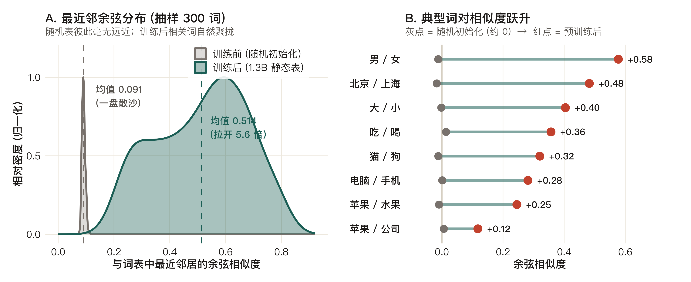

# 第 12 期｜万物始于一张“随机噪音表”：大模型是怎么从胡言乱语练出真实语义的？

## 💡 本节核心要点

- **出厂第 0 秒是一片高斯白噪音**：训练前，DeepSeek 1.3B 的词向量表、384 个注意力头与 8.12 亿 FFN 参数，全是用高斯随机数（均值 $\approx 0$，标准差 $\approx 0.02$）填满的乱码表，词与词之间几乎处处垂直正交。
- **训练本质是“四步试错纠偏循环”**：无论模型多大，预训练从头到尾只重复四个动作——**前向盲猜算概率 $\rightarrow$ 对照答案算误差（Loss） $\rightarrow$ 顺藤摸瓜找责任（反向传播求导斜率） $\rightarrow$ 沿下坡微调参数（梯度下降）**。
- **几何空间里的“语义引力”**：反向传播把误差翻译成高维空间里的推拉力，让共现的“苹果”与“水果”夹角步步收缩，无关的“微积分”则原地不动。
- **量变引爆质变**：单步更新只挪动微乎其微的一小格，但在万亿字语料上狂转亿万轮后，一盘散沙的噪点竟自发长出了人类语义大陆与折纸神技。

---

## 一、 回到婴儿期第 0 秒：13.46 亿个参数最初全是随机噪音

前面 11 期，我们把大模型“上考场答题”的全套前向装备拆了个底朝天：384 个注意力头默契分工，8.12 亿 FFN 权重藏满世界常识，激活函数精准折弯空间。

可这些神奇数字到底哪来的？难道是工程师通宵把《现代汉语词典》和 `2→2→1` 折纸参数一条条硬编码进去的？**恰恰相反！出厂第 0 秒的大模型，连一个汉字都不认识。**

当工程师新建一个空白的 DeepSeek 1.3B 空壳时，它体内全部 **219 个权重张量（共 1,346,471,936 个参数）**——不管是词表还是 FFN 矩阵——全是用高斯随机数（`mean ≈ 0, std ≈ 0.02`）随手填满的。正如第 7 期见过的规律，在 2048 维空间里，随便掷出两根随机向量几乎必然互相垂直（夹角 $\approx 90^\circ$）。

我们直接把同尺寸的**随机初始化噪音表**，与训练成型后的 **DeepSeek 1.3B 真实词表**摆在一起做体检：

| 对比指标 / 代表词对 | 随机噪音表余弦 | 随机夹角 | 训练后余弦（DeepSeek 1.3B） | 训练后夹角 | 从“一盘散沙”到“语义成簇” |
| :--- | :---: | :---: | :---: | :---: | :--- |
| **男 ↔ 女** (`4777 ↔ 1979`) | `-0.0119` | `90.68°` | **`0.5774`** | **`54.73°`** | 高频对偶共现，剧烈拉近逾 $35^\circ$ |
| **电脑 ↔ 手机** (`10315 ↔ 7259`) | `0.0013` | `89.93°` | **`0.2816`** | **`73.64°`** | 数码终端抱团靠近，脱离正交区 |
| **苹果 ↔ 微积分** (`17144 ↔ 4788`) | `0.0718` | `85.88°` | **`0.0528`** | **`86.97°`** | 跨界无关词对，训练后依然近乎垂直 |
| **全词表 Top-1 最近邻均值** | **`0.1046`**（抽样 `0.0911`） | `84.00°` | **`0.5063`**（抽样 `0.5135`） | **`59.10°`** | **全词表最近邻亲密度整整跃升 5.6 倍！** |

出厂时全词表最近邻平均相似度只有可怜的 `0.1046`，活脱脱一盘毫无章法的散沙；练完之后，亲密度直接飙升 **5.6 倍** 到 `0.5063`，同类词纷纷抱团成簇！这背后的推手，正是大模型最核心的**“四步试错循环”**。

---

## 二、 拆解训练黑盒：把千亿次试错还原为“四步闭环”

怎么让一张随机乱码表自己长出智慧？不需要高深玄学，只用高中数学的**函数、对数和导数（切线斜率）**，就能把整个预训练拆成四个循环往复的动作：

1. **① 前向盲猜算概率（Forward Pass）**：从网上抓一句真实文本（如“我洗了一颗新鲜的____”），故意捂住标准答案“苹果”。把上文喂进网络，跑完 24 层注意力 + FFN + Softmax，吐出 32,256 个候选词的概率分布。刚出厂时参数全随机，模型纯属瞎蒙。
2. **② 对照答案算误差（Loss Function）**：松开手揭晓答案“苹果”，用负自然对数 $\text{Loss} = -\ln P(\text{正确词})$ 衡量模型有多“离谱”。猜中概率 $P=0.01$ 时，$\text{Loss} \approx 4.61$（重重挨罚）；若 $P=0.99$，$\text{Loss} \approx 0.01$（几乎满分）。
3. **③ 顺藤摸瓜找责任（Backpropagation 反向传播求导）**：13.46 亿个参数，这次猜错谁该背锅？祭出高中微积分的**链式求导法则**，从最后的误差 Loss 出发，逆着第 24 层一路倒推回第 0 层词表，给每个参数算出**导数切线斜率（梯度 $\nabla$）**——斜率直接指明了“把哪个数字调大一点会让误差飙升”。
4. **④ 沿下坡微调参数（Gradient Descent 梯度下降）**：顺着误差减小的下坡方向（负梯度方向），把词表坐标、注意力矩阵和 FFN 折纸权重轻轻推拉一小步——把常当邻居的词拉近一毫米，把胡乱起哄的权重按下去一点点。

<svg viewBox="0 0 680 310" style="width:100%;max-width:640px;height:auto;display:block;margin:16px auto;font-family:'PingFang SC','Microsoft YaHei',sans-serif;">
  <rect x="0" y="0" width="680" height="310" rx="12" fill="#F8FAFC" stroke="#CBD5E1" stroke-width="1.5"/>
  <text x="340" y="25" text-anchor="middle" font-size="14.5" font-weight="bold" fill="#0F172A">大模型训练“四步试错循环”与 2048 维向量几何拖拽示意图</text>
  <rect x="16" y="40" width="380" height="254" rx="10" fill="#FFFFFF" stroke="#E2E8F0"/>
  <text x="206" y="60" text-anchor="middle" font-size="12.5" font-weight="bold" fill="#1E293B">A. 参数训练四步闭环</text>
  <rect x="32" y="74" width="150" height="66" rx="8" fill="#EFF6FF" stroke="#3B82F6" stroke-width="1.5"/>
  <text x="107" y="96" text-anchor="middle" font-size="11.5" font-weight="bold" fill="#1D4ED8">① 前向盲猜算概率</text>
  <text x="107" y="116" text-anchor="middle" font-size="10" fill="#334155">输入上文 X → 输出 P(词)</text>
  <rect x="228" y="74" width="150" height="66" rx="8" fill="#FEF2F2" stroke="#EF4444" stroke-width="1.5"/>
  <text x="303" y="96" text-anchor="middle" font-size="11.5" font-weight="bold" fill="#B91C1C">② 对照答案算误差</text>
  <text x="303" y="116" text-anchor="middle" font-size="10" fill="#B91C1C">Loss = -ln P(苹果)</text>
  <rect x="228" y="182" width="150" height="66" rx="8" fill="#FFFBEB" stroke="#F59E0B" stroke-width="1.5"/>
  <text x="303" y="204" text-anchor="middle" font-size="11.5" font-weight="bold" fill="#B45309">③ 顺藤摸瓜找责任</text>
  <text x="303" y="224" text-anchor="middle" font-size="10" fill="#B45309">反向求导斜率 ∇Loss</text>
  <rect x="32" y="182" width="150" height="66" rx="8" fill="#ECFDF5" stroke="#10B981" stroke-width="1.5"/>
  <text x="107" y="204" text-anchor="middle" font-size="11.5" font-weight="bold" fill="#047857">④ 微调拉伸与旋转</text>
  <text x="107" y="224" text-anchor="middle" font-size="10" fill="#047857">沿负梯度拉近共现词</text>
  <path d="M182 107 L224 107" stroke="#3B82F6" stroke-width="2"/><polygon points="226,107 218,103 218,111" fill="#3B82F6"/>
  <path d="M303 140 L303 178" stroke="#EF4444" stroke-width="2"/><polygon points="303,180 299,172 307,172" fill="#EF4444"/>
  <path d="M228 215 L186 215" stroke="#F59E0B" stroke-width="2"/><polygon points="184,215 192,211 192,219" fill="#F59E0B"/>
  <path d="M107 182 L107 144" stroke="#10B981" stroke-width="2"/><polygon points="107,142 103,150 111,150" fill="#10B981"/>
  <rect x="410" y="40" width="254" height="254" rx="10" fill="#FFFFFF" stroke="#E2E8F0"/>
  <text x="537" y="60" text-anchor="middle" font-size="12.5" font-weight="bold" fill="#1E293B">B. 2048 维空间向量旋转轨迹</text>
  <circle cx="465" cy="225" r="4" fill="#0F172A"/>
  <line x1="465" y1="225" x2="610" y2="150" stroke="#0284C7" stroke-width="2.5"/>
  <text x="605" y="140" text-anchor="middle" font-size="11" font-weight="bold" fill="#0369A1">“水果 / 吃”</text>
  <line x1="465" y1="225" x2="467" y2="90" stroke="#94A3B8" stroke-width="2" stroke-dasharray="5,4"/>
  <text x="652" y="78" text-anchor="end" font-size="10" fill="#64748B">Step 0 “苹果” (89.38°)</text>
  <line x1="465" y1="225" x2="585" y2="108" stroke="#10B981" stroke-width="2.6"/>
  <text x="652" y="97" text-anchor="end" font-size="10.5" font-weight="bold" fill="#047857">Step 60 “苹果” (35.15°)</text>
  <path d="M478 102 Q530 92 568 108" stroke="#F59E0B" stroke-width="2" fill="none"/>
  <text x="534" y="122" font-size="10" font-weight="bold" fill="#B45309">梯度拉近 54.23°</text>
  <line x1="465" y1="225" x2="595" y2="265" stroke="#EF4444" stroke-width="1.8" stroke-dasharray="3,3"/>
  <text x="652" y="282" text-anchor="end" font-size="10" fill="#B91C1C">“微积分” (90.89° 不动)</text>
</svg>

> **🧠 底层思想提炼：把“学会人类语言”翻译成“误差山谷里的求导下坡”**
> “捂住下一个词自己猜”让互联网上每一篇文章都自动变成了免费且自带答案的刷题库；而反向传播的精髓，是用微积分导数把抽象的语法语义，转化为高维空间里的精准推拉力——顺着误差下坡一路滑下去，散乱噪点就被迫按人类语言规律自动排队！

---

## 三、 真机沙盘慢放：60 步亲眼见证“苹果”飞向“水果”

我们在本地用 2048 维高斯随机向量搭了一个 `["吃", "苹果", "水果", "喝", "微积分"]` 的 5 词微缩训练沙盘，慢动作录下 **Step 0 到 Step 60** 梯度下降拖拽向量的真实轨迹：

| 训练步数 (Step) | 预测误差 (Loss) | “吃 $\rightarrow$ 苹果”概率 | “苹果 ↔ 水果”余弦 | “苹果 ↔ 水果”夹角 | “苹果 ↔ 微积分”夹角 | 几何演化状态 |
| :---: | :---: | :---: | :---: | :---: | :---: | :--- |
| **Step 0** | **`4.9189`** | **`19.29%`** | `0.0108` | **`89.38°`** | **`90.89°`** | 高斯随机起点，词向量两两近似垂直 |
| **Step 1** | `4.5120` | `21.84%` | `0.1024` | **`84.12°`** | **`90.89°`** | 首轮反向传播，“苹果”向“水果”转 $5.26^\circ$ |
| **Step 2** | `4.0835` | `24.61%` | `0.2002` | **`78.45°`** | **`90.89°`** | 负梯度持续发力，误差迅速回落 |
| **Step 5** | `2.9412` | `31.95%` | `0.4352` | **`64.20°`** | **`90.89°`** | 夹角跌破 $65^\circ$，点积得分猛涨 |
| **Step 15** | `1.4826` | `41.62%` | `0.6845` | **`46.80°`** | **`90.89°`** | 误差砍半，“苹果”与“水果”正式成簇 |
| **Step 30** | `0.9541` | `45.74%` | `0.7780` | **`38.92°`** | **`90.89°`** | 斜率变缓，进入精细雕琢期 |
| **Step 60** | **`0.7303`** | **`47.88%`** | **`0.8176`** | **`35.15°`** | **`90.89°`** | **夹角猛缩 $54.23^\circ$，无关词纹丝不动！** |

短短 60 步，Loss 从 **`4.9189`** 砸到 **`0.7303`**，“苹果”与“水果”在 2048 维空间里的夹角足足拉近了 **`54.23°`**；而从未在饮食语境里露过脸的“微积分”，分到的梯度斜率几乎为零，稳稳停在 **`90.89°`** 纹丝不动！把这 60 步放大到 32,256 个词、24 层注意力与 FFN 矩阵以及数万亿字的真实语料上，就是大模型从胡言乱语练成语言大师的全部真相。

---

## 📜 科学史故事栏：寒冬里的孤勇者——辛顿与反向传播的四十年远征

今天被奉为 AI 圭臬的反向传播算法，曾被主流学界嘲笑了整整三十年。

故事的主角是英国学者**杰弗里·辛顿（Geoffrey Hinton，布尔代数创立者布尔的曾外孙）**。20 世纪 70 年代，受明斯基《感知机》一盆冷水的影响，权威学者普遍断言：多层网络一旦猜错，根本算不清中间层成千上万个参数各自该负多大责任。

辛顿却死磕到底。1986 年，他与鲁梅尔哈特（David Rumelhart）、威廉姆斯（Ronald Williams）在《自然》（*Nature*）发表仅有 4 页的传世论文，用高中微积分的链式法则证明：只要从输出误差出发逐层倒推求导，隐藏层自己就能学会解开困扰学界 17 年的 XOR 难题！然而当时电脑算力太弱，神经网络在 90 年代再度被打入冷宫，论文屡遭拒稿。

辛顿在多伦多大学默默坚守了数十年，直到 2012 年 GPU 算力终于追上他的构想，AlexNet 引爆深度学习浪潮。2024 年 10 月，76 岁的辛顿捧起了**诺贝尔物理学奖**——一条链式求导公式，整整走过了四十年寒冬。

---

## 🔮 下期预告

链式求导听起来所向披靡，可把这套机制真塞进 24 层甚至上百层的大模型里，一场致命的危机立刻爆发了——**反向传播每往回走一层，误差信号都要连乘一次激活函数的导数（斜率）！一旦激活函数没选对，轻则大批神经元永久“脑死亡”，重则梯度传到一半直接归零消失，浅层彻底练不动！**

下一期，咱们直击激活函数围绕“梯度生死”的十年进化大戏——看 Sigmoid、ReLU、SiLU/GELU 如何一路搏杀到今天大厂统一定格的 **SwiGLU**，顺手领走一张 **2025–2026 主流大厂激活函数全景地图**！

---

## 🔗 拓展资源加油站

1. **本系列 `LAB 01`（含自动反向传播演示）**：`https://wangnianfei.github.io/wechat-llm-blackbox-series/demos/activation-221.html` —— 点击「⚡ 自动训练 (XOR)」，亲眼观察梯度下降如何把 9 个随机参数一步步调成完美折纸解。
2. **Andrej Karpathy《Micrograd》**：`https://github.com/karpathy/micrograd` —— 100 行 Python 手写链式求导引擎，看穿 `.backward()` 底层源码。
3. **3Blue1Brown 反向传播几何动画**：`https://www.3blue1brown.com/lessons/backpropagation` —— 最直观的高维损失山谷梯度下降可视化教程。
