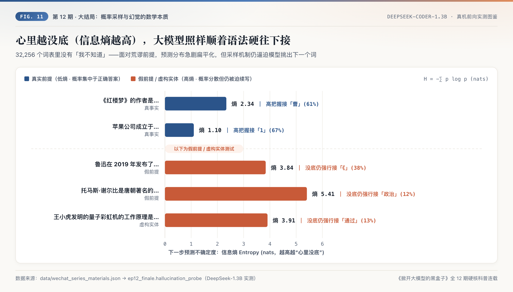

# 第 15 期｜大结局·一句话的奇幻漂流：从敲下键盘的二进制电流，到吐出下一个词的完整张量之旅

## 💡 本节核心要点

- **10 站张量奇幻漂流全景贯通**：从敲击键盘产生的 **30 个 UTF-8 字节**，到 BPE 压缩为 **6 个 Token ID**，再到 **`[1, 6, 2048]` 语义张量**穿越 24 层多头注意力与 SwiGLU 知识库，最后化为 **32,256 维概率分布**吐出下一个词——大模型内部全程只有严密的数学变换，没有半点黑盒魔法。
- **“幻觉（胡说八道）”的数学真相**：32,256 个词元里根本没有“我不知道”这个断路器开关。遇到假前提时，输出层**信息熵（Entropy）**从 `1.10～2.34` 飙升至 `3.84～5.41`，概率分布被拍成扁平煎饼，但自回归机制依然逼迫模型顺着语法惯性硬猜下一个词。
- **7 把底层思想钥匙大闭环**：超级函数观、统计压缩观、张量堆叠观、线性与非线性几何观、分层语境注入观、FFN 升维折弯与梯度活性观、训练与冻结推理二分观——带走它们，你便真正站在了黑盒之上。

---

## 一、 终极全景沙盘：“我在苹果公司吃了一个苹果”的 10 站张量奇幻漂流

欢迎来到《掀开大模型的黑盒子》全系列 **15 期**的收官大结局！

在过去 14 期里，我们把大模型的每一个齿轮都拆下来放进显微镜做了真机实测。今天，把所有零件重新装回 DeepSeek 1.3B（24 层、16 个注意力头、SwiGLU 前馈层、13.46 亿参数）体内，敲下贯穿全系列的经典例句——**“我在苹果公司吃了一个苹果”**，一图一表直击它从键盘电流到开口说话的 **10 站奇幻漂流**：

<svg viewBox="0 0 680 350" style="width:100%;max-width:640px;height:auto;display:block;margin:16px auto;font-family:'PingFang SC','Microsoft YaHei',sans-serif;">
  <rect x="0" y="0" width="680" height="350" rx="12" fill="#F8FAFC" stroke="#CBD5E1" stroke-width="1.5"/>
  <text x="340" y="25" text-anchor="middle" font-size="14.5" font-weight="bold" fill="#0F172A">“我在苹果公司吃了一个苹果”穿越 DeepSeek 1.3B 的 10 站张量漂流全景图</text>
  <rect x="16" y="42" width="118" height="78" rx="8" fill="#EFF6FF" stroke="#3B82F6" stroke-width="1.5"/>
  <text x="75" y="61" text-anchor="middle" font-size="11" font-weight="bold" fill="#1D4ED8">第1站｜UTF-8字节</text>
  <text x="75" y="78" text-anchor="middle" font-size="9.5" fill="#334155">10汉字 → 30字节</text>
  <text x="75" y="94" text-anchor="middle" font-size="9.5" fill="#1E40AF">243合法字节底座(Ep3)</text>
  <rect x="148" y="42" width="118" height="78" rx="8" fill="#EFF6FF" stroke="#3B82F6" stroke-width="1.5"/>
  <text x="207" y="61" text-anchor="middle" font-size="11" font-weight="bold" fill="#1D4ED8">第2站｜BPE分词</text>
  <text x="207" y="78" text-anchor="middle" font-size="9.5" fill="#334155">合并为6个Token ID</text>
  <text x="207" y="94" text-anchor="middle" font-size="9.5" fill="#1E40AF">形状 [1, 6] (Ep4-5)</text>
  <rect x="280" y="42" width="118" height="78" rx="8" fill="#ECFDF5" stroke="#10B981" stroke-width="1.5"/>
  <text x="339" y="61" text-anchor="middle" font-size="11" font-weight="bold" fill="#047857">第3站｜冻结表查表</text>
  <text x="339" y="78" text-anchor="middle" font-size="9.5" fill="#334155">查 [32256, 2048] 表</text>
  <text x="339" y="94" text-anchor="middle" font-size="9.5" fill="#065F46">输出[1,6,2048](Ep6,14)</text>
  <rect x="412" y="42" width="118" height="78" rx="8" fill="#FFFBEB" stroke="#F59E0B" stroke-width="1.5"/>
  <text x="471" y="61" text-anchor="middle" font-size="11" font-weight="bold" fill="#B45309">第4站｜QKV线性投影</text>
  <text x="471" y="78" text-anchor="middle" font-size="9.5" fill="#334155">拉伸8.26倍·转90.2°</text>
  <text x="471" y="94" text-anchor="middle" font-size="9.5" fill="#92400E">各[1,6,2048] (Ep7-8)</text>
  <rect x="544" y="42" width="120" height="78" rx="8" fill="#FFFBEB" stroke="#F59E0B" stroke-width="1.5"/>
  <text x="604" y="61" text-anchor="middle" font-size="11" font-weight="bold" fill="#B45309">第5站｜16头与RoPE</text>
  <text x="604" y="78" text-anchor="middle" font-size="9.5" fill="#334155">劈成16×128按位旋转</text>
  <text x="604" y="94" text-anchor="middle" font-size="9.5" fill="#92400E">[1,16,6,128] (Ep6,8)</text>
  <path d="M134 81 L145 81" stroke="#3B82F6" stroke-width="2"/><polygon points="147,81 141,77 141,85" fill="#3B82F6"/>
  <path d="M266 81 L277 81" stroke="#10B981" stroke-width="2"/><polygon points="279,81 273,77 273,85" fill="#10B981"/>
  <path d="M398 81 L409 81" stroke="#F59E0B" stroke-width="2"/><polygon points="411,81 405,77 405,85" fill="#F59E0B"/>
  <path d="M530 81 L541 81" stroke="#F59E0B" stroke-width="2"/><polygon points="543,81 537,77 537,85" fill="#F59E0B"/>
  <path d="M604 120 L604 146" stroke="#F59E0B" stroke-width="2"/><polygon points="604,150 599,142 609,142" fill="#F59E0B"/>
  <rect x="544" y="152" width="120" height="78" rx="8" fill="#FEF2F2" stroke="#EF4444" stroke-width="1.5"/>
  <text x="604" y="171" text-anchor="middle" font-size="11" font-weight="bold" fill="#B91C1C">第6站｜多头注意力</text>
  <text x="604" y="188" text-anchor="middle" font-size="9.5" fill="#334155">点积+掩码Softmax</text>
  <text x="604" y="204" text-anchor="middle" font-size="9.5" fill="#991B1B">[1,16,6,6] 吃←60.2%</text>
  <rect x="412" y="152" width="118" height="78" rx="8" fill="#FEF2F2" stroke="#EF4444" stroke-width="1.5"/>
  <text x="471" y="171" text-anchor="middle" font-size="11" font-weight="bold" fill="#B91C1C">第7站｜语境加权融汇</text>
  <text x="471" y="188" text-anchor="middle" font-size="9.5" fill="#334155">乘V+16头拼接+残差</text>
  <text x="471" y="204" text-anchor="middle" font-size="9.5" fill="#991B1B">输出[1,6,2048](Ep8-9)</text>
  <rect x="280" y="152" width="118" height="78" rx="8" fill="#F3E8FF" stroke="#9333EA" stroke-width="1.5"/>
  <text x="339" y="171" text-anchor="middle" font-size="11" font-weight="bold" fill="#6B21A8">第8站｜SwiGLU×24层</text>
  <text x="339" y="188" text-anchor="middle" font-size="9.5" fill="#334155">2048→5504→2048折弯</text>
  <text x="339" y="204" text-anchor="middle" font-size="9.5" fill="#581C87">2/3知识库(Ep10-11,13)</text>
  <rect x="148" y="152" width="118" height="78" rx="8" fill="#ECFDF5" stroke="#10B981" stroke-width="1.5"/>
  <text x="207" y="171" text-anchor="middle" font-size="11" font-weight="bold" fill="#047857">第9站｜lm_head投影</text>
  <text x="207" y="188" text-anchor="middle" font-size="9.5" fill="#334155">乘 [2048,32256] 矩阵</text>
  <text x="207" y="204" text-anchor="middle" font-size="9.5" fill="#065F46">[1,6,32256] (Ep1,15)</text>
  <rect x="16" y="152" width="118" height="78" rx="8" fill="#ECFDF5" stroke="#10B981" stroke-width="1.5"/>
  <text x="75" y="171" text-anchor="middle" font-size="11" font-weight="bold" fill="#047857">第10站｜Softmax抽样</text>
  <text x="75" y="188" text-anchor="middle" font-size="9.5" fill="#334155">“，”34.1% / “。”24.2%</text>
  <text x="75" y="204" text-anchor="middle" font-size="9.5" fill="#065F46">自回归循环吐词(Ep1,15)</text>
  <path d="M544 191 L533 191" stroke="#EF4444" stroke-width="2"/><polygon points="531,191 537,187 537,195" fill="#EF4444"/>
  <path d="M412 191 L401 191" stroke="#9333EA" stroke-width="2"/><polygon points="399,191 405,187 405,195" fill="#9333EA"/>
  <path d="M280 191 L269 191" stroke="#10B981" stroke-width="2"/><polygon points="267,191 273,187 273,195" fill="#10B981"/>
  <path d="M148 191 L137 191" stroke="#10B981" stroke-width="2"/><polygon points="135,191 141,187 141,195" fill="#10B981"/>
  <rect x="16" y="250" width="648" height="82" rx="10" fill="#FFFFFF" stroke="#94A3B8" stroke-width="1.5"/>
  <text x="340" y="274" text-anchor="middle" font-size="12" font-weight="bold" fill="#0F172A">🔄 自回归接龙闭环：每吐出 1 个新词，立刻拼回第 2 站末尾重新跑完 10 站！</text>
  <text x="340" y="298" text-anchor="middle" font-size="11" fill="#047857">4 步连续生成：“我在苹果公司吃了一个苹果，它很甜” / “我在苹果公司吃了一个苹果，然后又吃”</text>
</svg>

| 漂流站点（对应期数） | 核心数学与工程操作 | 输入形状 | 输出形状 | DeepSeek 1.3B 真机实测数据与几何状态 |
| :--- | :--- | :---: | :---: | :--- |
| **第 1 站：键盘电流与 UTF-8 编码**（第 3 期） | 字符编码为变长 UTF-8 二进制字节流 | 10 个汉字信号 | **30 字节** (`240 bits`) | 每字 3 字节（如“苹”=`0xE8 0x8B 0xB9`），全取自 **243 个合法 UTF-8 初始字节底座** |
| **第 2 站：BPE 分词合并树**（第 4～5 期） | 高频相邻字节滚雪球合并为词元 Token | 30 个基础字节 | **`[1, 6]`** | 压缩为 6 个词：`["我在", "苹果", "公司", "吃", "了一个", "苹果"]`，base 版 ID 为 `[23098, 17144, 2804, 3509, 13556, 17144]` |
| **第 3 站：冻结词表静态查表**（第 6、14 期） | 在锁死的 `[32256, 2048]` 词表中按行抽向量 | `[1, 6]` | **`[1, 6, 2048]`** | 两个“苹果(`17144`)”初始模长均为 **`8.07`**，余弦相似度恒为 **`1.0000`** |
| **第 4 站：RMSNorm 与 Q/K/V 线性投影**（第 7～8 期） | 层归一化校准模长 + 乘 3 个 `[2048, 2048]` 矩阵 | `[1, 6, 2048]` | Q,K,V 各 **`[1, 6, 2048]`** | 模长先校准至 `6.61`；乘 $W_Q$ 后被线性**拉伸 `8.26 倍`**（模长 `54.66`）并**旋转 `90.24°`** |
| **第 5 站：16 头切分与 RoPE 旋转**（第 6、8 期） | 2048 维劈成 $16 \times 128$，按位置序号几何旋转 | `[1, 6, 2048]` | **`[1, 16, 6, 128]`** | 位置 1 的“苹果₁”与位置 5 的“苹果₂”旋转角不同，打破位置对称性 |
| **第 6 站：多头缩放点积注意力**（第 8～9 期） | $Q \cdot K^T / \sqrt{128}$ + 上三角 $-\infty$ 掩码 + Softmax | Q,K: `[1, 16, 6, 128]` | **`[1, 16, 6, 6]`** | **第 1 层 Head 10**“苹果₂ $\rightarrow$ 吃”达 **`60.16%`**；**第 7 层 Head 5**“公司 $\rightarrow$ 苹果₁”达 **`88.28%`** |
| **第 7 站：语境加权融汇与残差相加**（第 8～9 期） | 注意力权重乘 V 干货，16 头拼接乘 $W_O$ 加残差 | `[1, 16, 6, 6] × V` | **`[1, 6, 2048]`** | 前文“公司”与“吃”的语境分量分别注入两个“苹果”体内 |
| **第 8 站：SwiGLU 前馈层与 24 层接力**（第 10～11、13 期） | `2048 → 5504 → 2048` 升维折弯筛选，循环 24 层 | `[1, 6, 2048]` | **`[1, 6, 2048]`** | SiLU 弯折 **`14.24°`** 调出 2/3 世界知识；穿完 24 层两“苹果”欧氏距离从 `0` 拉开至第 23 层 **`84.87`**（终局归一化 **`9.614`**） |
| **第 9 站：终局归一化与 `lm_head` 投影**（第 1、15 期） | 第 24 层张量经 RMSNorm 后乘 `[2048, 32256]` 矩阵 | `[1, 6, 2048]` | **`[1, 6, 32256]`** | 取句尾第 6 位最终向量，与全词表 32,256 个候选词点积算出 Logits |
| **第 10 站：Softmax 抽样与自回归接龙**（第 1、15 期） | Logits 转概率分布，抽样新词拼回第 2 站循环 | `[1, 32256]` | **1 个新 Token ID** | **`“，”` 占 `34.12%`（`37.38%`）**，**`“。”` 占 `24.16%`（`14.64%`）**；4 步贪心接龙生成 **`“我在苹果公司吃了一个苹果，它很甜”`**（或 `“...，然后又吃”`） |

---

## 二、 破除最后的迷信：为什么大模型会一本正经地“胡说八道（幻觉）”？

既然这 10 站数学精密如瑞士钟表，大模型为什么还会满嘴跑火车、一本正经编造假事实（**幻觉 Hallucination**）？

我们在第 10 站输出层插上一根信息论探针——**信息熵（Shannon Entropy，$H = -\sum P_i \ln P_i$）**，用来测量 32,256 个候选词概率分布的“心里没底程度”：越有把握，概率尖峰越高，**熵越低**；越心里发虚，概率拍得越扁平，**熵越高**。请看真机实测：

| 测试类别 | 输入提示词（Prompt） | 预测信息熵 | Top-1 候选词与概率 | Top-2 / Top-3 分散度 | 实际贪心续写结果 | 概率状态与幻觉成因 |
| :---: | :--- | :---: | :---: | :---: | :--- | :--- |
| **真事实 A** | `《红楼梦》的作者是` | **`1.54`**（`2.34`） | **`曹` (`61.40%`)** | `贾` (`6.78%`), `谁` (`4.38%`) | **`曹雪芹，《`** | 概率尖峰高耸，模型胸有成竹 |
| **真事实 B** | `苹果公司成立于` | **`1.10`** | **`1` (`67.35%`)** | `2` (`17.30%`), `空格` (`12.27%`) | **`1989年，`** | 首字“1”（19xx年）高度集中 |
| **假前提 A** | `鲁迅在 2019 年发布了` | **`5.23`**（`3.84`） | **`《` (`37.92%`)** | `他的` (`7.47%`), `自己的` (`3.11%`) | **`《在那遥远的`** | **高熵拍扁！** 见“发布了”按语法硬接书名号 `《` 编书名 |
| **假前提 B** | `托马斯·谢尔比是唐朝著名的` | **`5.41`** | **`政治` (`12.25%`)** | `诗` (`8.96%`), `作` (`4.95%`) | **`政治家、军事家、`** | **彻底没底！** 最高词仅 `12.25%`，顺着“唐朝著名的”硬套头衔 |
| **虚构实体** | `王小虎发明的量子彩虹机的工作原理是` | **`3.91`** | **`通过` (`12.70%`)** | `，` (`11.93%`), `利用` (`9.59%`) | **`通过将一个量子态`** | 最高词仅 `12.70%`，强行套用科普句式圆场 |

> **🧠 底层思想提炼：幻觉是“无断路器的概率接龙机”的必然副产物**
> 遇到“鲁迅在 2019 年发布了”这种荒谬前提，预测熵飙升到 **`5.23`**，证明模型心里早已慌成一团。可它为什么不直接报错？因为 **32,256 个词元里根本没有“【停机：我不知道】”这个断路器开关！** Softmax 的数学铁律逼着所有词概率之和必须凑够 $100\%$，于是接龙函数 $Y=F(X)$ 只能硬着头皮挑出语法最顺溜的模板词往下硬编。

---

## 三、 收官复盘：带走这 7 把底层思想钥匙，你已站在黑盒之上

回望全系列 15 期，请把这 **7 把底层思想钥匙**装进行囊——任凭未来 AI 新名词怎么翻花样，你都能一眼看穿：
1. **超级函数观（第 1、15 期）**：大模型本质是复合函数 $Y = F(X)$，输入上文张量，输出词表概率分布，循环抽样接龙。
2. **统计压缩观（第 3～5 期）**：从 243 个合法 UTF-8 字节到 3.2 万个 BPE 词元，用高频共现打包与空间换时间建立语言底座。
3. **张量堆叠观（第 6 期）**：从标量、向量、矩阵到多维超立方体，张量是 GPU 并行运算的标准集装箱。
4. **线性与非线性几何观（第 7 期）**：千亿参数只靠两条腿走路——矩阵乘法做**拉伸旋转**，点积量出**语义夹角**，非线性打破直线束缚。
5. **分层语境注入观（第 8～9 期）**：24 层 $\times$ 16 头注意力横向交流，把前文语境按权重注入当前词，让两个“苹果”逐层分道扬镳。
6. **FFN 升维折弯与梯度活性观（第 10～11、13 期）**：占核心主体 2/3 参数的 FFN 靠“升维 → 激活折纸 → 降维”提炼世界知识；从 Sigmoid、ReLU 到 SwiGLU，每一代激活函数都在前向折弯与反向梯度生死之间精妙走钢丝。
7. **训练与冻结推理二分观（第 12、14 期）**：训练从高斯随机表出发靠反向传播微调拉近共现词；推理则将权重 100% 焊死，靠静态权重与动态激活算活语境。

---

## 📜 科学史故事栏：从图灵 1950 年的追问，到每个少年笔记本里的十亿参数实验室

1950 年，计算机科学之父**艾伦·图灵（Alan Turing）**在经典论文《计算机器与智能》开篇写下：**“机器能思考吗？”** 当时他面前的“曼彻斯特 1 号”塞满整间教室，内存却只有区区 **128 字节**。可图灵依然大胆预言：未来不该靠人工编写成人的知识规则，而该造一台像白纸一样的“儿童机器”，让它靠试错自己学会人类语言。

七十多年后，图灵构想的“儿童机器”以 Transformer 大模型的模样震撼降临。更激动人心的是开源浪潮：今天像 **DeepSeek 1.3B** 这样藏着 13.46 亿参数的模型，只需一台普通笔记本和十几行 Python，就能把每一层张量切开看个通透。图灵点燃的火炬，已经稳稳交到了每个愿意亲手掀开黑盒子的少年手中。

---

## 🔮 毕业挑战：轮到你亲手掀开黑盒子了！

全系列 15 期到此圆满收官！周末不妨花半小时完成这四个毕业小实验：
1. **挑战一（零代码折弯空间）**：打开本系列自研的 **`LAB 01`**（`demos/activation-221.html`），亲手对比“无激活”直线坍缩与 `ReLU / SiLU` 折纸解开 XOR，再把 ReLU 偏置拖到 `-3` 制造一次 Dead ReLU！
2. **挑战二（分词器解剖）**：用 HuggingFace 加载 DeepSeek 分词器，输入你的名字，看看被切成了几个 Token ID？
3. **挑战三（同词异义追踪）**：输入**“我打车去体育馆打篮球”**，提取两个“打”字在第 0 层与第 24 层的余弦相似度，画出你的语义分化曲线！
4. **挑战四（防幻觉护栏）**：在假前提提问前加上“若前提违背历史事实请直接指出”，观察输出层首词概率分布的剧变！

---

## 🔗 拓展资源加油站

1. **本系列专属 `2→2→1` 互动实验室（LAB 01）**：`https://wangnianfei.github.io/wechat-llm-blackbox-series/demos/activation-221.html` —— 零代码亲手调权重、看公式坍缩与 5 大激活曲线实时训练。
2. **Andrej Karpathy《Let's build GPT from scratch》**：`https://www.youtube.com/watch?v=kCc8FmEb1nY` —— 从空白 Python 文件亲手敲出完整 GPT。
3. **Transformer Explainer & DeepSeek-1.3B**：在线访问 `poloclub.github.io/transformer-explainer/` 实时追踪 10 站张量流转，或在 `huggingface.co/deepseek-ai/deepseek-coder-1.3b-base` 下载本系列同款模型开启你的第一场真机实验！
